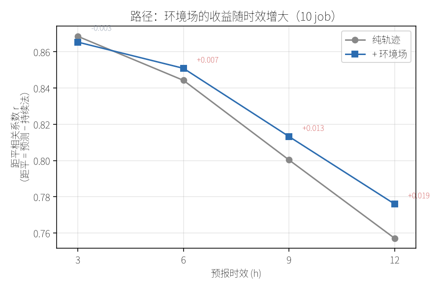
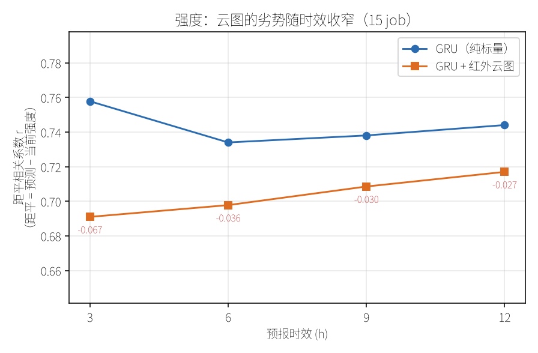
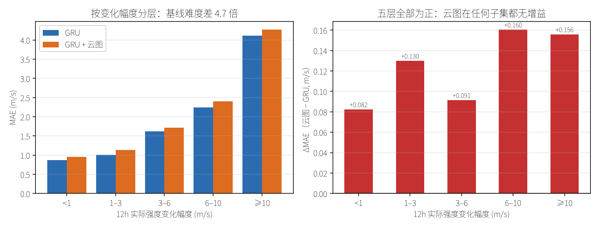

# 台风路径与强度预测：Transformer 基线工程

从零搭建的台风预测系统，覆盖**路径回归、强度回归、快速增强（RI）事件分类**三个任务，
并在 IBTrACS 轨迹、ARCO-ERA5 环境场、风云卫星云图上做了系统性消融实验。

> 完整实验记录与方法论分析见 [docs/TECHNICAL_REPORT.md](docs/TECHNICAL_REPORT.md)

---

## 核心结果

| 任务 | 评估范围 | 最佳模型 | 指标 | vs 持续法 | 距平相关 |
|---|---|---|---|---|---|
| 路径（24h） | 全量 1420 台风 | Transformer | **208 km** | 567 km（好 63%） | — |
| 路径（24h） | 环境场子集 128 台风 | Transformer + 环境场 | **320 km** | 330 km（好 3.1%） | 0.776（12h） |
| 强度（12h） | 224 台风，15 job | 纯时序 GRU | **1.53 m/s** | 2.17 m/s（好 29%） | 0.744（12h） |
| RI（AUC） | 224 台风，10 折 | GRU | **0.879 / 0.904**（阈值 10/15） | 0.808 / 0.846 | —（分类任务） |

两行"路径"不可直接比较：全量行训练数据多 15 倍，误差自然更低。

**距平相关**（距平 = 预测 − 持续法）是补充 MAE 的第二个评价维度。注意
**不能直接用 Pearson r**：样本散布整个西北太平洋，r 恒在 0.999 以上，不携带信息；
而用样本均值作"气候态"也无效（Pearson r 对整体平移不变，结果与 r 完全相同）。

```bash
.venv/bin/python scripts/evaluation/acc_report.py    # 逐时效距平相关
```

### 消融结论

| 尝试 | 结果 | 显著性 |
|---|---|---|
| **环境场 → 路径** | **−10.1 km（−3.1%）** | **p=0.0005，25 job** |
| 卫星云图 → 强度 | +0.11 m/s | 15 job **0/15 胜**，p=3.9e-08，**显著更差** |
| **被动微波 → 强度** | **−0.003 m/s** | 15 job 6/15 胜，p=0.89，**无差异** |
| **微波双头模型 → 强度** | **+0.017 m/s** | 15 job 4/15 胜，p=0.012，略差 |
| **云图按变化幅度分层** | **+0.082 ~ +0.160** | 5 层 × 15 job，**全部为正** |
| 暖心结构 → 强度 | **+0.031 m/s** | **p=0.0007，显著更差** |
| 地形特征 → 强度 | −0.002 m/s | p=0.83，无变化 |
| 纬度自适应分区 | +0.8 km vs 全程环境场 | p=0.53，无差异 |

**四条重要提醒**：

1. **训练不充分时，差值的符号本身都不可信**。两个案例的方向相反：

   | 案例 | 早期 | 中期 | 最终 |
   |---|---|---|---|
   | 环境场 → 路径 | 30 epoch：**+2.6 km**（判为无效） | 60 epoch：**−10.1 km（p=0.0005）** | 同上，25 job 稳定 |
   | 被动微波 → 强度 | 10 epoch：**+0.317**（判为有害） | 60 epoch：−0.022（p=0.049，"有效"） | 100 epoch：**−0.003（p=0.89，无差异）** |

   环境场是"**没训够所以看起来没用**"；微波是"**没训够所以看起来没用，训到一半
   又看起来有用**"，最后才发现二者持平。根因是两个模型的**收敛速度不同**
   （GRU 的 `best_ep` 中位 85，微波 68），而误差都还在下降。

   **判据**：看 `best_ep` 相对 epoch 上限的位置。两组都贴着上限（如 85/100）时
   还没到头，此时任何 Δ 都不能解读。详见技术报告 §7.4。

2. 所有特征消融都用 **多种折划分**（5 折 × 3~5 种划分）验证。单一划分会给出
   不可靠结论（同一配置在不同划分下可从 −10 km 变到 +3 km）。

3. **卫星云图这条路已经走完，不要再试**。四个独立方向都无效：数据扩容
   （90→224 台风）、加大 dropout、把视野从 ±64 km 扩到 ±128 km、把亮度归一化
   改成 z-score 并新增 8 维圈层特征——**每次都是 0/15 全负，ΔMAE 稳定在
   +0.11 m/s**。详见技术报告 §4.1.2。云图特征本身携带信号（单变量相关达
   −0.55），但信息已被 `cent_prs` 与强度历史覆盖，属于冗余。

4. **被动微波同样无增益**（8,330 帧 TC PRIMED，2016-2024）。它的单变量相关
   比云图更强（89 GHz 与强度 −0.73），但三种接入方式都无增益（−0.003 / −0.006 /
   +0.017），按变化幅度分层也无受益子集。**信息冗余的结论被两种独立模态
   复现了两次**——见 §4.7。

## 分时效机制

用距平相关看"特征的作用随时效如何变化"，两条任务给出**方向相反**的曲线：

| 任务 | 引入的信息 | 3h | 12h | 趋势 |
|---|---|---|---|---|
| **路径** | 环境场 | Δr −0.003 | **Δr +0.019（p=0.003）** | **收益随时效增大** |
| **强度** | 红外云图 | **Δr −0.067** | Δr −0.027 | **劣势随时效收窄** |




**物理上各自说得通**：路径短时效靠惯性，转向后由引导气流主导（环境场的价值才显现）；
强度则由海温/切变等环境因子驱动，云图看到的是"现在多强"而非"未来怎么变"。
后者的收窄只说明误差基数变大（12h 的 GRU MAE 是 3h 的 3.8 倍），**不代表云图在长时效有用**。

## 分层评估：按强度变化幅度

按 12h **实际**强度变化幅度分层（`stratify_by_change.py`）：

| 分层 (m/s) | 样本/job | GRU MAE | 云图 ΔMAE |
|---|---|---|---|
| 稳定 `<1` | 713 | **0.869** | +0.082 |
| 弱变 `1–3` | 568 | 1.009 | +0.130 |
| 中变 `3–6` | 796 | 1.623 | +0.091 |
| 强变 `6–10` | 287 | 2.240 | +0.160 |
| 剧变 `≥10` | 203 | **4.112** | +0.156 |



**两个发现**：

1. **误差主要由变化幅度决定**：稳定段与剧变段相差 **4.7 倍**，远大于海域差异（1.9 倍）。
   建议作为标准评估口径之一。
2. **"云图只在剧变样本有用"的假说被否证**：五层 ΔMAE 全部为正。

```bash
# 需要先有逐样本预测（rerun_ablations.py 会自动生成 .npz）
.venv/bin/python scripts/evaluation/stratify_by_change.py \
    --npz outputs/intensity_rerun_224_pred_base/cv5_summary.npz
```

---

## 数据

原始数据（约 374 GB ERA5 + 轨迹 + 卫星）**不在本仓库**，通过挂载使用。

数据根目录解析优先级：

| 优先级 | 方式 | 说明 |
|---|---|---|
| 1 | 环境变量 `TYPHOON_DATA_ROOT` | 临时切换、多数据集共存 |
| 2 | `configs/default.yaml` 的 `data_root` | 固定路径 |
| 3 | `<项目>/data`（默认） | 软链接或实际目录 |

```bash
# 挂载到外部目录后，三种用法任选
export TYPHOON_DATA_ROOT=/mnt/datasets/typhoon

# 或建软链接（之后所有命令无需改动）
.venv/bin/python scripts/utils/separate_data.py --target /mnt/datasets/typhoon --apply
```

所需目录结构、各文件格式与来源说明见 [docs/DATASETS.md](docs/DATASETS.md)，
仓库内的 [data.sample/](data.sample/) 提供目录骨架。

### 数据构成

| 数据 | 来源 | 规模 |
|---|---|---|
| 轨迹 | IBTrACS v4 西北太平洋 | 1420 台风 / 72206 记录 |
| 环境场 | ARCO-ERA5（Google 公开，免注册） | 3421 时次 / 17105 文件 |
| 卫星云图 | 风云 FY-2C/E/F/G/H、FY-4A/B | **224 台风 / 17193 帧**（2005-2024） |
| 被动微波 | TC PRIMED v01r01（NOAA/NCEI，AWS 公开桶） | **213 台风 / 8330 帧**（2016-2024） |

> 卫星数据中 203 帧（1.17%）为源文件 HDF5 元数据损坏，无法恢复；已自动跳过，
> 87% 的台风数据完整。

---

## 快速开始

```bash
# 环境（复用系统科学栈，避免重复安装 numpy/torch 等）
python -m venv .venv --system-site-packages
.venv/bin/pip install -i https://mirrors.cernet.edu.cn/pypi/web/simple -r requirements.txt

# 自检（14 项）
.venv/bin/python tests/test_core.py
```

### 路径预测

```bash
# 1) 轨迹 -> 滑窗样本
.venv/bin/python scripts/data/prepare_data.py

# 2) 训练
.venv/bin/python scripts/path/train.py --set device=cuda

# 3) 四模型对比（持续法 / 线性 / GRU / Transformer）
.venv/bin/python scripts/path/compare.py

# 4) 业务预报基线（EC / EC AIFS / 中央气象台等 21 个方法）
.venv/bin/python scripts/path/baseline_report.py
```

### 环境场实验

```bash
# 1) 从本地 ERA5 分块提取环境特征
.venv/bin/python scripts/data/era5_env.py --check    # 先验证数据完整性
.venv/bin/python scripts/data/era5_env.py            # 提取 -> env_era5.parquet

# 2) 消融：有/无环境场（K 折 × 多划分，最严谨）
.venv/bin/python scripts/path/ablate_environment.py \
    --env data/processed/env_era5.parquet --folds 5 --set device=cuda

# 3) 多种折划分的稳健性检验（推荐，25 个 job）
.venv/bin/python scripts/path/latitude_adaptive.py \
    --env data/processed/env_era5.parquet --folds 5 \
    --fold-seeds 0 42 7 123 2024 --device cuda --epochs 60

# 4) 并行跑多个 seed（比串行快 2-3 倍）
.venv/bin/python scripts/path/run_ablation_gpu.py \
    --env data/processed/env_era5.parquet --seeds 0 1 2 3 4 --workers 3 --device cuda
```

### 强度与 RI

```bash
# 1) 卫星云图 -> patch 缓存（边长由 satellite.patch_size 决定，默认 64 即 ±128km）
#    缓存文件名自动带尺寸：sat_patches64.npz，换尺寸不会覆盖旧缓存
#    耗时约 17 分钟，产出约 264 MB
.venv/bin/python scripts/data/build_sat_patches.py

# 2) 强度预测（5 折 × 多划分，可加 --warmcore / --terrain）
.venv/bin/python scripts/intensity/train_intensity.py --cv 5 --fold-seeds 42 0 7 --set device=cuda

# 3) 三变体统一重跑（base / +暖心 / +地形，每个变体训练 4 个模型）
.venv/bin/python scripts/intensity/rerun_ablations.py --device cuda --folds 5 --fold-seeds 42 0 7

# 4) RI 事件（10 折，支持阈值 10 / 15 m/s）
.venv/bin/python scripts/ri/train_ri.py --cv 10 --threshold 10
```

**内存提示**：64px patch 下每个样本的云图占 375 KB，显存/内存随 batch 线性增长
（实测 batch=16/32/64/128 对应整进程峰值 0.78/0.97/1.33/2.01 GB）。
默认 `batch_size: 32`，16 GB 内存机器若仍 OOM 可降到 16。

### 被动微波（TC PRIMED）

微波是独立的第三类观测，与红外云图互为补充（89 GHz 冰散射对深对流敏感，
37 GHz 对液态水敏感）。完整流程四步：

```bash
# 1) 下载（断点续传；按位置投票把 TC PRIMED 系统对到本地台风）
.venv/bin/python scripts/data/fetch_tcprimed.py --seasons 2016 2017 2018 2019 2020 2021 2022 2023 2024
#    -> data/raw/tcprimed/{files/, manifest.csv, state.json}
#    中断后重跑同一条命令即自动续传

# 2) 提取 patch（±128 km，64x64，4 通道 36.5V/H + 89.0V/H）
.venv/bin/python scripts/data/build_patch_microwave.py --workers 8
#    -> data/processed/sat_patches_mw64_<年份>.npz（文件名自动带年份，分年跑不互相覆盖）

# 3) 补台风名（微波 keys 用 IBTrACS sid，需与红外的 name 对齐）
.venv/bin/python scripts/data/annotate_mw_names.py

# 4) 接入验证（单折冒烟；正式对照用 --epochs 100 --folds 5 --fold-seeds 42 0 7）
.venv/bin/python scripts/intensity/smoke_microwave.py --only-mw --epochs 100
```

**结论：对强度预测无增益**（ΔMAE −0.003，p=0.89，胜率 6/15）。
详见技术报告 §4.7。数据与脚本保留，供后续其他任务（如 RI）复用。

**两个数据特性值得记住**：

| 特性 | 实测值 | 影响 |
|---|---|---|
| 观测是离散快照 | 每台风中位 44 次，间隔中位 2.4 h | 不能拼成 8 步序列；只能用"末端锚观测 + 时间差特征" |
| SSMIS 缺 37V | 约 5.4% 的帧 | 用同频另一极化填充，并写入 `channel_mask` |


### 两种 seed 不要混用

| 参数 | 控制什么 | 什么时候用 |
|---|---|---|
| `--fold-seeds 42 0 7` | **数据切分**：哪些台风进测试集 | 结论性实验**必须**用多种划分 |
| `--set seed=0 1 2` | **模型初始化 + 批次打乱顺序** | 要衡量训练随机性时用，3~5 个足够 |

`seed` 同时也是 `--fold-seeds` 的默认值，所以单独改 `seed` 会连切分一起改，
**无法单独衡量训练随机性**。正确做法：用 `--fold-seeds` 固定切分，
再用 `--set seed=` 单独扫训练随机性。不同 `--set` 的结果会自动写到不同文件名。

### 地形特征

```bash
.venv/bin/python scripts/data/era5_terrain.py
# -> env_terrain.parquet（7 维：山脉阻挡、陆地占比、地形梯度等）

# 强度 + 地形
.venv/bin/python scripts/intensity/train_intensity.py --terrain data/processed/env_terrain.parquet --cv 5
```

### 分层评估

```bash
# 按海域 / 强度分档看误差（持续法基线难度）
.venv/bin/python scripts/evaluation/stratified_report.py
```

---

## 目录结构

```
typhoon-transformer/
├── configs/default.yaml          全部超参数
├── data -> /mnt/datasets/typhoon 数据（软链接，不入库）
├── data.sample/                  数据结构模板（入库）
├── docs/
│   ├── TECHNICAL_REPORT.md       完整技术报告（实验记录 + 方法论）
│   └── DATASETS.md               数据结构、格式、挂载指南
├── scripts/
│   ├── data/                     预处理：样本、环境场、地形、卫星 patch、微波下载/提取
│   ├── path/                     路径：训练、对比、环境场消融、基线
│   ├── intensity/                强度：训练、分段对比、三变体重跑
│   ├── ri/                       RI 事件分类
│   ├── evaluation/               分层评估
│   └── utils/                    GPU 自检、数据分离
├── src/
│   ├── config.py                 配置加载 + 路径解析
│   ├── data/                     数据加载、特征、数据集
│   ├── models/                   Transformer / GRU / CNN 融合 / RI
│   ├── training/                 训练循环、球面距离损失
│   └── evaluation/               指标、绘图、分层统计
├── tests/test_core.py            14 项自检
└── outputs/                      实验结果（见 outputs/INDEX.md，权重不入库）
```

---

## 关键设计决策

| 决策 | 理由 |
|---|---|
| **增量预测**而非绝对坐标 | 避免数值范围问题，符合"位移"的物理直觉 |
| **Haversine 球面距离损失**（伪 Huber） | 经纬度网格在高纬度被压缩，欧氏距离会失真 |
| **按台风切分**，而非按年份 | 同一台风的相邻窗口必须在同一集合，否则信息泄漏 |
| **K 折 + 多种折划分** | 单一划分的结论不可靠（实测可从 −10 km 变到 +3 km） |
| **报告 24h 与 4 时次平均两个口径** | 两者灵敏度不同，混用会造成误判 |
| **消融时每组配置独立早停** | 新增特征需要更多轮次，固定 epoch 会让特征组吃亏 |

---

## 配置

```bash
# 改超参不改文件
.venv/bin/python scripts/path/train.py --set model.d_model=192 train.epochs=100

# 常用覆盖
--set device=cpu                     # 强制 CPU
--set data.in_len=20 data.out_len=8  # 120h 输入 -> 48h 输出
--set model.name=gru                 # 换模型
```

主要配置项见 [configs/default.yaml](configs/default.yaml)。

---

## 已知限制

| 限制 | 说明 |
|---|---|
| **与业务差距 3.9 倍** | 24h 路径 208 km vs ECMWF AIFS 54 km。差距来自数据规模、分辨率与端到端训练，非本工程特征能弥补 |
| 环境场仅覆盖 5 年台风季 | 2017-2021，每年 6-11 月（冬季无数据），共 128 台风 |
| ERA5 分辨率 0.25° | 约 28 km，台风内核结构被严重平滑 |
| 卫星云图已判定无效 | 224 台风 / 17193 帧已全部用上，四种改进方向均无增益 |
| 被动微波已判定无效 | 213 台风 / 8330 帧（2016-2024），ΔMAE −0.003（p=0.89） |
| 未做端到端训练 | 环境场是预先提取的 9 维特征，存在归纳偏置 |
| 硬件 | RTX 3050 Ti (4 GB)，模型规模与 batch 受限 |

---

## 下一步方向

按投入产出比排序：

1. **端到端训练** —— 直接从 ERA5 网格学习（而非 9 维手工特征），保留空间结构
2. **更高分辨率环境场** —— 0.25° → 0.1°，可能带来实质改善（数据量约 6 倍）
3. **延长输入窗口** —— 72h → 120h（转向信号往往更早出现）
4. **多任务联合训练** —— 路径与强度共享底层表征
5. **模型集成** —— 已有 GRU / Transformer / 线性，可做加权或 stacking

**已排除的方向**（不必再投入）：

| 方向 | 排除依据（224 台风时代的最终结果） |
|---|---|
| 卫星云图（红外） | 4 种配置 × 15 job，全部 0/15 全负；按变化幅度分层 5 层全正 |
| **被动微波（TC PRIMED）** | 3 种接入 × 15 job：−0.003 / −0.006 / +0.017，均无增益 |
| 暖心结构特征反演 | 15 job，**+0.031 m/s，p=0.0007，显著更差** |
| 地形特征 | 15 job，−0.002 m/s，p=0.83，无变化 |
| 纬度自适应分区 | 25 job，+0.8 km vs 全程环境场，p=0.53，无差异 |

> ⚠️ 上表是**当前**结论。早期（90 台风）时暖心曾显示 p=0.42"无影响"，
> 扩容到 224 台风后翻转为 p=0.0007"显著更差"——**数据规模不够时，
> "无影响"往往是"证据不足"**。详见技术报告 §7.1。

**卫星结构特征这条路已经走完**：红外与被动微波两种模态、五种接入方式、
按海域/强度/变化幅度三种分层，**没有任何组合显示出增益**。
若仍要尝试，唯一方向性不同的思路是**改变任务表达而非模型**：
不预测绝对强度，改为预测相对持续法的增量并配合增强/减弱分类辅助损失。
但基于五轮零效果，预期收益有限。

---

## 环境要求

Python 3.10+、PyTorch、numpy、pandas、pyarrow、PyYAML、matplotlib、netCDF4、zarr、numcodecs。

GPU 非必需（CPU 可跑，速度约慢 20 倍）。
