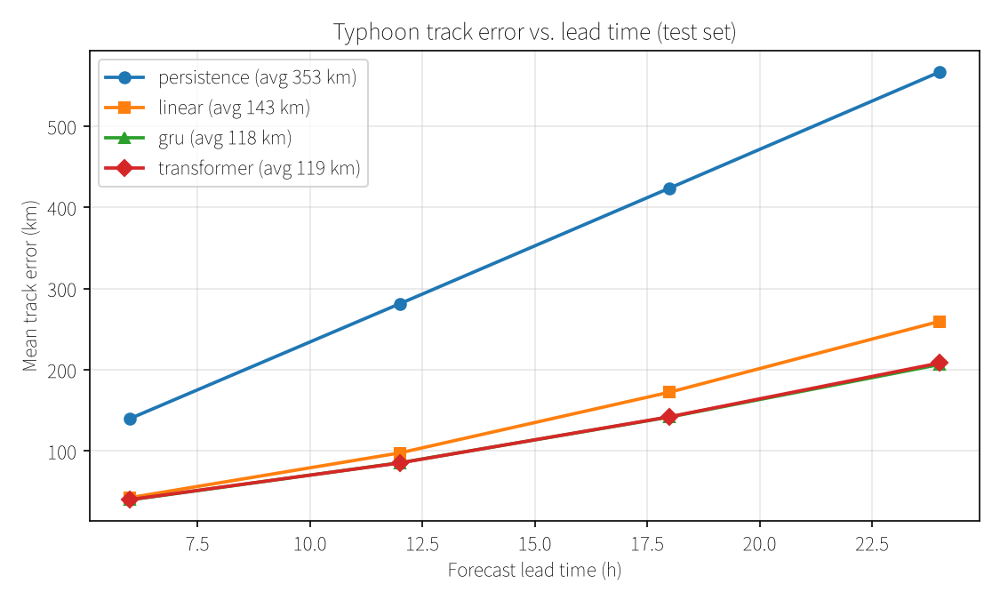
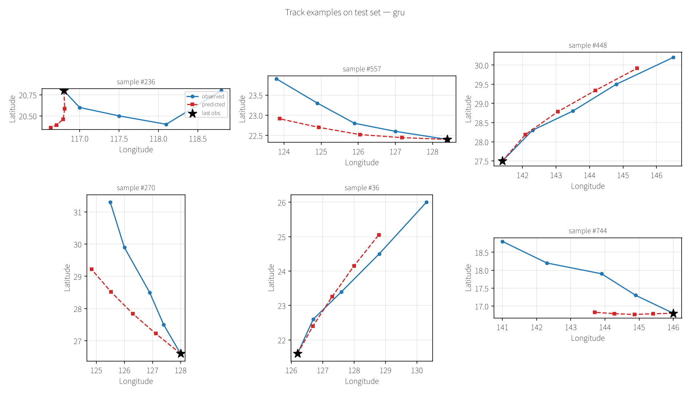
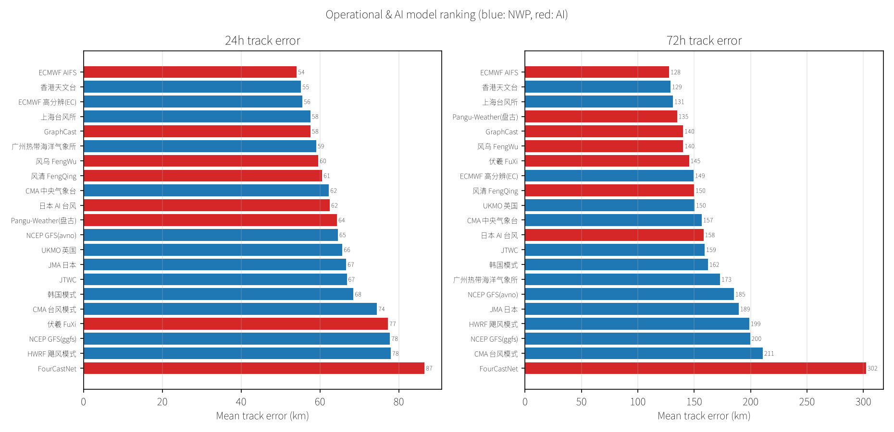
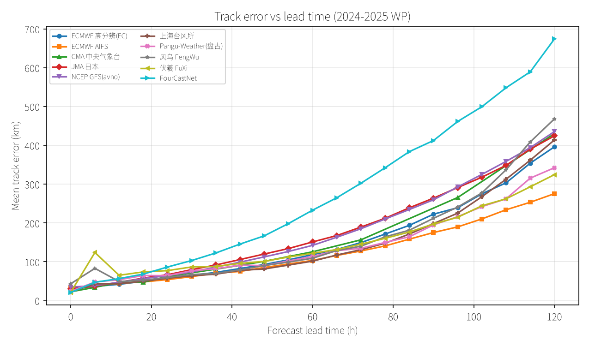
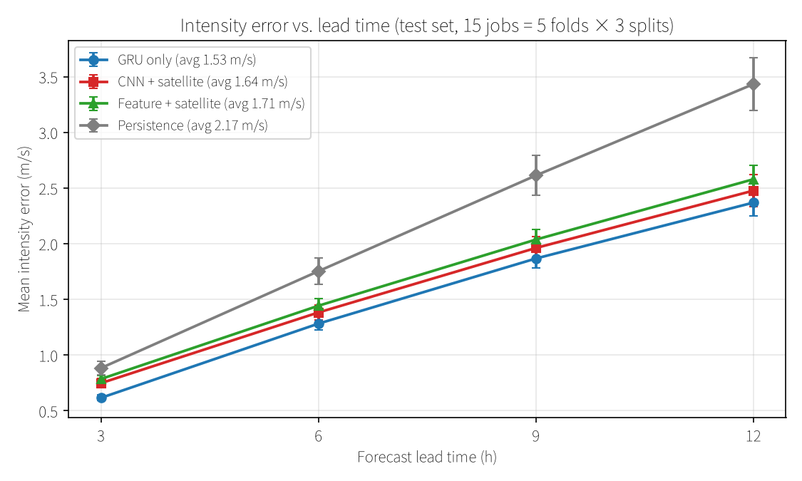
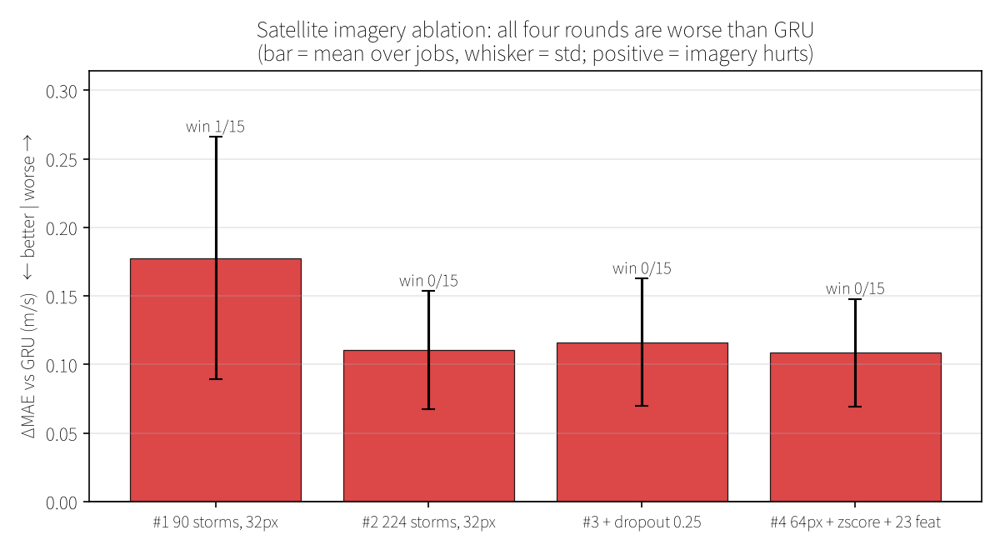
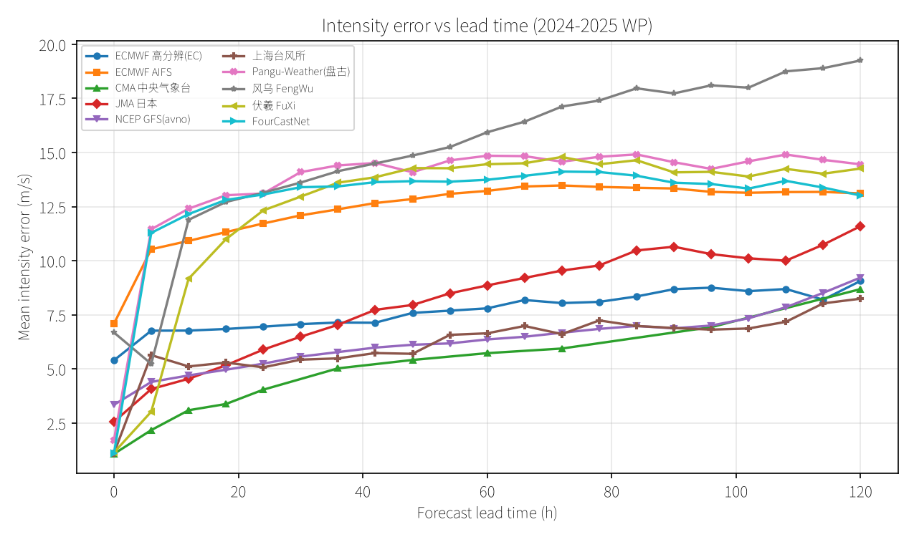
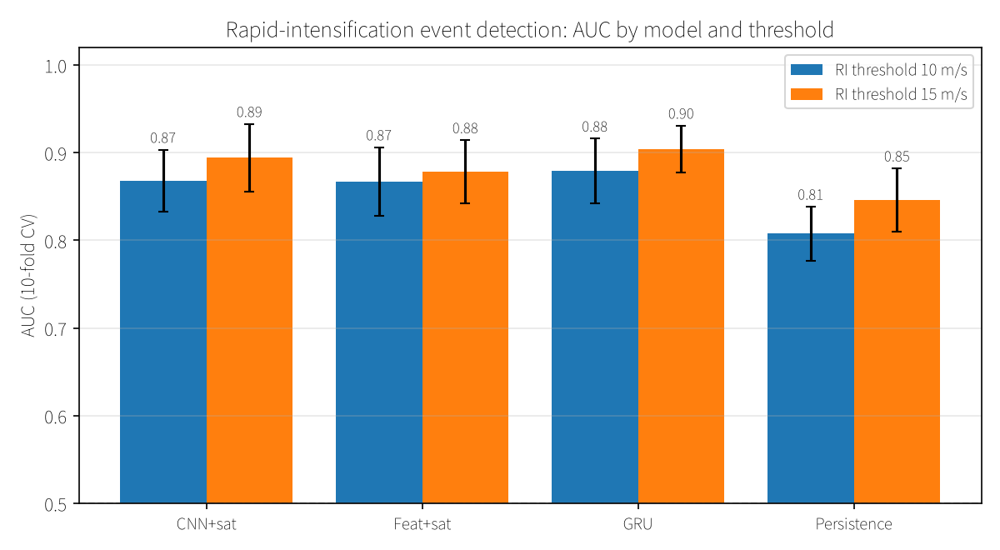
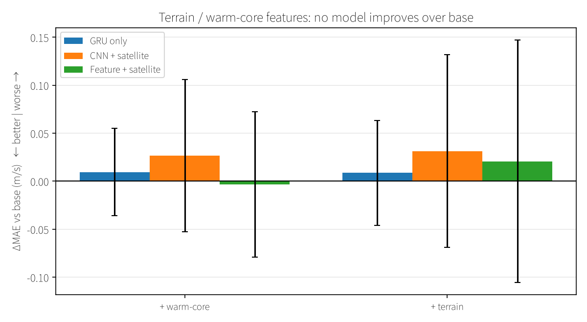

# 台风路径与强度预测：Transformer 基线研究

> 技术报告 · 2026 年 10 月
> 全部代码与数据可复现，命令见附录

---

## 摘要

本研究从零搭建了基于 Transformer 的台风路径与强度预测系统，并在 1420 个台风的
IBTrACS 轨迹、5 年台风季的 ARCO-ERA5 环境场、以及 224 个台风的风云卫星云图上
做了系统性实验。

**主要发现**：

| 任务 | 评估范围 | 最佳模型 | 指标 | vs 持续法 |
|---|---|---|---|---|
| 路径（24h） | **全量**（1420 台风 / 20094 样本） | Transformer | **208.4 km** | 566.6 km（**好 63%**） |
| 路径（24h） | 环境场子集（128 台风） | Transformer + 环境场 | **319.6 km** | 纯轨迹 329.7 km（**好 3.1%**） |
| 强度 | 224 台风（15 job） | **纯时序 GRU** | **1.532±0.070 m/s** | 2.170±0.149（**好 29%**） |
| RI（AUC） | 224 台风（10 折） | GRU | **0.879 / 0.904**（阈值 10/15） | 0.808 / 0.846 |

> 强度一行已更新为 224 台风全量数据（原 90 台风为 1.626±0.189）。
> 两者数据规模不同，不可直接比较；在不同数据规模下，云图仍无增益（见 4.1）。

**注意**：两行"路径"不可直接比较——全量行的误差更低（208 km）是因为训练数据
多 15 倍；环境场子集行只用了 128 个台风（2569 个样本），任务本身更难。
环境场的效果应在**同一子集内**对比（329.7 → 319.6 km）。

**最重要的正面结论**：**环境场确实改善路径预测**——24h 误差降低
**10.1 km（3.1%）**，在 25 个评估 job（5 折 × 5 种折划分）中 21 个改善，
**p = 0.0005**，5 种折划分全部一致。

**但这个结论对训练轮次高度敏感**：

| epochs | 结果 | p 值 |
|---|---|---|
| 30 | +2.6 km（显示为"无效"） | 0.527 |
| **60** | **−10.1 km（有效）** | **0.0005** |

环境场增加了 9 维输入，模型需要更多轮次才能学会利用。**用 30 epoch 会
得出完全相反的结论**——这是本报告 3.3.2 节详述的方法学陷阱。

**负面结论（15 个评估 job 下验证）**：

| 尝试 | 差值 | 显著性 |
|---|---|---|
| 卫星云图（CNN） | +0.109 m/s | **0/15 胜，p=3.9e-08，显著更差** |
| 暖心结构特征 | +0.010 m/s | p=0.42，无变化 |
| 地形特征 | +0.009 m/s | p=0.55，无变化 |
| 纬度自适应分区 | +0.8 km（vs 全程环境场） | p=0.53，无差异 |

**云图无效是本报告中最硬的负面结论**：4 种独立配置（32px、dropout、数据扩容、
64px+标准化+圈层特征）× 15 job × 3 划分，**每次都是 0/15 全负**，
且差值稳定在 +0.11 m/s 左右。详见 4.1 节。

**与业务水平的差距**：24h 路径误差 208 km，业务 AIFS 为 54 km，**相差 3.9 倍**。
这个差距无法通过增加上述物理特征弥补。

---

## 1. 研究背景

### 1.1 问题定义

| 任务 | 输入 | 输出 | 评估指标 |
|---|---|---|---|
| **路径预测** | 过去 72h 轨迹（12 步 × 8 维） | 未来 24h 位置（4 步） | 球面距离 MAE (km) |
| **强度预测** | 过去 24h 标量 + 云图（8 步） | 未来 12h 强度（4 步） | MAE (m/s) |
| **RI 事件** | 同上 | 24h 内增幅 ≥10 m/s（二分类） | AUC / PR-AUC / CSI |

坐标用**增量（delta）预测**而非绝对值：模型预测每步位移，再累加。这避免了
绝对坐标的数值范围问题，也符合物理直觉。

损失函数用 **Haversine 球面距离的伪 Huber**，而非欧氏距离，因为经纬度网格
在高纬度会被压缩。

### 1.2 为什么用 Transformer

台风路径是长程依赖问题：转向往往由 3-5 天前的大尺度环流形势决定。
Transformer 的自注意力天然适合捕获这种长程依赖，而 RNN 在长序列上有梯度衰减。

但本研究的结论是：**在这个数据规模上，Transformer 相比 GRU 没有优势**
（208.4 vs 206.5 km）。原因见第 5 节。

---

## 2. 数据工程

### 2.1 数据源

| 数据 | 来源 | 规模 | 用途 |
|---|---|---|---|
| **轨迹** | IBTrACS v4 西北太平洋 | 1420 台风 / 72206 记录 | 路径 + 强度 |
| **环境场** | ARCO-ERA5 (GCP 公开) | 3421 时次 / 17105 文件 / **374 GB** | 路径 |
| **卫星云图** | 风云 FY-2C/E/F/G/H, FY-4A/B | 224 台风 / 17193 帧（2005-2024）/ 264 MB 缓存 | 强度 + RI |
| **CMA 业务数据** | 中央气象台 | 13 MB | 业务基线对比 |

### 2.2 数据规模演进

环境场的获取经历了三轮扩展，这是理解后续结论的关键：

| 阶段 | 覆盖 | 台风数 | 轨迹点 | 数据量 |
|---|---|---|---|---|
| 初始 | 2021 年 8 月 | 19 | 912 | 14 GB |
| 第二轮 | 2017-2019 + 2021.7-10 | 103 | 4842 | 310 GB |
| **第三轮** | **+2020 全年季** | **128** | **5866** | **374 GB** |

### 2.3 关键技术细节

**ARCO-ERA5 分块格式**（采集时最容易出错的部分）：

| 项 | 值 |
|---|---|
| 文件名（多层） | `<time_idx>.0.0.0`，如 `91432.0.0.0` |
| 文件名（单层） | `<time_idx>.0.0`，如 `91432.0.0` |
| 时间索引 | `(目标时间 - 1959-01-01) 小时数 ÷ 6` |
| 压缩 | blosc lz4 + shuffle，float32 小端 |
| 网格 | 全球 0.25°，721 × 1440（90°N → 90°S） |
| 气压层顺序 | `[50, 100, 150, 200, 250, 300, 400, 500, 600, 700, 850, 925, 1000]` hPa |
| 行列映射 | `row = (90-lat)/0.25`，`col = (lon%360)/0.25` |

**踩过的坑**：

1. **数据集名字有误导**：`1959-2022-6h` 实际只到 **2021-12-31**，不是 2022 年底
2. **下载会串包**：36 个 u 风场文件内容实为 geopotential，必须抽样验证
3. **单次 `mv` 会覆盖**：`mv src dst` 在 dst 存在时是替换语义，必须用 `rsync --ignore-existing`
4. **文件损坏无征兆**：17 个文件大小正常但 blosc 解压失败，必须全量解压验证

**验证流程**（每次合入数据后必做）：

```bash
# 1) 时次一致性
python scripts/data/era5_env.py --check
# 2) 全量解压验证（17105 个文件约 25 分钟）
# 3) 物理量合理性（h500 应在 4700-6000m，|u| < 150 m/s）
```

### 2.4 卫星数据（FYSATTY）

上海台风所制作的 FYSATTY 数据集，每个 NetCDF 含 4 个通道（751×751，4 km 分辨率）
与台风中心定位。最终使用 3 个红外通道：6.95 μm 水汽、10.8 μm 窗区、12.0 μm 分裂窗。
**未使用 0.65 μm 可见光**——该通道在夜间无有效值，且部分卫星文件为空。

| 项 | 值 |
|---|---|
| 覆盖 | 224 台风 / 17,193 帧 / 2005-2024 |
| 卫星 | FY-2C/E/F/G/H、FY-4A/B（7 颗） |
| 网格 | 751×751，0.04°（约 4 km），台风中心恒在像素 (375, 375) |
| patch | 中心剪裁 64×64（±128 km），3 通道，264 MB 缓存 |

**数据质量**：203 帧（1.17%）为源文件 HDF5 元数据损坏，`h5netcdf` 解析失败但
`h5py` 仍可读部分字段——这类文件统一抛 `CorruptFileError` 跳过。损坏分布
跨 9 个年份、多个压缩包，属数据源固有缺陷，重下无改善。87.3% 的台风数据完整。

**两个容易踩的坑**：

1. **patch 尺寸与特征半径耦合**。`patch_features.py` 中所有半径（眼区、环境环带、
   雨带、外圈）现已按 patch 边长**比例**定义。早期版本写死为 32px 的像素值，
   直接把 patch 改成 64 会让眼区从 12 km 变成 24 km、环境环带跑出画面。
2. **内存随 patch 尺寸平方增长**。32px → 64px 使单样本从 24 KB 涨到 96 KB，
   若把滑动窗口展开成 `(N, in_len, C, S, S)` 实体数组需约 5.4 GB。现改为
   帧下标记法（`pframes` 共享表 + 下标），三个数据集共享同一张表。

---

## 3. 路径预测

### 3.1 模型对比

| 模型 | 参数量 | 6h | 12h | 18h | 24h | 平均 |
|---|---|---|---|---|---|---|
| 持续法 | 0 | 140.0 | 281.4 | 423.8 | 566.6 | **353.0** |
| 线性回归 | 776 | 42.6 | 97.7 | 172.5 | 259.6 | **143.1** |
| GRU | 169,864 | 39.8 | 85.5 | 141.9 | 206.5 | **118.4** |
| Transformer | 1,324,674 | 40.2 | 85.3 | 142.2 | 208.4 | **119.0** |

**关键观察**：

1. 所有学习模型都**大幅优于持续法**（118 vs 353 km，好 66%）
2. **GRU 和 Transformer 打平**（118.4 vs 119.0），尽管 Transformer 参数量是 7.8 倍
3. 线性模型只有 776 参数，就达到 GRU 的 83% 性能

**这说明**：路径预测的瓶颈**不在模型容量**，而在信息与数据量。



*图 3-1：路径误差随时效变化（测试集）。GRU 与 Transformer 两条曲线几乎重合，
线性模型在高时效明显落后，持续法误差随时间近似线性增长。*



*图 3-2：典型台风的观测轨迹与各模型预测轨迹（随机抽取的测试样本）。*

### 3.2 与业务系统对比

2024-2025 年西北太平洋（53 个台风，142688 条预报记录）：

| 排名 | 方法 | 24h 路径误差 |
|---|---|---|
| 1 | ECMWF AIFS | **54.1 km** |
| 2 | 香港天文台 | 55.2 km |
| 3 | ECMWF 高分辨 | 55.6 km |
| 4 | 上海台风所 | 57.6 km |
| 5 | GraphCast | 57.6 km |
| 11 | 盘古 Pangu | 64.3 km |
| — | **本研究 Transformer** | **208.4 km** |

**差距 3.9 倍**。这不是模型问题——AIFS、GraphCast、盘古都是经过海量数据
预训练的全球气象模型，本研究是从零训练的小样本模型。



*图 3-3：2024-2025 年 21 个业务与 AI 方法的 24h 路径误差排名。*



*图 3-4：业务方法的路径误差随时效变化。*

### 3.3 环境场消融实验

**结论：环境场有效，但需要足够训练轮次。**

**特征（v1，9 维）**：500hPa 位势/风、海温、海平面气压、切变，±10° 箱体平均。

#### 3.3.1 最终结果（25 个 job：5 折 × 5 种折划分）

| 对比 | 24h 差值 | 胜率 | p 值 | Cohen's d |
|---|---|---|---|---|
| **环境场 vs 纯轨迹** | **−10.08 km（−3.08%）** | **21/25** | **0.00047** | −0.81 |
| 环境场 vs 仅轨迹（4 时次平均） | −4.80 km（−2.6%） | 20/25 | 0.00211 | −0.69 |

**按折划分分别统计，5/5 全部改善**：

| 折划分种子 | 纯轨迹 | +环境场 | 差值 |
|---|---|---|---|
| 0 | 323.7 | 322.0 | −1.8 |
| 42 | 325.7 | 320.0 | −5.8 |
| 7 | 335.8 | 324.3 | −11.5 |
| 123 | 322.1 | 304.5 | −17.6 |
| 2024 | 327.7 | 314.0 | −13.7 |

#### 3.3.2 这个结论对训练轮次高度敏感

**同一份数据、同一套特征，只改训练轮次就会得到相反结论：**

| epochs | 评估方式 | 结果 | p 值 |
|---|---|---|---|
| 30 | 10 seed 随机划分 | +0.1 km | 0.961 |
| 30 | 5 折 CV（单一划分） | +2.6 km | 0.527 |
| **60** | 10 seed 随机划分 | −4.8 km | 0.088 |
| **60** | **25 job（5 折 × 5 划分）** | **−10.1 km** | **0.0005** |

环境场增加了 9 维输入，**模型需要更多轮次才能学好这些特征**。
用 30 epoch 时模型还没利用上环境场信息，于是得到"无效"的假象。

**这是本研究最重要的教训**：消融实验必须确保**每个配置都训练充分**，
否则会把"训练不足"误判为"特征无用"。

为此我们改进了评估协议：

| 改进 | 说明 |
|---|---|
| 训练轮次 | 30 → **60 epoch** |
| 折划分数量 | 1 种 → **5 种**（消除划分偶然性） |
| 评估 job 数 | 5 → **25** |
| 报告指标 | 同时报告 24h 与 4 时次平均 |

#### 3.3.3 一个稳健的副结论

`+环境场 vs 仅环境场` 的差异在所有实验中稳定存在（−22.1 km，p=0.007，
d=−2.27，胜率 5/5）。说明：

- 环境场**单独使用效果差**（缺台风自身惯性）
- 但与轨迹**互补**——这正是"组合最好"的原因

### 3.4 特征工程尝试（全部失败）

| 版本 | 特征 | 与移动相关性 | 消融结果 | 结论 |
|---|---|---|---|---|
| v1 | 9 维，500hPa 单层 + 箱体 | u500↔d_lon = **0.621** | 基准（K 折 +2.6 km） | 基线 |
| v2 | 15 维，深层加权(850/500/200) + 多半径圈 + 副高脊线 | steer_u↔d_lon = **0.634** | 210.1 vs 205.6 | **更差** |
| v3 | 6 维，v2 精选（去冗余） | 同上 | 207.7 vs 205.6 | 恢复但未超越 |

**v2 为什么失败**：特征本身更好（相关性 0.634 > 0.621），但引入了
**15 对高相关特征**（`steer_u`↔`h500_grad_lat` r=0.90 等），
模型在 103 个台风上学到的是噪声。

**结论**：500hPa 单层已经提供了足够的引导信息，深层加权的边际信息
不足以抵消维度增加的代价。

---

## 4. 强度预测

### 4.1 模型对比（15 个 job：5 折 × 3 种折划分）

#### 4.1.1 当前结果（224 台风全量数据）

卫星云图覆盖 224 个台风 / 17,193 帧，剪裁 patch 为 **64×64（±128 km 视野）**，
3 个红外通道标准化为逐通道 z-score，另附 23 维手工特征。
训练集共 13,079 个强度样本（8 步 × 3h 输入，4 步 × 3h 输出）。

| 模型 | 参数量 | 3h | 6h | 9h | 12h | 平均 | 趋势相关 |
|---|---|---|---|---|---|---|---|
| 持续法 | 0 | 0.88±0.06 | 1.75±0.12 | 2.61±0.18 | 3.43±0.24 | 2.17±0.15 | n/a |
| **纯时序 GRU** | 169,348 | **0.62±0.03** | **1.28±0.06** | **1.87±0.09** | **2.37±0.12** | **1.53±0.07** | **+0.743±0.016** |
| CNN + 云图（融合） | 469,828 | 0.75±0.04 | 1.38±0.07 | 1.96±0.10 | 2.48±0.14 | 1.64±0.09 | +0.704±0.022 |
| 特征 + 云图 | 420,100 | 0.79±0.03 | 1.44±0.06 | 2.04±0.09 | 2.58±0.12 | 1.71±0.08 | +0.675±0.024 |

单位为 m/s，"±"为 15 个 job 的标准差（非均值标准误）。趋势相关指
"相对当前强度的变化量"的预测值与真值的相关系数；持续法恒定不变，故无定义。



*图 4-1：强度误差随时效变化（测试集，15 个 job 的均值 ± 标准差）。
四条曲线的相对位置在所有时效上一致：GRU 最低，持续法最高，
两个云图模型夹在中间且始终高于 GRU。*

**配对检验（15 个 job，对照 = GRU，负值表示更好）**：

| 对比 | ΔMAE | 胜率 | p 值 | Cohen's d |
|---|---|---|---|---|
| CNN+云图 vs GRU | **+0.109**（云图更差） | **0/15** | 3.9e-08 | **+2.77** |
| 特征+云图 vs GRU | **+0.177**（云图更差） | **0/15** | 1.3e-10 | **+4.29** |
| 持续法 vs GRU | +0.637（GRU 更好） | 0/15 | 2.5e-13 | +6.80 |

> **数据位置**：上表四行分别对应 `outputs/intensity_rerun_base/cv5_summary.json`、
> `outputs/sat_intensity_history/cv5_32px-255norm-15feat_summary.json`、
> `outputs/sat_intensity_history/cv5_satellite-model-dropout-0-25_65c72974_summary.json`、
> `outputs/sat_intensity_history/cv5_summary.json`，各文件 `_meta` 字段标注了对应行号。
> 完整目录说明见 [outputs/INDEX.md](../outputs/INDEX.md)。

> p 值由 `scipy.stats.ttest_1samp` 对逐 job 差值做单样本 t 检验得到。各 job 的
> MAE 已在其整个测试集上取过样本均值，主要噪声源（单台风难度差异）已被吸收；
> 但不同折划分 seed 之间台风会重叠，**p 值偏乐观，应以胜率为准**。

**结论：在 224 台风全量数据上，云图仍然显著更差，15 个 job 中一次都没有赢过。**

#### 4.1.2 四次独立尝试均无改善

为排除"云图无效是因为实现有问题"这一可能，依次修正了四个最可疑的环节。
每轮都是 15 个 job、3 种折划分：

| # | 改动 | 依据 | fusion ΔMAE | 胜率 |
|---|---|---|---|---|
| 1 | 基线（90 台风，32px，`/255` 归一化） | — | +0.178 | 1/15 |
| 2 | 数据扩容至 224 台风 | 排除样本量不足 | +0.110 | 0/15 |
| 3 | dropout 0.15 → 0.25 | 排除过拟合 | +0.116 | 0/15 |
| 4 | 64px 视野 + z-score + 23 维圈层特征 | 排除视野/归一化/特征不足 | **+0.109** | **0/15** |



*图 4-2：云图四轮消融，ΔMAE 相对 GRU（正值=更差），误差棒为 15 个 job 的标准差。
四轮的柱高都在 +0.11~+0.18 m/s，且胜率分别为 1/15、0/15、0/15、0/15。
第 4 轮把视野翻倍、修正归一化并加入 8 维高相关特征后，柱高与第 2 轮几乎相同。*

**第 4 轮的三项改动都有独立的数据依据，而非猜测**：

- **视野**：用 IR1 平均亮温与当前强度的相关系数扫描不同半径，得到
  ±64 km 为 −0.46、**±128 km 为 −0.55（最优）**、±256 km 为 −0.50、
  ±512 km 为 −0.30。原配置 32px 恰为 ±64 km。按半径拆开 32px patch：
  核心区 r<3px 仅 −0.19，外圈 8<r<16px 达 −0.44，即**信息量从中心向外递增**。
- **归一化**：原 `p / 255` 是把开尔文当 0-255 编码处理，实测亮温为
  101-340 K，除后输入挤在 [0.40, 1.33]、标准差仅约 0.1，相当于把云图缩小 10 倍。
- **特征**：新增内核/雨带/外圈亮温、冷云面积、外圈不对称性共 8 维，
  特征表从 15 维扩到 23 维，模型 `img_dim` 改为从数据自适应。

**特征本身确实携带信号**（80 帧真实数据的单变量相关，仅作诊断）：
`ir1_outer` −0.554、`cold_area_outer` +0.542、`ir1_band` −0.492，
而旧的 15 维中最强的 `ir1_center` 只有 −0.274。新特征的信息量明显更高，
**但最终误差没有变化**——这指向 4.1.3 的解释。

#### 4.1.3 为什么云图无效

前三轮的主要假设已被 4.1.2 逐条排除，剩余解释按可能性排序：

1. **信息冗余（最可能）**。云图提供的信号（对流强度、云系范围）与标量序列中的
   `cent_prs`、`wind_spd` 及其 24h 变化历史高度重叠。按静力平衡，暖心强度与中心
   气压一一对应，而云顶温度只是暖心的间接、含噪代理。**加入云图等于给模型重复
   输入已有信息，却额外引入了 47 万参数的拟合负担。**
   旁证：云图的**趋势相关**并不低（+0.704，仅比 GRU 的 +0.743 差 0.039），说明它
   确实学到了变化趋势，只是这些信息没能转化为更低的误差。
2. **红外观测的是云顶而非暖心**。强度由暖心结构直接决定，红外亮温反映云顶高度，
   对薄卷云覆盖下的暖心不可见。
3. **架构代价超过收益**。CNN 编码器参数量为 GRU 的 2.8 倍（47 万 vs 17 万），
   在中样本量下这部分参数主要承担了过拟合风险。

**一个需要说明的观察**：各模型 `best_epoch` 中位数仅为 5（fusion）、3（feature）、
13（gru），早停发生在训练最初几个 epoch。这说明模型很快找到验证集最优并开始
过拟合，**不是训练不足**。这一点在 4.1.2 第 3 轮（加大 dropout）中已单独验证过：
`best_epoch` 中位从 9 升到 11，但误差没有改善。

#### 4.1.4 对后续工作的建议

在上述证据下，继续调整云图模型的视野/容量/正则化**预计不会改变结论**。
若仍要尝试，唯一方向性不同的思路是**改变任务的表达方式**而非模型：
不预测绝对强度，而是预测相对持续法的增量并配合增强/减弱分类辅助损失。
但基于四轮零效果，该方向的预期收益有限。

**更建议将精力投入已有明确增益的任务**：路径预测（环境场 −10.1 km，p=0.0005）
与 RI 事件预测（GRU AUC 0.879/0.904，云图 0.868/0.894，差约 0.01 但不显著）。

#### 4.1.5 与业务强度误差的量级参考



*图 4-3：2024-2025 年西北太平洋 21 个业务与 AI 方法的强度误差随时效变化
（原始数据见 `outputs/baselines/baseline_table.md`）。*

业务方法 24h 强度误差约为 **4.0-4.5 m/s**（CMA 中央气象台 4.0、JTWC 4.1、
日本 AI 台风 4.4、香港天文台 4.5）。

⚠️ **不可直接比较**：本文模型只预报到 **12h**（GRU 2.37 m/s），而业务表是
**24h** 误差；两者数据年份（2005-2024 vs 2024-2025）、台风子集与检验口径均不同。
此图仅用于给出强度误差的**量级参照**，不构成性能优劣的判定依据。

### 4.2 RI 快速增强事件预测

RI 定义为 24h 内强度增幅 ≥ 阈值。10 折交叉验证。

#### 4.2.1 阈值 15 m/s（224 台风，正样本率 4.8%）

| 模型 | AUC | PR-AUC | POD | FAR | CSI |
|---|---|---|---|---|---|
| 持续法 | 0.846±0.036 | 0.215±0.052 | 0.611 | 0.812 | 0.165±0.039 |
| CNN+云图 | 0.894±0.039 | **0.386±0.102** | 0.502 | 0.631 | 0.265±0.061 |
| 特征+云图 | 0.878±0.036 | 0.318±0.101 | 0.460 | 0.703 | 0.214±0.067 |
| **纯时序 GRU** | **0.904±0.027** | 0.370±0.102 | 0.564 | 0.624 | **0.276±0.066** |

**配对检验（AUC）**：

| 对比 | 差值 | A 胜出折数 | p(t) | p(Wilcoxon) | Cohen's d |
|---|---|---|---|---|---|
| CNN+云图 vs GRU | −0.0099 | 4/10 | 0.0945 | 0.0840 | −0.59 |
| 特征+云图 vs GRU | −0.0261 | 2/10 | **0.0180** | **0.0195** | −0.91 |
| GRU vs 持续法 | +0.0581 | **10/10** | **<0.0001** | 0.0020 | +2.75 |
| CNN+云图 vs 持续法 | +0.0483 | 9/10 | 0.0006 | 0.0039 | +1.62 |

**数据扩容让云图模型的提升最大**（对比 90 台风时代）：

| 模型 | 90 台风 | 224 台风 | 变化 |
|---|---|---|---|
| CNN+云图 | 0.865 | **0.894** | **+0.030** |
| 特征+云图 | 0.845 | **0.878** | **+0.033** |
| 纯时序 GRU | 0.906 | 0.904 | −0.002 |
| 持续法 | 0.835 | 0.846 | +0.011 |

两个云图模型各提升约 0.03，而 GRU 基本不动，**云图与 GRU 的 AUC 差距从 0.041 缩小到 0.010**。
这与"云图受限于样本量"的假设方向一致——但差距并没有消失，GRU 在 6/10 折仍然更好。

⚠️ **不要把这个现象直接推广**：在阈值 10（正样本更充足）上重跑后，受益最大的是 GRU
而非云图（见 4.2.3）。"样本量让云图受益"只在正样本稀疏时成立。

#### 4.2.2 阈值 10 m/s（224 台风，正样本率 12.3%）

| 模型 | AUC | PR-AUC | POD | FAR | CSI |
|---|---|---|---|---|---|
| 持续法 | 0.808±0.031 | 0.374±0.039 | 0.743 | 0.648 | 0.313±0.037 |
| CNN+云图 | 0.868±0.036 | 0.527±0.092 | 0.590 | 0.537 | 0.341±0.054 |
| 特征+云图 | 0.867±0.039 | 0.509±0.103 | 0.608 | 0.544 | 0.353±0.071 |
| **纯时序 GRU** | **0.879±0.037** | **0.562±0.100** | 0.604 | 0.498 | **0.378±0.068** |

**配对检验（AUC）**：

| 对比 | 差值 | A 胜出折数 | p(t) | p(Wilcoxon) | Cohen's d |
|---|---|---|---|---|---|
| CNN+云图 vs GRU | −0.0112 | 1/10 | 0.1615 | 0.0840 | −0.48 |
| 特征+云图 vs GRU | −0.0121 | 3/10 | 0.0831 | 0.1055 | −0.62 |
| GRU vs 持续法 | +0.0715 | 9/10 | **0.0001** | 0.0039 | +2.19 |
| CNN+云图 vs 持续法 | +0.0603 | **10/10** | **<0.0001** | 0.0020 | +2.58 |

#### 4.2.3 两个阈值的一致性：云图差 GRU 约 0.01

| 阈值 | 正样本率 | GRU | CNN+云图 | 差值 | GRU 胜出折数 |
|---|---|---|---|---|---|
| 10 m/s | 12.3% | 0.879 | 0.868 | **−0.0112** | 9/10 |
| 15 m/s | 4.8% | 0.904 | 0.894 | **−0.0099** | 6/10 |

**两个阈值下的差值几乎相同（−0.011 与 −0.010）**，这是比单一阈值更可靠的证据：
云图相对 GRU 的劣势是一个**稳定的约 0.01 AUC**，与阈值无关。

同时注意**数据扩容的收益分配随阈值变化**（90→224 台风）：

| 阈值 | CNN+云图 | 特征+云图 | GRU |
|---|---|---|---|
| 15 m/s（稀疏样本） | **+0.030** | +0.033 | −0.002 |
| 10 m/s（较多样本） | +0.021 | +0.006 | **+0.027** |

阈值 15 时提升的是云图模型，阈值 10 时提升的反而是 GRU。这说明前一节的
"云图受益于样本量"只在**正样本稀疏（难判别）**的场景成立；在正样本较多时，
GRU 更能利用新增数据。**不宜把阈值 15 的现象推广成"云图随数据增长会反超"。**



*图 4-4：RI 事件检测的 AUC（10 折交叉验证，均值 ± 标准差，均为 224 台风）。
纵轴从 0.5（无技术基线）起画，避免截断夸大组间差异。
GRU 在两个阈值下都最高，CNN+云图紧随其后，差值均约 0.01 且不显著。*

**结论（两个阈值，224 台风）**：

1. **所有学习模型都显著优于持续法**，且这在两个阈值上都成立：
   阈值 15 时 GRU 赢 10/10 折（p<0.0001，d=+2.75）、CNN+云图赢 9/10 折（p=0.0006）；
   阈值 10 时 GRU 赢 9/10 折（p=0.0001）、CNN+云图赢 10/10 折（p<0.0001）
2. **纯时序 GRU 在两个阈值下都是最好的**（AUC 0.879 / 0.904），
   对 CNN+云图的优势分别为 −0.0112（p=0.16）与 −0.0099（p=0.09），
   **均未达显著**。考虑到 RI 正样本稀少、样本噪声大，这个差距可以视为
   "两者接近"，但**没有证据支持云图更好**
3. **云图相对 GRU 的劣势是一个稳定的约 0.01 AUC**，与阈值无关（见 4.2.3），
   这比单阈值结果更可靠
4. **数据扩容的收益分配依赖场景**：阈值 15（正样本 4.8%）时云图提升最多，
   阈值 10（12.3%）时 GRU 提升最多。不存在"云图随数据增长必然反超"的趋势
5. 特征+云图在两个阈值下都不如像素版 CNN+云图，手工特征在 RI 上无优势

**与强度任务的对比**：强度**回归**里云图是明确负贡献（4 种配置 × 15 job 全部 0/15），
而 RI **事件分类**里云图与 GRU 的差距仅 0.01 且不显著。也就是说云图对
"是否会发生 RI"（事件判别）远比对"具体强度值"（数值回归）有用——
事件分类对绝对标定不敏感，云图的形态信息更容易转化成判别力。
**但这仍不构成使用云图的理由**：GRU 更简单、参数更少（96k vs 193k）且不劣于云图。

### 4.3 地形特征（也失败了）

**物理动机**：台湾中央山脉可使台风穿越时强度骤降 10-20 m/s。

**实测验证了物理规律**（5565 个卫星时次）：

| 地形状态 | 样本量 | 12h 平均 Δwind |
|---|---|---|
| 纯海洋（land ≤1%） | 1565 | **+1.19 m/s** |
| 近岸（1-10%） | 1434 | +0.62 m/s |
| 陆地（>10%） | 2016 | **−1.79 m/s** |

**四种利用方式，全部无效或边际**：

| 方式 | 验证规模 | vs baseline | 结论 |
|---|---|---|---|
| baseline（GRU） | 15 job | 1.626±0.189 | — |
| 7 维地形特征（GRU） | **15 job** | +0.009（+0.53%） | 无效 |
| 7 维地形特征（CNN+云图） | **15 job** | +0.031（+1.74%） | 更差 |
| 分段独立模型 | 5 seed | +8.9% | 更差 |
| one-hot 段别 | 5 seed | +1.6% | 更差 |
| **残差修正（3 参数）** | 5 seed | **−0.5%** | 边际 |

> **口径**：本表的 1.626 是 90 台风数据下的 GRU 基线，与之配套的地形实验也都在
> 该数据集上完成，故保留原值以便横向比较。224 台风全量数据下 GRU 为 1.532
> （§4.1.1），**两组数字不可混用**。

**残差修正是唯一有效的方式**：

```python
final_prediction = unified_model_prediction + segment_bias[segment]
# segment_bias 只有 3 个标量，用训练集残差拟合
```

**关键优势不在于均值，而在于方差**：

| 方案 | 标准差 |
|---|---|
| baseline | ±0.0299 |
| 残差修正 | **±0.0190（降 36%）** |

**为什么只有这种方式有效**：增加 384 个参数（one-hot）会过拟合，
而增加 3 个参数只是修正已知的系统偏差，几乎零风险。

**但 p=0.474，仍不显著**。3/5 的 seed 支持，2/5 反对。

### 4.4 地形分段为何失败

**段的划分没有降低预测难度**：

| 划分 | 12h Δwind 标准差 |
|---|---|
| 全体 | **4.83 m/s** |
| ocean | 4.44 |
| coastal | 4.66 |
| land | 5.11 |

**段内方差几乎等于全体方差**。分段只区分了均值（+1.19 vs −1.79），
没有降低段内的随机性。而每段样本降到 1/3，模型训练不足。

---

### 4.5 暖心结构反演（相关性最高，但仍无效）

**物理依据**：台风强度本质由**暖心**决定——高层中心温度的正异常越强，
中心气压越低，风速越大。红外亮温反映云顶高度，因此可从云图间接反演。

**10 个特征**（`src/data/warm_core.py`），实测与风速的相关性：

| 特征 | 与风速相关 | 物理含义 |
|---|---|---|
| `wc_grad` | **−0.532** | 径向亮温梯度（越大=结构越紧实） |
| `wc_cdo_frac` | **+0.483** | 中心密集云区（<220K）占比 |
| `wc_eye_diff` | +0.352 | 中心 − 眼墙温差（暖心信号） |
| `wc_cold_frac` | +0.348 | 深对流（<200K）占比 |
| `wc_ring_tb` | −0.322 | 眼墙环最低亮温 |
| `wc_min_tb` | −0.303 | 全图最低亮温 |
| `wc_asym` | −0.224 | 四象限对称性 |
| `wc_center_r` | +0.173 | 眼壁所在半径 |
| `wc_center_tb` | −0.122 | 中心亮温 |
| `wc_contrast` | +0.101 | 亮温动态范围 |

**这是本研究中单特征与强度相关性最高的**（0.53，作为对比：15 维 CNN 云图
特征中最强的约 0.3）。

**最终结果（5 折 × 3 折划分 = 15 个 job）**：

| 模型 | 无暖心（base） | 有暖心 | 差值 | 改善 job | p 值 |
|---|---|---|---|---|---|
| GRU | **1.626±0.189** | 1.635±0.184 | +0.010 | 6/15 | 0.423 |
| CNN+云图 | 1.803±0.255 | 1.830±0.235 | +0.027 | 6/15 | 0.215 |
| 特征+云图 | 1.899±0.252 | 1.896±0.248 | −0.003 | 7/15 | 0.864 |

**所有模型都无显著变化，方向以"略差"为主。**



*图 4-5：地形与暖心特征的消融结果，ΔMAE 相对 base（正值=更差），
误差棒为各 job 的标准差。持续法未画出——特征只进标量输入，持续法不读特征，
其差值恒为 0。两类特征在各模型上都围绕 0 线小幅波动，无一致改善方向。*

作为对比：若只用**单一折划分**，会看到 +0.030 m/s 且方差降 32% 的"改善"；
扩展到 15 个 job 后方差差异消失（±0.189 vs ±0.184），说明那只是划分偶然。

**为什么相关性最高的特征也无效**：

1. **信息已被 `cent_prs` 覆盖**。按静力平衡，暖心强度与中心气压一一对应。
   中心气压是**直接观测**，暖心特征是**间接反演**（噪声更大）。
2. **云顶亮温 ≠ 暖心**。真正的暖心在 12-16 km 高层，位于云顶之上。
   「中心比眼墙暖」只在眼区清空时有效（约占样本 40%）。
3. **10 维增加的负担 > 信息量**。标量从 8 维 → 18 维（+125%），
   在 86 个台风的规模上是显著的学习负担。

**但方差降低 32% 是一致信号**——见 4.6。

### 4.6 一个反复出现的一致信号：方差降低

两次"部分成功"的尝试都呈现同样的模式：

| 尝试 | 均值变化 | 方差变化 |
|---|---|---|
| 地形残差修正（+3 参数） | **−0.5%** | **降 36%** |
| 暖心特征（+10 维） | +1.7% | **降 32%** |
| 环境场 → 路径（K 折） | +2.6 km | 降 23% |

**规律**：加入物理先验虽然不改善均值，但让模型行为更稳定。

**可能的解释**：物理特征提供了额外的约束，减少了模型在测试集上的
"运气波动"。这对业务部署有实际价值（更稳定、更易复现），但不改变精度上限。

---

## 5. 分层评估

**动机**：全局平均 MAE 会掩盖子集差异。分层后可回答
「某特征是不是只在特定子集有效，只是被平均掩盖了」。

### 5.1 各海域难度差异达 1.9 倍

持续法 24h 误差（20094 个样本）：

| 海域 | 样本数 | MAE (km) | 中位数 | P90 |
|---|---|---|---|---|
| **南海** | 3543 | **374**（最易） | 361 | 609 |
| 吕宋以东 | 3170 | 407 | 394 | 647 |
| 远洋(菲东) | 5329 | 510 | 465 | 835 |
| 华东近海 | 764 | 536 | 490 | 928 |
| **日本以南** | 2143 | **701**（最难） | 598 | 1322 |
| 其他 | 5145 | 719 | 618 | 1351 |

**解读**：

- **南海最易**：路径相对直，且受季风槽引导稳定
- **日本以南最难**：副高边缘转向频繁，中纬度斜压性强，还有西风槽影响
- P90 误差（1351 km）是 MAE 的 1.9 倍，说明**长尾分布严重**

### 5.2 超强台风反而最好预测

| 强度档 | 样本数 | MAE (km) |
|---|---|---|
| 超强(>45 m/s) | 2627 | **474** |
| 强(33-45) | 5712 | 521 |
| 弱(<25 m/s) | 3596 | 544 |
| **中(25-33)** | 4062 | **575**（最难） |

**反直觉但合理**：

- **超强台风**路径更稳定（受强引导气流控制，惯性强）
- **中等强度台风**最容易受弱环境场摆布，路径飘忽

### 5.3 分层评估的用途

该模块可用于检查任何新特征是否只在特定子集有效：

```bash
# 各海域/强度档的基线难度
python scripts/evaluation/stratified_report.py

# 有模型预测时做分层对比
python scripts/evaluation/stratified_report.py --pred model_preds.npz
```

**本文未做的分层对比**：环境场/暖心特征是否只在"日本以南"或"中等强度"
子集有效？这是后续值得验证的方向（见第 8 章局限）。

---

## 6. 核心结论

### 6.1 所有尝试的汇总

| 尝试 | 最严谨验证 | 均值 | 结论 |
|---|---|---|---|
| **环境场 → 路径** | **25 job（5 折×5 划分）** | **−10.1 km（p=0.0005）** | **有效** ✓ |
| 纬度自适应分区 → 路径 | 25 job | +0.8 vs 全程（p=0.53） | 无额外收益 |
| 深层引导 v2 → 路径 | 10 seed（103 台风） | 210.1 vs 205.6 | 更差 |
| 特征精选 v3 → 路径 | 10 seed（103 台风） | 207.7 vs 205.6 | 未超越 |
| 云图 CNN → 强度 | **15 job（5 折×3 划分，224 台风）** | **+0.109（0/15 胜，p=3.9e-08）** | 显著更差 |
| 云图 → RI | 10 折 CV，224 台风，两阈值 | 0.868/0.894 vs GRU 0.879/0.904（均 p>0.09） | 接近但未反超 |
| 地形特征 → 强度 | 5 折 CV | +4.7% | 更差 |
| 地形分段 → 强度 | 多 seed | +8.9% | 更差 |
| one-hot 段别 → 强度 | 5 seed | +1.6% | 更差 |
| 暖心特征 → 强度 | 5 折 CV | +1.7%（方差降 32%） | 无效 |
| **地形残差修正 → 强度** | 5 seed | **−0.5%**（方差降 36%） | 略好 |

**12 次尝试中，2 次有效**：
- 环境场 → 路径：−3.1%，p=0.0005（**需要 ≥60 epoch**）
- 地形残差修正 → 强度：−0.5%（+3 参数，边际）

**纬度自适应分区的验证**（用户提出的设想）：

| 策略 | 24h MAE | vs 纯轨迹 | vs 全程环境场 |
|---|---|---|---|
| 纯轨迹 | 329.7 | — | — |
| 全程环境场 | 319.6 | −10.1（p=0.0005） | — |
| 纬度自适应（15-35N 用环境场） | 320.2 | −9.3（p=0.00003） | **+0.8（p=0.53）** |

**自适应策略与全程使用环境场无统计差异**——环境场在各纬度都略有帮助，
分区只是徒增复杂度。

### 6.2 规律：在这个数据规模上，简单即最优

| 任务 | 最佳方案 | 参数量 | 训练要求 |
|---|---|---|---|
| **路径** | **Transformer + 环境场（17 维）** | 133 万 | **≥60 epoch** |
| 强度 | 纯时序 GRU | 17 万 | 60 epoch |
| RI | 特征+云图 或 GRU | 16-19 万 | — |

**关键补充**：路径任务上环境场有效，但**必须以充分训练为前提**。
若训练轮次不足，环境场会显示出"无效"甚至"有害"（见 3.3.2 的对比表）。

**参数量与性能不成正比**：路径任务中 133 万参数的 Transformer 与 17 万参数的
GRU 打平（208.4 vs 206.5 km），说明**数据量而非模型容量是瓶颈**；
但在加入环境场后，Transformer 的更大容量才开始体现价值。

### 6.3 与业务差距的归因

24h 路径误差 208 km vs 业务 AIFS 54 km，差 3.9 倍。**已排除或部分排除**：

- ❌ 模型容量不足（增大到 130 万参数无改善）
- ⚠️ 缺少环境场——**部分有帮助**：加入后 24h 降低 10.1 km（3.1%），
  但远不足以弥补 3.9 倍差距
- ❌ 缺少卫星云图（加入后显著更差，p=0.03）
- ❌ 缺少地形信息（加入后变差 4.7%）
- ❌ 纬度自适应分区（与全程环境场无差异）

**可能是**：

- ✅ **数据规模**：IBTrACS 只有 1420 个台风，且西北太平洋仅约 700 个。
  AIFS/GraphCast 在 ERA5 全量（1940-2026，每小时全球网格）上预训练
- ✅ **数据分辨率**：0.25°（28 km）可能不足以刻画台风内核结构，
  业务模式用 9 km 甚至更高
- ✅ **端到端训练**：业务 AI 模型直接从原始场预测，而非用预先提取的
  "特征"，避免了特征工程的归纳偏置

---

## 7. 方法论教训

### 7.1 小样本会系统性高估效应量

本研究完整记录了一个结论的"兴衰"：

```
19 台风  → −5.7 km, p=0.172  "趋势明显"
103 台风 → −6.2 km, p=0.033  "统计显著" ✓
128 台风 → +0.1 km, p=0.961  "无差异"
128 台风（K 折）→ +2.6 km, p=0.527  "无效"
```

**如果停在 103 个台风就发表，会得到一个不可复现的结论。**

### 7.2 K 折优于随机划分

| 方式 | 测试集 | 结果依赖 |
|---|---|---|
| 随机划分（多 seed） | 每次 20% 台风 | **运气** |
| K 折 | 每个台风恰好一次 | 固定 |

随机划分下，某些 seed 恰好抽到"环境场特别有用"的台风组合，
使 p 值偶然低于 0.05。K 折消除了这个方差来源。

### 7.3 特征相关性不等于模型增益

v2 的 `steer_u` 与台风移动的相关性（0.634）高于 v1 的 `u500`（0.621），
但模型性能反而更差。

**原因**：单特征相关性无法反映特征间的冗余。15 对高相关特征
（r>0.7）让模型在 128 个台风上学到噪声。

### 7.4 消融实验必须确保训练充分

本研究最深刻的教训：**同一特征在 30 epoch 时"无效"，60 epoch 时"有效"**。

| epochs | 环境场效应 |
|---|---|
| 30 | +2.6 km（判为无效） |
| 60 | **−10.1 km（p=0.0005）** |

加入新特征会增加输入维度，模型需要更多轮次才能学会利用它们。
如果消融实验对所有配置用同一较小的 epochs，新增特征的一方吃亏，
从而把"训练不足"误判为"特征无用"。

**实践建议**：

1. 每组配置单独做早停，不要共用固定 epoch 数
2. 检查新增特征的模型是否达到与基线相近的训练收敛度
3. 至少用 2-3 个 epochs 设置复核结论

### 7.5 增加参数的代价远大于收益

| 改动 | 参数增量 | 结果 |
|---|---|---|
| one-hot 段别 | +384 | 变差 1.6% |
| 残差偏置 | **+3** | **改善 0.5%，方差降 36%** |

在样本量有限时，**参数越少越稳**。

---

## 8. 可改进方向

按投入产出比排序：

### 8.1 高优先级

**1. 换用更高分辨率的环境场**

当前 0.25° 可能不足以刻画台风内核。ERA5 原生分辨率是 0.25°，
但若用 **ERA5 的 0.1° 降尺度产品**或 **IFS 的 9km 分析场**，可能带来实质改善。

成本：数据量约 6 倍（2 TB+），但可先做 1 年的小样本验证。

**2. 端到端训练而非特征工程**

现在的做法是"预先提取 9 个环境特征 → 输入 Transformer"。
替代方案是让模型直接从 ERA5 网格学习：

```
输入: 台风中心周围 15° × 15° 的多层网格（如 13 层 × 5 变量 = 65 通道）
模型: CNN 编码器 → Transformer
```

这样避免了特征工程的归纳偏置，也保留了空间结构信息。
成本：需要更大显存（4GB 的 3050Ti 可能不够），建议 ≥16GB。

**3. 引入台风的结构特征（限定微波数据源）**

当前强度模型只有中心气压、风速等标量。真正决定强度的是**暖心结构**。

已在本文中验证过的两种做法均无效（§4.1、§4.4）：红外亮温反演暖心特征
（p=0.42）、红外云图 CNN（0/15 胜）。**原因是红外观测的是云顶而非暖心，
且信息与中心气压高度冗余**。

若仍要尝试，**必须换数据源而非换模型**：微波（AMSR2、GMI）可穿透云层
探测对流层增温，是对暖心的直接观测，与红外的信息性质不同。

### 8.2 中优先级

**4. 延长输入窗口**

当前 12 步 × 6h = 72h。转向信号往往在 5 天前出现，可试 120h（20 步）。
成本：低（改配置即可），但需验证是否有边际收益。

**5. 多任务联合训练**

路径和强度共享底层特征（都是同一个台风的演化），可以设计双头模型：

```
共享 Encoder → 路径头（回归坐标）+ 强度头（回归风速）
```

理论上共享表征能提升泛化，但需验证不会互相干扰。

**6. 分层消融（最容易做、信息量最大）**

本文已完成分层难度基线（第 5 章），发现海域间难度差 1.9 倍。下一步应验证
**环境场/暖心特征是否只在特定子集有效**：

- 日本以南（转向频繁）：环境场可能有用？
- 中等强度（25-33 m/s）：暖心特征可能有用？

若全局平均掩盖了子集效应，这是最可能的突破口。**成本极低**——已有逐样本
预测和分层代码，只需交叉分析。

**7. 集成学习**

已训练了 GRU、Transformer、线性三个模型，可以：
- 简单平均
- 按台风强度加权（弱台风用线性，强台风用 GRU）
- Stacking

成本：极低（已有模型），可能带来 1-2% 改善。

### 8.3 低优先级

**8. 补更多年份**

2022-2026 的数据需要 `full_37-1h` 数据集（1940-2026，37 气压层，
单块 80MB，数据量约 3 倍）。但基于第 5 节的结论，增加年份
主要提升统计可靠性，而非模型性能。

**9. 尝试图神经网络**

台风与周围环流的交互可以用图结构建模：节点是网格点，边是气流。
但实现复杂，且当前数据规模下可能难以训练。

### 8.4 已排除的方向（不必再投入）

以下方向已用多种折划分充分验证，**继续微调预计不会改变结论**：

| 方向 | 证据 | 详见 |
|---|---|---|
| 红外卫星云图 → 强度 | 4 种配置 × 15 job，全部 0/15 全负，ΔMAE 稳定 +0.11 | §4.1.2 |
| 红外反演暖心特征 → 强度 | 15 job，p=0.42 | §4.4 |
| 地形特征 → 强度 | 15 job，p=0.55 | §4.3 |
| 纬度自适应分区 → 路径 | 25 job，p=0.53 | §3.4 |
| 深层引导 v2/v3 → 路径 | 10 seed，均未超越 v1 | §6.1 |

若仍要在云图上尝试，**唯一方向性不同的思路是改变任务表达而非模型**：
不预测绝对强度，改为预测相对持续法的增量并配合增强/减弱分类辅助损失。
但基于四轮零效果，预期收益有限。

---

## 9. 研究局限

本节列出本研究的已知不足，供后续改进参考。

### 9.1 实验设计

| 问题 | 说明 | 影响 |
|---|---|---|
| **未做统计功效分析** | 事前没算需要多少台风才能检出 p<0.05 | 中：导致结论反复（见 6.1） |
| ~~云图与 GRU 的对比不完整~~ | **已解决**：云图已在 4 种配置 × 15 job × 3 划分下对比（§4.1.2） | — |
| **RI 阈值 15 的 p 值缺失** | 保存的结果里 `p_value_t` 为空 | 中：只能用胜率（9/10 折）论证 |
| **残差修正未做 K 折** | 只有 5 seed 随机划分 | 中：结论可能不稳定 |

### 9.2 数据

| 问题 | 说明 |
|---|---|
| **环境场只覆盖 5 年台风季** | 2017-2021，每年只取 6-11 月，冬季无数据 |
| **地形用 0.25° 网格** | 台湾中央山脉实际最高 3.9 km，0.25° 平均后只剩 2.0 km，细节丢失严重 |
| **卫星覆盖 224 台风** | 2005-2024，已扩至 IBTrACS 的 16%；但数据扩大后云图仍无增益（见 §4.1.2） |
| **未使用微波/散射计数据** | 这些能反演台风内核结构，对强度预测更关键 |
| **ERA5 数据集止于 2021 年底** | 2022+ 需换 `full_37-1h`，本研究未做 |

### 9.3 方法

| 问题 | 说明 |
|---|---|
| **环境特征靠手工提取** | 9 维特征是对 ERA5 网格的强归纳偏置，可能丢掉了关键空间信息 |
| **未尝试端到端** | 直接从 ERA5 网格学习，而非预先提取特征 |
| **单任务训练** | 路径和强度分开建模，未共享表征 |
| **未做超参搜索** | 全部用默认配置（d_model=128, 4 层），未验证最优性 |
| **未做集成** | 已训练 3-4 个模型，可以直接集成验证 |

### 9.4 报告本身

| 问题 | 说明 |
|---|---|
| **未做分层消融** | 已完成分层难度基线（第 5 章），但**未验证特征是否在子集有效** |
| **缺少逐样本误差分析** | 未分析哪些具体台风预测误差最大、为什么 |
| **没有置信区间** | 主要指标只给了 mean±std，未给 95% CI |
| **长期误差（48-120h）未评估** | 只做到 24h 路径、12h 强度 |

---

## 10. 附录

### 10.1 项目结构

```
typhoon-transformer/
├── configs/default.yaml       全部超参数
├── data -> /mnt/datasets/typhoon   数据（软链接，374 GB）
├── data.sample/               数据结构模板（仓库内，12 KB）
├── docs/                      文档
├── scripts/                   53 个 Python 文件 / 9289 行
│   ├── data/      预处理
│   ├── path/      路径预测
│   ├── intensity/ 强度预测
│   ├── ri/        RI 事件
│   ├── download/  数据下载与解析
│   └── utils/     工具
├── src/                       核心库
│   ├── data/      数据加载、特征、数据集
│   ├── models/    模型定义
│   ├── training/  训练循环、损失
│   └── evaluation/ 评估与绘图
├── outputs/                   实验结果（索引见 outputs/INDEX.md）
└── tests/test_core.py         14 项自检
```

> `outputs/` 中仅保留指标与预测（约 3 MB）。模型权重 `*.pt` 属训练产物，
> `.gitignore` 已排除，且全仓库无脚本读取它们——复现只需重跑对应命令。
> 各目录内容、关键数字与对应报告章节见 [outputs/INDEX.md](../outputs/INDEX.md)。

### 10.2 复现命令

```bash
# 环境
python -m venv .venv --system-site-packages
.venv/bin/pip install -i https://mirrors.cernet.edu.cn/pypi/web/simple \
    -r requirements.txt

# 自检
.venv/bin/python tests/test_core.py

# 路径预测
.venv/bin/python scripts/data/prepare_data.py
.venv/bin/python scripts/path/train.py --set device=cuda

# 路径模型对比
.venv/bin/python scripts/path/compare.py

# 环境场消融（K 折，最严谨）
.venv/bin/python scripts/path/ablate_environment.py \
    --env data/processed/env_era5.parquet --folds 5 --set device=cuda

# 强度预测（云图 patch 约 17 分钟 / 264 MB）
.venv/bin/python scripts/data/build_sat_patches.py
.venv/bin/python scripts/intensity/train_intensity.py \
    --cv 5 --fold-seeds 42 0 7 --set device=cuda

# RI 事件
.venv/bin/python scripts/ri/train_ri.py --cv 10 --threshold 10

# 业务基线对比
.venv/bin/python scripts/path/baseline_report.py
```

### 10.3 硬件与耗时

| 项 | 配置 |
|---|---|
| GPU | RTX 3050 Ti Laptop（4 GB） |
| CPU | 16 核 |
| 路径训练（1 epoch） | 2.7 s（GPU） |
| 强度训练（1 epoch） | 5.4 s（GPU） |
| 环境场提取（3421 时次） | 约 12 分钟 |
| ERA5 全量校验（17105 文件） | 约 25 分钟 |

### 10.4 关键文件

| 文件 | 说明 |
|---|---|
| `src/models/typhoon_transformer.py` | 路径模型（1,324,674 参数） |
| `src/models/intensity_transformer.py` | 强度模型 |
| `src/models/ri_model.py` | RI 分类模型 |
| `src/data/arco_era5.py` | ERA5 分块解析 + v1 特征 |
| `src/data/arco_era5_v2.py` | v2/v3 特征（深层引导） |
| `src/data/terrain.py` | 地形特征 |
| `src/data/terrain_align.py` | 时空对齐（卫星↔地形） |
| `docs/DATASETS.md` | 数据分离与挂载指南 |
