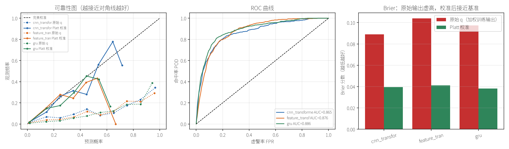
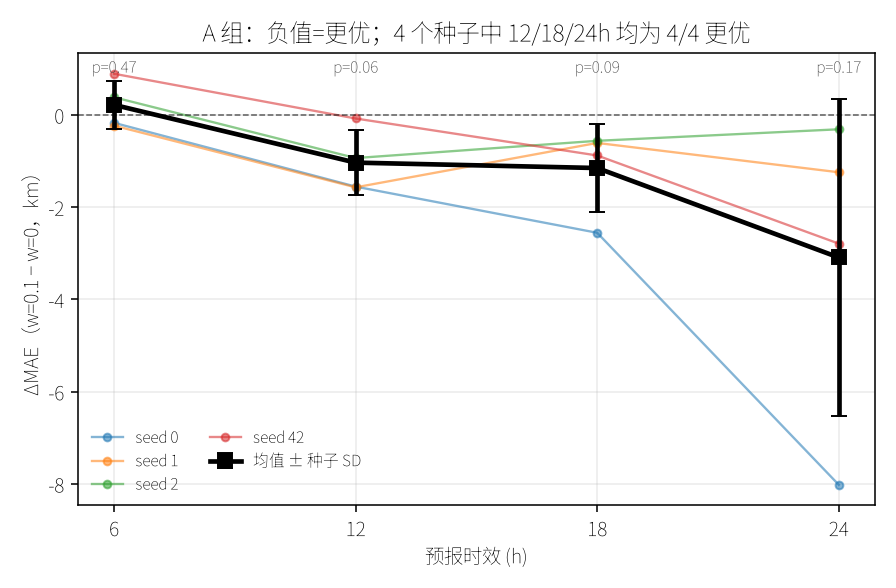
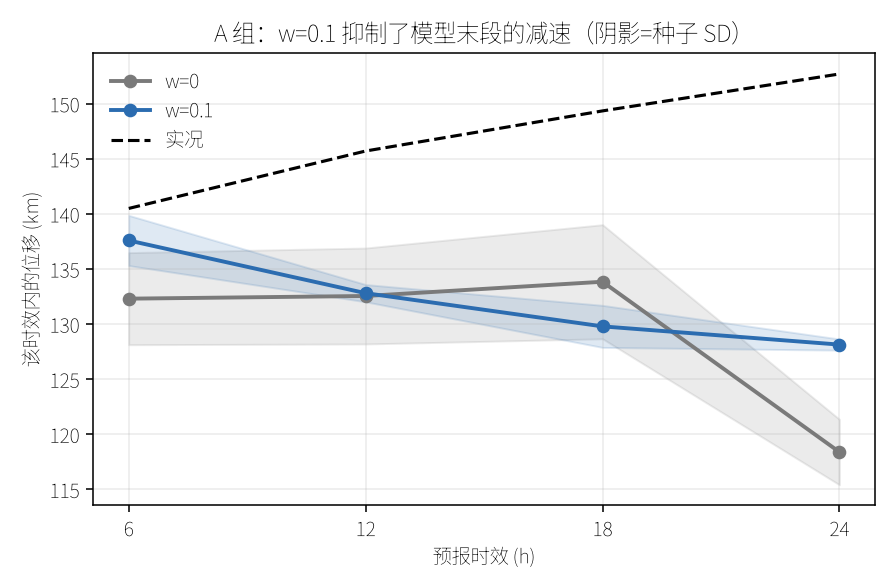
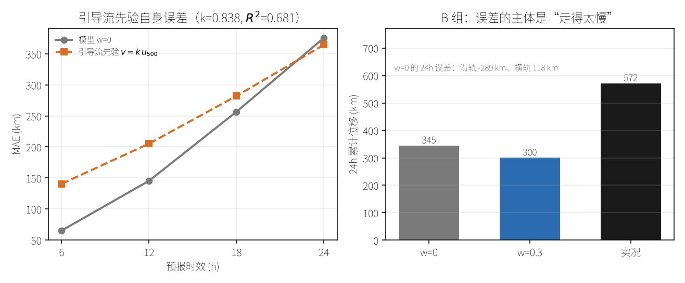

# 台风路径与强度预测：Transformer 基线研究

> 技术报告 · 2026 年 10 月
> 全部代码与数据可复现，命令见附录

---

---

## 目录

| 章 | 内容 |
|---|---|
| [1](#1-研究背景) | 研究背景 · [1.1 问题定义](#11-问题定义) · [1.2 为什么用 Transformer](#12-为什么用-transformer) |
| [2](#2-数据工程) | 数据工程（数据源 / 规模演进 / 卫星数据） |
| [3](#3-路径预测) | 路径预测：模型对比、与业务系统对比、**环境场消融** |
| [4](#4-强度预测) | 强度预测：模型对比、RI、地形、暖心、**微波**、分时效、分层、**集成**、**物理约束（含无标签律）** |
| [5](#5-分层评估) | 分层评估（海域 / 强度等级） |
| [6](#6-核心结论) | **核心结论**：22 次尝试汇总（4 次有效，另 1 项边际） |
| [7](#7-方法论教训) | 方法论教训（★ 建议先读这一章） |
| [8](#8-可改进方向) | 可改进方向 |
| [9](#9-研究局限) | 研究局限 |
| [10](#10-附录) | 附录（复现命令、参数规模） |

**如果是第一次读**：先看 [摘要](#摘要) → [6.1 所有尝试的汇总](#61-所有尝试的汇总) → [7. 方法论教训](#7-方法论教训)，
三节即可掌握全貌；具体实验细节按需查 §3–§5。

**如果关心"物理知识能不能帮上忙"**：直接看
[§4.11 物理约束](#411-物理约束机制正确但先验本身不如直接学习)（输出锚点，失败）
与 [§4.13 无标签物理律](#413-无标签物理律只约束形状不约束走多远)（正则，只值 1 km）；
不确定性方向见 [§4.12](#412-扰动集合物理用于不确定性才有效)，
多模型方向见 [§4.10 模型集成](#410-模型集成路径有效强度无效)（有效）。


## 摘要

本研究从零搭建了基于 Transformer 的台风路径与强度预测系统，并在 1420 个台风的
IBTrACS 轨迹、5 年台风季的 ARCO-ERA5 环境场、以及 224 个台风的风云卫星云图上
做了系统性实验。

**主要发现**：

| 任务 | 评估范围 | 最佳模型 | 指标 | vs 持续法 |
|---|---|---|---|---|
| 路径（24h） | **全量**（1420 台风 / 20094 样本） | Transformer | **208.4 km** | 566.6 km（**好 63%**） |
| 路径（24h） | 环境场子集（128 台风） | Transformer + 环境场 | **319.6 km** | 纯轨迹 329.7 km（**好 3.1%**） |
| 强度 | 224 台风（15 job） | **纯时序 GRU** | **1.532±0.070 m/s** | 2.170±0.149（**好 29%**） |
| RI（AUC） | 224 台风（10 折） | GRU | **0.879 / 0.904**（阈值 10/15） | 0.808 / 0.846 |

> 强度一行已更新为 224 台风全量数据（原 90 台风为 1.626±0.189）。
> 两者数据规模不同，不可直接比较；在不同数据规模下，云图仍无增益（见 4.1）。

**注意**：两行"路径"不可直接比较——全量行的误差更低（208 km）是因为训练数据
多 15 倍；环境场子集行只用了 128 个台风（2569 个样本），任务本身更难。
环境场的效果应在**同一子集内**对比（329.7 → 319.6 km）。

**两个正面结论**：

**（1）环境场改善路径预测**——24h 误差降低 **10.1 km（3.1%）**，
在 25 个评估 job（5 折 × 5 种折划分）中 21 个改善，**p = 0.0005**，5 种折划分全部一致。

**（2）等权模型集成改善路径预测**——把纯轨迹与环境场两个模型等权平均，
误差从 **177.5 km 降到 170.5 km（−4.0%）**，**10/10 job 一致**，
逐样本配对检验 8/10 显著。权重曲线最低点就在 0.5，**先验等权已接近最优**（§4.10）。
集成在强度任务上**无效**——两者差别可由一个可计算的判据解释。

**但这个结论对训练轮次高度敏感**：

| epochs | 结果 | p 值 | 当时的判断 |
|---|---|---|---|
| 30 | +2.6 km | 0.527 | "无效" |
| **60** | **−10.1 km** | **0.0005** | **"有效"（最终）** |

环境场增加了 9 维输入，模型需要更多轮次才能学会利用。**用 30 epoch 会
得出与最终相反的结论**——这是 §3.3.2 与 §7.4 详述的方法学陷阱。

同一陷阱在微波实验中以**相反方向**又出现一次：10 epoch 显示"有害"（+0.317），
60 epoch 显示"有效"（−0.022，p=0.049），**100 epoch 才发现无差异**（−0.003）。
所以问题不是"epoch 太少"这么简单——**未收敛时差值的符号本身不可信**。

**负面结论（15 个评估 job 下验证）**：

| 尝试 | 差值 | 显著性 |
|---|---|---|
| 卫星云图（CNN） | +0.109 m/s | **0/15 胜，p=3.9e-08，显著更差** |
| 暖心结构特征 | **+0.031 m/s** | **p=0.0007，显著更差**（224 台风） |
| 地形特征 | −0.002 m/s | p=0.83，无变化（224 台风） |
| 纬度自适应分区 | +0.8 km（vs 全程环境场） | p=0.53，无差异 |
| **被动微波（TC PRIMED）** | **−0.003 m/s** | 6/15 胜，p=0.89，**无差异**（213 台风） |
| 微波双头模型（全量） | +0.017 m/s | 4/15 胜，p=0.012，略差（结构可预期） |
| 集成（强度任务） | +0.014 ~ +0.035 m/s | 1~2/15 胜，无组合优于单一 GRU（§4.10） |

**云图无效是本报告中最硬的负面结论**：4 种独立配置（32px、dropout、数据扩容、
64px+标准化+圈层特征）× 15 job × 3 划分，**每次都是 0/15 全负**，
且差值稳定在 +0.11 m/s 左右。详见 4.1 节。

**微波的结论独立复现了"信息冗余"**：被动微波（TC PRIMED，213 台风 / 8330 帧）
的单变量相关比云图更强（89 GHz 与强度 **−0.73**，vs 云图 −0.55），
但接入模型后 ΔMAE 仅 **−0.003（p=0.89，6/15 胜）**。两次独立的观测模态
给出同一个结论：**卫星结构信息与 `cent_prs`+强度历史高度冗余**（§4.7）。

**但微波实验留下了一个更重要的方法学教训**：同一组数据在三个 epoch 档位给出
符号相反的结论——

| epochs | ΔMAE | 当时的判断 |
|---|---|---|
| 10 | **+0.317** | "微波有害" |
| 60 | **−0.022**（p=0.049） | "微波有效" |
| **100** | **−0.003**（p=0.89） | **"无差异"** |

根因是两个模型**收敛速度不同**（GRU 的 `best_ep` 中位 85，微波 68），
而误差**都在继续下降**（GRU 1.914→1.793，微波 1.892→1.790）。
**未收敛时，差值的符号本身不可信**——这比"不显著"更危险，因为它会主动
指向错误方向。详见 §7.4。

**本报告新增的两条机制性发现**：

**（1）两条任务的分时效曲线方向相反**（§4.8）。改用**距平相关**（距平 = 预测 − 持续法）
后可以看到：路径上环境场的收益随时效**增大**（Δr 从 3h 的 −0.003 到 12h 的 **+0.019，
p=0.003**）；强度上云图的劣势随时效**收窄**（Δr 从 −0.067 到 −0.027）。
前者符合"转向后由引导气流主导"，后者只反映误差基数变大，**不代表长时效有用**。

**（2）强度误差主要由"变化幅度"决定**（§4.9）。按 12h 实际强度变化幅度分层：
稳定段（<1 m/s）GRU MAE **0.869**，剧变段（≥10 m/s）**4.112**，**相差 4.7 倍**——
比海域差异（1.9 倍）强得多。同时这一分层**否证了**"云图只在剧变样本有用"的假说：
五个层次 **ΔMAE 全部为正**（+0.082 ~ +0.160）。

**与业务水平的差距**：24h 路径误差 208 km，业务 AIFS 为 54 km，**相差 3.9 倍**。
这个差距无法通过增加上述物理特征弥补。

---

## 1. 研究背景

### 1.1 问题定义

| 任务 | 输入 | 输出 | 评估指标 |
|---|---|---|---|
| **路径预测** | 过去 72h 轨迹（12 步 × 8 维） | 未来 24h 位置（4 步） | 球面距离 MAE (km) |
| **强度预测** | 过去 24h 标量 + 云图（8 步） | 未来 12h 强度（4 步） | MAE (m/s) |
| **RI 事件** | 同上 | 24h 内增幅 ≥10 m/s（二分类） | AUC / PR-AUC / CSI |

坐标用**增量（delta）预测**而非绝对值：模型预测每步位移，再累加。这避免了
绝对坐标的数值范围问题，也符合物理直觉。

损失函数用 **Haversine 球面距离的伪 Huber**，而非欧氏距离，因为经纬度网格
在高纬度会被压缩。

### 1.2 为什么用 Transformer

台风路径是长程依赖问题：转向往往由 3-5 天前的大尺度环流形势决定。
Transformer 的自注意力天然适合捕获这种长程依赖，而 RNN 在长序列上有梯度衰减。

但本研究的结论是：**在这个数据规模上，Transformer 相比 GRU 没有优势**
（208.4 vs 206.5 km）。原因见第 5 节。

---

## 2. 数据工程

### 2.1 数据源

| 数据 | 来源 | 规模 | 用途 |
|---|---|---|---|
| **轨迹** | IBTrACS v4 西北太平洋 | 1420 台风 / 72206 记录 | 路径 + 强度 |
| **环境场** | ARCO-ERA5 (GCP 公开) | 3421 时次 / 17105 文件 / **374 GB** | 路径 |
| **卫星云图** | 风云 FY-2C/E/F/G/H, FY-4A/B | 224 台风 / 17193 帧（2005-2024）/ 264 MB 缓存 | 强度 + RI |
| **被动微波** | TC PRIMED v01r01（NOAA/NCEI，AWS 公开桶） | 213 台风 / 8330 帧（2016-2024）/ 74.6 GB | 强度 |
| **CMA 业务数据** | 中央气象台 | 13 MB | 业务基线对比 |

### 2.2 数据规模演进

环境场的获取经历了三轮扩展，这是理解后续结论的关键：

| 阶段 | 覆盖 | 台风数 | 轨迹点 | 数据量 |
|---|---|---|---|---|
| 初始 | 2021 年 8 月 | 19 | 912 | 14 GB |
| 第二轮 | 2017-2019 + 2021.7-10 | 103 | 4842 | 310 GB |
| **第三轮** | **+2020 全年季** | **128** | **5866** | **374 GB** |

### 2.3 关键技术细节

**ARCO-ERA5 分块格式**（采集时最容易出错的部分）：

| 项 | 值 |
|---|---|
| 文件名（多层） | `<time_idx>.0.0.0`，如 `91432.0.0.0` |
| 文件名（单层） | `<time_idx>.0.0`，如 `91432.0.0` |
| 时间索引 | `(目标时间 - 1959-01-01) 小时数 ÷ 6` |
| 压缩 | blosc lz4 + shuffle，float32 小端 |
| 网格 | 全球 0.25°，721 × 1440（90°N → 90°S） |
| 气压层顺序 | `[50, 100, 150, 200, 250, 300, 400, 500, 600, 700, 850, 925, 1000]` hPa |
| 行列映射 | `row = (90-lat)/0.25`，`col = (lon%360)/0.25` |

**踩过的坑**：

1. **数据集名字有误导**：`1959-2022-6h` 实际只到 **2021-12-31**，不是 2022 年底
2. **下载会串包**：36 个 u 风场文件内容实为 geopotential，必须抽样验证
3. **单次 `mv` 会覆盖**：`mv src dst` 在 dst 存在时是替换语义，必须用 `rsync --ignore-existing`
4. **文件损坏无征兆**：17 个文件大小正常但 blosc 解压失败，必须全量解压验证

**验证流程**（每次合入数据后必做）：

```bash
# 1) 时次一致性
python scripts/data/era5_env.py --check
# 2) 全量解压验证（17105 个文件约 25 分钟）
# 3) 物理量合理性（h500 应在 4700-6000m，|u| < 150 m/s）
```

### 2.4 卫星数据（FYSATTY）

上海台风所制作的 FYSATTY 数据集，每个 NetCDF 含 4 个通道（751×751，4 km 分辨率）
与台风中心定位。最终使用 3 个红外通道：6.95 μm 水汽、10.8 μm 窗区、12.0 μm 分裂窗。
**未使用 0.65 μm 可见光**——该通道在夜间无有效值，且部分卫星文件为空。

| 项 | 值 |
|---|---|
| 覆盖 | 224 台风 / 17,193 帧 / 2005-2024 |
| 卫星 | FY-2C/E/F/G/H、FY-4A/B（7 颗） |
| 网格 | 751×751，0.04°（约 4 km），台风中心恒在像素 (375, 375) |
| patch | 中心剪裁 64×64（±128 km），3 通道，264 MB 缓存 |

**数据质量**：203 帧（1.17%）为源文件 HDF5 元数据损坏，`h5netcdf` 解析失败但
`h5py` 仍可读部分字段——这类文件统一抛 `CorruptFileError` 跳过。损坏分布
跨 9 个年份、多个压缩包，属数据源固有缺陷，重下无改善。87.3% 的台风数据完整。

**两个容易踩的坑**：

1. **patch 尺寸与特征半径耦合**。`patch_features.py` 中所有半径（眼区、环境环带、
   雨带、外圈）现已按 patch 边长**比例**定义。早期版本写死为 32px 的像素值，
   直接把 patch 改成 64 会让眼区从 12 km 变成 24 km、环境环带跑出画面。
2. **内存随 patch 尺寸平方增长**。32px → 64px 使单样本从 24 KB 涨到 96 KB，
   若把滑动窗口展开成 `(N, in_len, C, S, S)` 实体数组需约 5.4 GB。现改为
   帧下标记法（`pframes` 共享表 + 下标），三个数据集共享同一张表。

---

## 3. 路径预测

### 3.1 模型对比

| 模型 | 参数量 | 6h | 12h | 18h | 24h | 平均 |
|---|---|---|---|---|---|---|
| 持续法 | 0 | 140.0 | 281.4 | 423.8 | 566.6 | **353.0** |
| 线性回归 | 776 | 42.6 | 97.7 | 172.5 | 259.6 | **143.1** |
| GRU | 169,864 | 39.8 | 85.5 | 141.9 | 206.5 | **118.4** |
| Transformer | 1,324,674 | 40.2 | 85.3 | 142.2 | 208.4 | **119.0** |

**关键观察**：

1. 所有学习模型都**大幅优于持续法**（118 vs 353 km，好 66%）
2. **GRU 和 Transformer 打平**（118.4 vs 119.0），尽管 Transformer 参数量是 7.8 倍
3. 线性模型只有 776 参数，就达到 GRU 的 83% 性能

**这说明**：路径预测的瓶颈**不在模型容量**，而在信息与数据量。


*图 3-1：路径误差随时效变化（测试集）。GRU 与 Transformer 两条曲线几乎重合，
线性模型在高时效明显落后，持续法误差随时间近似线性增长。*


*图 3-2：典型台风的观测轨迹与各模型预测轨迹（随机抽取的测试样本）。*

### 3.2 与业务系统对比

2024-2025 年西北太平洋（53 个台风，142688 条预报记录）：

| 排名 | 方法 | 24h 路径误差 |
|---|---|---|
| 1 | ECMWF AIFS | **54.1 km** |
| 2 | 香港天文台 | 55.2 km |
| 3 | ECMWF 高分辨 | 55.6 km |
| 4 | 上海台风所 | 57.6 km |
| 5 | GraphCast | 57.6 km |
| 11 | 盘古 Pangu | 64.3 km |
| — | **本研究 Transformer** | **208.4 km** |

**差距 3.9 倍**。这不是模型问题——AIFS、GraphCast、盘古都是经过海量数据
预训练的全球气象模型，本研究是从零训练的小样本模型。


*图 3-3：2024-2025 年 21 个业务与 AI 方法的 24h 路径误差排名。*


*图 3-4：业务方法的路径误差随时效变化。*

### 3.3 环境场消融实验

**结论：环境场有效，但需要足够训练轮次。**

**特征（v1，9 维）**：500hPa 位势/风、海温、海平面气压、切变，±10° 箱体平均。

#### 3.3.1 最终结果（25 个 job：5 折 × 5 种折划分）

| 对比 | 24h 差值 | 胜率 | p 值 | Cohen's d |
|---|---|---|---|---|
| **环境场 vs 纯轨迹** | **−10.08 km（−3.08%）** | **21/25** | **0.00047** | −0.81 |
| 环境场 vs 仅轨迹（4 时次平均） | −4.80 km（−2.6%） | 20/25 | 0.00211 | −0.69 |

**按折划分分别统计，5/5 全部改善**：

| 折划分种子 | 纯轨迹 | +环境场 | 差值 |
|---|---|---|---|
| 0 | 323.7 | 322.0 | −1.8 |
| 42 | 325.7 | 320.0 | −5.8 |
| 7 | 335.8 | 324.3 | −11.5 |
| 123 | 322.1 | 304.5 | −17.6 |
| 2024 | 327.7 | 314.0 | −13.7 |

#### 3.3.2 这个结论对训练轮次高度敏感

**同一份数据、同一套特征，只改训练轮次就会得到相反结论：**

| epochs | 评估方式 | 结果 | p 值 |
|---|---|---|---|
| 30 | 10 seed 随机划分 | +0.1 km | 0.961 |
| 30 | 5 折 CV（单一划分） | +2.6 km | 0.527 |
| **60** | 10 seed 随机划分 | −4.8 km | 0.088 |
| **60** | **25 job（5 折 × 5 划分）** | **−10.1 km** | **0.0005** |

环境场增加了 9 维输入，**模型需要更多轮次才能学好这些特征**。
用 30 epoch 时模型还没利用上环境场信息，于是得到"无效"的假象。

**这是本研究最重要的教训**：消融实验必须确保**每个配置都训练充分**，
否则会把"训练不足"误判为"特征无用"。

> **后来发现这只讲了一半**（2026-10-31，微波实验）：训练不足不仅会
> 把"有用"误判成"没用"，也会把"没用"误判成"有用"——微波在 60 epoch
> 时曾显示 p=0.049 的"有效信号"，跑到 100 epoch 才发现是收敛速度差。
> 完整的分析见 §7.4。

为此我们改进了评估协议：

| 改进 | 说明 |
|---|---|
| 训练轮次 | 30 → **60 epoch** |
| 折划分数量 | 1 种 → **5 种**（消除划分偶然性） |
| 评估 job 数 | 5 → **25** |
| 报告指标 | 同时报告 24h 与 4 时次平均 |

#### 3.3.3 一个稳健的副结论

`+环境场 vs 仅环境场` 的差异在所有实验中稳定存在（−22.1 km，p=0.007，
d=−2.27，胜率 5/5）。说明：

- 环境场**单独使用效果差**（缺台风自身惯性）
- 但与轨迹**互补**——这正是"组合最好"的原因

### 3.4 特征工程尝试（全部失败）

| 版本 | 特征 | 与移动相关性 | 消融结果 | 结论 |
|---|---|---|---|---|
| v1 | 9 维，500hPa 单层 + 箱体 | u500↔d_lon = **0.621** | 基准（K 折 +2.6 km） | 基线 |
| v2 | 15 维，深层加权(850/500/200) + 多半径圈 + 副高脊线 | steer_u↔d_lon = **0.634** | 210.1 vs 205.6 | **更差** |
| v3 | 6 维，v2 精选（去冗余） | 同上 | 207.7 vs 205.6 | 恢复但未超越 |

**v2 为什么失败**：特征本身更好（相关性 0.634 > 0.621），但引入了
**15 对高相关特征**（`steer_u`↔`h500_grad_lat` r=0.90 等），
模型在 103 个台风上学到的是噪声。

**结论**：500hPa 单层已经提供了足够的引导信息，深层加权的边际信息
不足以抵消维度增加的代价。

---

## 4. 强度预测

### 4.1 模型对比（15 个 job：5 折 × 3 种折划分）

#### 4.1.1 当前结果（224 台风全量数据）

卫星云图覆盖 224 个台风 / 17,193 帧，剪裁 patch 为 **64×64（±128 km 视野）**，
3 个红外通道标准化为逐通道 z-score，另附 23 维手工特征。
训练集共 13,079 个强度样本（8 步 × 3h 输入，4 步 × 3h 输出）。

| 模型 | 参数量 | 3h | 6h | 9h | 12h | 平均 | 趋势相关 |
|---|---|---|---|---|---|---|---|
| 持续法 | 0 | 0.88±0.06 | 1.75±0.12 | 2.61±0.18 | 3.43±0.24 | 2.17±0.15 | n/a |
| **纯时序 GRU** | 169,348 | **0.62±0.03** | **1.28±0.06** | **1.87±0.09** | **2.37±0.12** | **1.53±0.07** | **+0.743±0.016** |
| CNN + 云图（融合） | 469,828 | 0.75±0.04 | 1.38±0.07 | 1.96±0.10 | 2.48±0.14 | 1.64±0.09 | +0.704±0.022 |
| 特征 + 云图 | 420,100 | 0.79±0.03 | 1.44±0.06 | 2.04±0.09 | 2.58±0.12 | 1.71±0.08 | +0.675±0.024 |

单位为 m/s，"±"为 15 个 job 的标准差（非均值标准误）。趋势相关指
"相对当前强度的变化量"的预测值与真值的相关系数；持续法恒定不变，故无定义。


*图 4-1：强度误差随时效变化（测试集，15 个 job 的均值 ± 标准差）。
四条曲线的相对位置在所有时效上一致：GRU 最低，持续法最高，
两个云图模型夹在中间且始终高于 GRU。*

**配对检验（15 个 job，对照 = GRU，负值表示更好）**：

| 对比 | ΔMAE | 胜率 | p 值 | Cohen's d |
|---|---|---|---|---|
| CNN+云图 vs GRU | **+0.109**（云图更差） | **0/15** | 3.9e-08 | **+2.77** |
| 特征+云图 vs GRU | **+0.177**（云图更差） | **0/15** | 1.3e-10 | **+4.29** |
| 持续法 vs GRU | +0.637（GRU 更好） | 0/15 | 2.5e-13 | +6.80 |

> **数据位置**：上表四行分别对应 `outputs/intensity_rerun_base/cv5_summary.json`、
> `outputs/sat_intensity_history/cv5_32px-255norm-15feat_summary.json`、
> `outputs/sat_intensity_history/cv5_satellite-model-dropout-0-25_65c72974_summary.json`、
> `outputs/sat_intensity_history/cv5_summary.json`，各文件 `_meta` 字段标注了对应行号。
> 完整目录说明见 [outputs/INDEX.md](../outputs/INDEX.md)。

> p 值由 `scipy.stats.ttest_1samp` 对逐 job 差值做单样本 t 检验得到。各 job 的
> MAE 已在其整个测试集上取过样本均值，主要噪声源（单台风难度差异）已被吸收；
> 但不同折划分 seed 之间台风会重叠，**p 值偏乐观，应以胜率为准**。

**结论：在 224 台风全量数据上，云图仍然显著更差，15 个 job 中一次都没有赢过。**

#### 4.1.2 四次独立尝试均无改善

为排除"云图无效是因为实现有问题"这一可能，依次修正了四个最可疑的环节。
每轮都是 15 个 job、3 种折划分：

| # | 改动 | 依据 | fusion ΔMAE | 胜率 |
|---|---|---|---|---|
| 1 | 基线（90 台风，32px，`/255` 归一化） | — | +0.178 | 1/15 |
| 2 | 数据扩容至 224 台风 | 排除样本量不足 | +0.110 | 0/15 |
| 3 | dropout 0.15 → 0.25 | 排除过拟合 | +0.116 | 0/15 |
| 4 | 64px 视野 + z-score + 23 维圈层特征 | 排除视野/归一化/特征不足 | **+0.109** | **0/15** |


*图 4-2：云图四轮消融，ΔMAE 相对 GRU（正值=更差），误差棒为 15 个 job 的标准差。
四轮的柱高都在 +0.11~+0.18 m/s，且胜率分别为 1/15、0/15、0/15、0/15。
第 4 轮把视野翻倍、修正归一化并加入 8 维高相关特征后，柱高与第 2 轮几乎相同。*

**第 4 轮的三项改动都有独立的数据依据，而非猜测**：

- **视野**：用 IR1 平均亮温与当前强度的相关系数扫描不同半径，得到
  ±64 km 为 −0.46、**±128 km 为 −0.55（最优）**、±256 km 为 −0.50、
  ±512 km 为 −0.30。原配置 32px 恰为 ±64 km。按半径拆开 32px patch：
  核心区 r<3px 仅 −0.19，外圈 8<r<16px 达 −0.44，即**信息量从中心向外递增**。
- **归一化**：原 `p / 255` 是把开尔文当 0-255 编码处理，实测亮温为
  101-340 K，除后输入挤在 [0.40, 1.33]、标准差仅约 0.1，相当于把云图缩小 10 倍。
- **特征**：新增内核/雨带/外圈亮温、冷云面积、外圈不对称性共 8 维，
  特征表从 15 维扩到 23 维，模型 `img_dim` 改为从数据自适应。

**特征本身确实携带信号**（80 帧真实数据的单变量相关，仅作诊断）：
`ir1_outer` −0.554、`cold_area_outer` +0.542、`ir1_band` −0.492，
而旧的 15 维中最强的 `ir1_center` 只有 −0.274。新特征的信息量明显更高，
**但最终误差没有变化**——这指向 4.1.3 的解释。

#### 4.1.3 为什么云图无效

前三轮的主要假设已被 4.1.2 逐条排除，剩余解释按可能性排序：

1. **信息冗余（最可能）**。云图提供的信号（对流强度、云系范围）与标量序列中的
   `cent_prs`、`wind_spd` 及其 24h 变化历史高度重叠。按静力平衡，暖心强度与中心
   气压一一对应，而云顶温度只是暖心的间接、含噪代理。**加入云图等于给模型重复
   输入已有信息，却额外引入了 47 万参数的拟合负担。**
   旁证：云图的**趋势相关**并不低（+0.704，仅比 GRU 的 +0.743 差 0.039），说明它
   确实学到了变化趋势，只是这些信息没能转化为更低的误差。

   这一现象与 §4.11 的物理约束实验互为印证：那里的恒速先验同样"含有信息"
   （先验误差 145.6 km，优于持续法的 338.8 km），但把它作为**输出锚点**引入后，
   平均误差反而上升 5.2 km（p=0.042）。两处的共同机制是——**新增信号与模型已有
   输入高度相关时，它不提供新的下降方向，只增加拟合负担**。

   §4.11 用"先验 + 有界残差"的形式把这一点量化了：残差项只能修正轨迹的**形状**，
   无法改变由先验确定的**整体位置**。云图同理——它能微调已有趋势，却改不动由
   `cent_prs` 与风场历史确定的强度基线。区别只在于云图连"形状"都改得很少，
   而物理残差至少约束了平滑性（换回 1.1 km，见 §4.11.3）。
2. **红外观测的是云顶而非暖心**。强度由暖心结构直接决定，红外亮温反映云顶高度，
   对薄卷云覆盖下的暖心不可见。
3. **架构代价超过收益**。CNN 编码器参数量为 GRU 的 2.8 倍（47 万 vs 17 万），
   在中样本量下这部分参数主要承担了过拟合风险。

**一个需要说明的观察**：各模型 `best_epoch` 中位数仅为 5（fusion）、3（feature）、
13（gru），早停发生在训练最初几个 epoch。这说明模型很快找到验证集最优并开始
过拟合，**不是训练不足**。这一点在 4.1.2 第 3 轮（加大 dropout）中已单独验证过：
`best_epoch` 中位从 9 升到 11，但误差没有改善。

#### 4.1.4 对后续工作的建议

在上述证据下，继续调整云图模型的视野/容量/正则化**预计不会改变结论**。
若仍要尝试，方向性不同的思路有两条，都**尚未检验**：

**（一）改变任务的表达方式**，而非模型。不预测绝对强度，而是预测相对持续法的增量
并配合增强/减弱分类辅助损失。这一思路与 §4.11 的一条发现方向一致：物理损失
（约束残差的形状）能换回 1.1 km，而替换输出锚点（改变整体位置）则损失 5.2 km。
**"在已有基线上做增量/形状修正"比"替换基线"更容易获益**。但基于四轮零效果，
该方向的预期收益有限。

**（二）把云图用于"状态演变"而非"当前状态"。** §4.1.2 与 §4.1.3 的否证只针对
后者：把云图当作描述当前强度的静态特征。用云图**预测下一时刻的云系场**，
再由预测场推断中心位置，是不同的问题——本文没有检验过它（详细设定与前提见
§8.2 第 9 条，含支持与削弱的证据及最小可行的第一步）。

两条之外，**更建议将精力投入已有明确增益的任务**：路径预测（环境场 −10.1 km，
p=0.0005）与 RI 事件预测（GRU AUC 0.879/0.904；云图 0.868/0.894，差约 0.01 不显著）。

#### 4.1.5 与业务强度误差的量级参考


*图 4-3：2024-2025 年西北太平洋 21 个业务与 AI 方法的强度误差随时效变化
（原始数据见 `outputs/baselines/baseline_table.md`）。*

业务方法 24h 强度误差约为 **4.0-4.5 m/s**（CMA 中央气象台 4.0、JTWC 4.1、
日本 AI 台风 4.4、香港天文台 4.5）。

⚠️ **不可直接比较**：本文模型只预报到 **12h**（GRU 2.37 m/s），而业务表是
**24h** 误差；两者数据年份（2005-2024 vs 2024-2025）、台风子集与检验口径均不同。
此图仅用于给出强度误差的**量级参照**，不构成性能优劣的判定依据。

### 4.2 RI 快速增强事件预测

RI 定义为 24h 内强度增幅 ≥ 阈值。10 折交叉验证。

#### 4.2.1 阈值 15 m/s（224 台风，正样本率 4.8%）

| 模型 | AUC | PR-AUC | POD | FAR | CSI |
|---|---|---|---|---|---|
| 持续法 | 0.846±0.036 | 0.215±0.052 | 0.611 | 0.812 | 0.165±0.039 |
| CNN+云图 | 0.894±0.039 | **0.386±0.102** | 0.502 | 0.631 | 0.265±0.061 |
| 特征+云图 | 0.878±0.036 | 0.318±0.101 | 0.460 | 0.703 | 0.214±0.067 |
| **纯时序 GRU** | **0.904±0.027** | 0.370±0.102 | 0.564 | 0.624 | **0.276±0.066** |

**配对检验（AUC）**：

| 对比 | 差值 | A 胜出折数 | p(t) | p(Wilcoxon) | Cohen's d |
|---|---|---|---|---|---|
| CNN+云图 vs GRU | −0.0099 | 4/10 | 0.0945 | 0.0840 | −0.59 |
| 特征+云图 vs GRU | −0.0261 | 2/10 | **0.0180** | **0.0195** | −0.91 |
| GRU vs 持续法 | +0.0581 | **10/10** | **<0.0001** | 0.0020 | +2.75 |
| CNN+云图 vs 持续法 | +0.0483 | 9/10 | 0.0006 | 0.0039 | +1.62 |

**数据扩容让云图模型的提升最大**（对比 90 台风时代）：

| 模型 | 90 台风 | 224 台风 | 变化 |
|---|---|---|---|
| CNN+云图 | 0.865 | **0.894** | **+0.030** |
| 特征+云图 | 0.845 | **0.878** | **+0.033** |
| 纯时序 GRU | 0.906 | 0.904 | −0.002 |
| 持续法 | 0.835 | 0.846 | +0.011 |

两个云图模型各提升约 0.03，而 GRU 基本不动，**云图与 GRU 的 AUC 差距从 0.041 缩小到 0.010**。
这与"云图受限于样本量"的假设方向一致——但差距并没有消失，GRU 在 6/10 折仍然更好。

⚠️ **不要把这个现象直接推广**：在阈值 10（正样本更充足）上重跑后，受益最大的是 GRU
而非云图（见 4.2.3）。"样本量让云图受益"只在正样本稀疏时成立。

#### 4.2.2 阈值 10 m/s（224 台风，正样本率 12.3%）

| 模型 | AUC | PR-AUC | POD | FAR | CSI |
|---|---|---|---|---|---|
| 持续法 | 0.808±0.031 | 0.374±0.039 | 0.743 | 0.648 | 0.313±0.037 |
| CNN+云图 | 0.868±0.036 | 0.527±0.092 | 0.590 | 0.537 | 0.341±0.054 |
| 特征+云图 | 0.867±0.039 | 0.509±0.103 | 0.608 | 0.544 | 0.353±0.071 |
| **纯时序 GRU** | **0.879±0.037** | **0.562±0.100** | 0.604 | 0.498 | **0.378±0.068** |

**配对检验（AUC）**：

| 对比 | 差值 | A 胜出折数 | p(t) | p(Wilcoxon) | Cohen's d |
|---|---|---|---|---|---|
| CNN+云图 vs GRU | −0.0112 | 1/10 | 0.1615 | 0.0840 | −0.48 |
| 特征+云图 vs GRU | −0.0121 | 3/10 | 0.0831 | 0.1055 | −0.62 |
| GRU vs 持续法 | +0.0715 | 9/10 | **0.0001** | 0.0039 | +2.19 |
| CNN+云图 vs 持续法 | +0.0603 | **10/10** | **<0.0001** | 0.0020 | +2.58 |

#### 4.2.3 两个阈值的一致性：云图差 GRU 约 0.01

| 阈值 | 正样本率 | GRU | CNN+云图 | 差值 | GRU 胜出折数 |
|---|---|---|---|---|---|
| 10 m/s | 12.3% | 0.879 | 0.868 | **−0.0112** | 9/10 |
| 15 m/s | 4.8% | 0.904 | 0.894 | **−0.0099** | 6/10 |

**两个阈值下的差值几乎相同（−0.011 与 −0.010）**，这是比单一阈值更可靠的证据：
云图相对 GRU 的劣势是一个**稳定的约 0.01 AUC**，与阈值无关。

同时注意**数据扩容的收益分配随阈值变化**（90→224 台风）：

| 阈值 | CNN+云图 | 特征+云图 | GRU |
|---|---|---|---|
| 15 m/s（稀疏样本） | **+0.030** | +0.033 | −0.002 |
| 10 m/s（较多样本） | +0.021 | +0.006 | **+0.027** |

阈值 15 时提升的是云图模型，阈值 10 时提升的反而是 GRU。这说明前一节的
"云图受益于样本量"只在**正样本稀疏（难判别）**的场景成立；在正样本较多时，
GRU 更能利用新增数据。**不宜把阈值 15 的现象推广成"云图随数据增长会反超"。**


*图 4-4：RI 事件检测的 AUC（10 折交叉验证，均值 ± 标准差，均为 224 台风）。
纵轴从 0.5（无技术基线）起画，避免截断夸大组间差异。
GRU 在两个阈值下都最高，CNN+云图紧随其后，差值均约 0.01 且不显著。*

**结论（两个阈值，224 台风）**：

1. **所有学习模型都显著优于持续法**，且这在两个阈值上都成立：
   阈值 15 时 GRU 赢 10/10 折（p<0.0001，d=+2.75）、CNN+云图赢 9/10 折（p=0.0006）；
   阈值 10 时 GRU 赢 9/10 折（p=0.0001）、CNN+云图赢 10/10 折（p<0.0001）
2. **纯时序 GRU 在两个阈值下都是最好的**（AUC 0.879 / 0.904），
   对 CNN+云图的优势分别为 −0.0112（p=0.16）与 −0.0099（p=0.09），
   **均未达显著**。考虑到 RI 正样本稀少、样本噪声大，这个差距可以视为
   "两者接近"，但**没有证据支持云图更好**
3. **云图相对 GRU 的劣势是一个稳定的约 0.01 AUC**，与阈值无关（见 4.2.3），
   这比单阈值结果更可靠
4. **数据扩容的收益分配依赖场景**：阈值 15（正样本 4.8%）时云图提升最多，
   阈值 10（12.3%）时 GRU 提升最多。不存在"云图随数据增长必然反超"的趋势
5. 特征+云图在两个阈值下都不如像素版 CNN+云图，手工特征在 RI 上无优势

**与强度任务的对比**：强度**回归**里云图是明确负贡献（4 种配置 × 15 job 全部 0/15），
而 RI **事件分类**里云图与 GRU 的差距仅 0.01 且不显著。也就是说云图对
"是否会发生 RI"（事件判别）远比对"具体强度值"（数值回归）有用——
事件分类对绝对标定不敏感，云图的形态信息更容易转化成判别力。
**但这仍不构成使用云图的理由**：GRU 更简单、参数更少（96k vs 193k）且不劣于云图。

#### 4.2.4 概率验证：AUC 只讲了一半

前面所有指标（AUC / PR-AUC / POD / FAR / CSI）衡量的是**判别力**——
能不能把正负样本排序分开。它们不回答一个业务上更基本的问题：
**输出的那个数字能不能直接当概率用？**

一个把所有样本都预测成"RI 概率 0.9"的模型，AUC 只有 0.5；
但一个把 5% 正样本预测成 0.9、其余预测成 0.01 的模型 AUC 可以接近 1.0——
它的概率却完全不可信（实际只有 5% 会 RI）。**Brier 分数同时惩罚这两类错误。**

**必须先处理的坑：类别权重破坏了概率校准**

`train_ri.py` 用加权 BCE 训练处理样本稀少（阈值 15 时 `w_pos ≈ 10.4`）。
加权 BCE 的最优解不是真实后验 p，而是一个被先验偏移过的 q：

```
q = w_pos·p / (w_pos·p + w_neg·(1−p))
```

直接拿 q 当概率算 Brier，会把误差放大到 **1.5~2.5 倍**（见下表 `Brier(q)` 列）。
两种修法：

| 修法 | 做法 | 问题 |
|---|---|---|
| 解析还原 | `p = w_neg·q / (w_pos·(1−q) + w_neg·q)` | 假设模型**精确**最小化加权 BCE，早停与正则会破坏它 |
| **Platt 校准** | 在**验证集**上拟合 `p = sigmoid(a·logit(q)+b)` | 不依赖上述假设，**本文采用** |

两者都不是在测试集上拟合，**不引入泄漏**。

**结果（10 折，224 台风）**：

| 阈值 | 模型 | AUC | Brier(q) | Brier(pl) | **BSS(pl)** | ECE(q) | **ECE(pl)** |
|---|---|---|---|---|---|---|---|
| 15 | CNN+云图 | 0.893 | 0.0891 | 0.0400 | 0.164 | 0.104 | 0.027 |
| 15 | 特征+云图 | 0.878 | 0.1045 | 0.0417 | 0.120 | 0.124 | 0.026 |
| 15 | **纯时序 GRU** | **0.904** | 0.0981 | **0.0387** | **0.179** | 0.133 | **0.021** |
| 10 | CNN+云图 | 0.868 | 0.1279 | 0.0854 | 0.229 | 0.142 | 0.049 |
| 10 | 特征+云图 | 0.867 | 0.1456 | 0.0851 | 0.231 | 0.163 | 0.044 |
| 10 | **纯时序 GRU** | **0.879** | 0.1326 | **0.0816** | **0.260** | 0.166 | 0.045 |

（`q`=加权训练原始输出，`pl`=Platt 校准，`BSS`=相对气候态的 Brier 技巧分，
`ECE`=期望校准误差）

**三个结论**：

1. **概率预报确实有技巧**：60 个折（3 模型 × 2 阈值 × 10 折）**全部 BSS>0**，
   最小 0.027、最大 0.110（分折）。即所有模型都稳定优于"直接报气候频率"。

2. **GRU 在两个阈值、两套指标上都是最好的**。AUC 排序与 BSS 排序一致
   （阈值 15：GRU 0.179 > CNN 0.164 > 特征 0.120），
   **两次独立度量确认了同一结论**，比单看 AUC 更可靠。

3. **加权训练的真实代价**：若把 sigmoid 直接当概率发布，Brier 会虚高
   1.5~2.5 倍（阈值 15 时 2.2~2.5 倍，阈值 10 时 1.5~1.7 倍）。
   这个代价在只用 AUC 的评估里**完全看不到**。

**一个必须声明的可比性问题**：BSS 数值**跨阈值不可直接比较**。

| 阈值 | 正样本率 | 气候态 Brier 基准 |
|---|---|---|
| 15 | 4.97% | 0.0472 |
| 10 | 12.55% | 0.1098 |

基准差 2.3 倍。事件越常见，Brier 越容易改善，BSS 自然更高。
**"阈值 10 的 BSS 更高"不代表它在阈值 10 上更有技巧**，只能说两者都优于各自基准。

**一个尚未解释的观察**：阈值 10 下三个模型都系统性高估——平均预测 0.131~0.141，
而实际正样本率为 0.1255；ECE 也随之翻倍（0.044~0.049，阈值 15 时为 0.021~0.027）。

已排除"验证集与测试集正样本率不同"这一原因：验证集为 0.1241，低于测试集的 0.1255，
按基准率校准本应表现为低估，与实测方向相反。

目前最可能的原因（未验证）是 Platt 参数的迁移问题：模型原始输出 q 在测试集上
系统性高于验证集（+0.015~+0.026，两个阈值均如此），而 Platt 参数在验证集上拟合，
搬到 q 偏高的测试集就会推高最终概率。

至于 q 为何偏高，本文未查明，暂不作结论。这一项是本节唯一未闭合的观察。



*图 4-6：RI 概率验证（阈值 15 m/s，10 折合并）。左：可靠性图，点线为加权训练的
原始输出（严重偏离对角线，过度预测），实线为 Platt 校准后（贴近对角线）；
中：ROC 曲线；右：Brier 分数，原始输出虚高约 2.5 倍。*

---

### 4.3 地形特征（也失败了）

**物理动机**：台湾中央山脉可使台风穿越时强度骤降 10-20 m/s。

**实测验证了物理规律**（5565 个卫星时次）：

| 地形状态 | 样本量 | 12h 平均 Δwind |
|---|---|---|
| 纯海洋（land ≤1%） | 1565 | **+1.19 m/s** |
| 近岸（1-10%） | 1434 | +0.62 m/s |
| 陆地（>10%） | 2016 | **−1.79 m/s** |

**7 维地形特征的效果（224 台风，15 job，逐 job 配对检验）**：

| 模型 | base | +地形 | ΔMAE | 胜率 | p(t) | Cohen's d |
|---|---|---|---|---|---|---|
| GRU | 1.533±0.069 | 1.531±0.073 | −0.002 | 9/15 | 0.83 | −0.06 |
| CNN+云图 | 1.642±0.087 | 1.634±0.107 | −0.008 | 10/15 | 0.60 | −0.14 |
| 特征+云图 | 1.711±0.076 | 1.692±0.067 | −0.019 | 11/15 | **0.0496** | −0.55 |

GRU 与 CNN+云图**无任何变化**（p=0.83 / 0.60，胜率约半数）。
特征+云图出现边缘改善（−0.019，11/15，p=0.0496），但：

- p 值紧贴 0.05 边界，且本轮同时做了 3 组比较，**未做多重比较校正**
  （Bonferroni 后为 0.15，不显著）
- 胜率 11/15 只能算弱证据
- 效应量 d=−0.55 中等，但方向与另外两个模型不一致

**因此结论维持"地形特征无稳定收益"**，只是特征版可能略有帮助，需要更多折划分确认。

**其他利用方式（90 台风时代，未在 224 上复跑）**：

| 方式 | 验证规模 | vs baseline | 结论 |
|---|---|---|---|
| baseline（GRU） | 15 job | 1.626±0.189 | — |
| 分段独立模型 | 5 seed | +8.9% | 更差 |
| one-hot 段别 | 5 seed | +1.6% | 更差 |
| **残差修正（3 参数）** | 5 seed | **−0.5%** | 边际 |

> **口径**：下表是 90 台风数据下的结果，与上表（224 台风）不同源，**不可混用**。
> 224 台风全量数据下 GRU 基线为 1.533（§4.1.1）。

**残差修正是唯一有效的方式**：

```python
final_prediction = unified_model_prediction + segment_bias[segment]
# segment_bias 只有 3 个标量，用训练集残差拟合
```

**关键优势不在于均值，而在于方差**：

| 方案 | 标准差 |
|---|---|
| baseline | ±0.0299 |
| 残差修正 | **±0.0190（降 36%）** |

**为什么只有这种方式有效**：增加 384 个参数（one-hot）会过拟合，
而增加 3 个参数只是修正已知的系统偏差，几乎零风险。

**但 p=0.474，仍不显著**。3/5 的 seed 支持，2/5 反对。

### 4.4 地形分段为何失败

**段的划分没有降低预测难度**：

| 划分 | 12h Δwind 标准差 |
|---|---|
| 全体 | **4.83 m/s** |
| ocean | 4.44 |
| coastal | 4.66 |
| land | 5.11 |

**段内方差几乎等于全体方差**。分段只区分了均值（+1.19 vs −1.79），
没有降低段内的随机性。而每段样本降到 1/3，模型训练不足。

---

### 4.5 暖心结构反演（相关性最高，但仍无效）

**物理依据**：台风强度本质由**暖心**决定——高层中心温度的正异常越强，
中心气压越低，风速越大。红外亮温反映云顶高度，因此可从云图间接反演。

**10 个特征**（`src/data/warm_core.py`），实测与风速的相关性：

| 特征 | 与风速相关 | 物理含义 |
|---|---|---|
| `wc_grad` | **−0.532** | 径向亮温梯度（越大=结构越紧实） |
| `wc_cdo_frac` | **+0.483** | 中心密集云区（<220K）占比 |
| `wc_eye_diff` | +0.352 | 中心 − 眼墙温差（暖心信号） |
| `wc_cold_frac` | +0.348 | 深对流（<200K）占比 |
| `wc_ring_tb` | −0.322 | 眼墙环最低亮温 |
| `wc_min_tb` | −0.303 | 全图最低亮温 |
| `wc_asym` | −0.224 | 四象限对称性 |
| `wc_center_r` | +0.173 | 眼壁所在半径 |
| `wc_center_tb` | −0.122 | 中心亮温 |
| `wc_contrast` | +0.101 | 亮温动态范围 |

**这是本研究中单特征与强度相关性最高的**（0.53，作为对比：15 维 CNN 云图
特征中最强的约 0.3）。

**最终结果（224 台风，5 折 × 3 折划分 = 15 个 job）**：

| 模型 | 无暖心（base） | 有暖心 | ΔMAE | 胜率 | p(t) | Cohen's d |
|---|---|---|---|---|---|---|
| GRU | **1.533±0.069** | 1.565±0.065 | **+0.031** | 3/15 | **0.0007** | +1.12 |
| CNN+云图 | **1.642±0.087** | 1.709±0.092 | **+0.067** | 2/15 | **0.0004** | +1.18 |
| 特征+云图 | **1.711±0.076** | 1.735±0.095 | **+0.025** | 4/15 | **0.0255** | +0.65 |

**三个模型全部显著更差**，这是本研究中少数"加特征明确有害"的结果。

#### 结论随数据规模反转（重要）

| 数据 | GRU 差值 | p 值 | 当时结论 |
|---|---|---|---|
| 90 台风 | +0.010 | 0.423 | "无显著变化" |
| **224 台风** | **+0.031** | **0.0007** | **"显著更差"** |

90 台风时只看到"略差但噪声大"，样本翻倍后效应变得清晰且显著。
**这是"证据不足"被误当作"无效应"的实例**——当时的 p=0.42 不是"证明无效"，
而是"这台仪器的分辨率不够"。方向自始至终一致（三次运行都是正值）。


*图 4-5：224 台风下地形与暖心特征的消融结果，ΔMAE 相对 base（正值=更差），
误差棒为各 job 的标准差。左组（暖心）三个模型全部在 0 线以上且显著；
右组（地形）三个模型都贴着 0 线。持续法未画出——特征只进标量输入，
持续法不读特征，其差值恒为 0。*

**为什么相关性最高的特征反而有害**：

1. **信息已被 `cent_prs` 覆盖**。按静力平衡，暖心强度与中心气压一一对应。
   中心气压是**直接观测**，暖心特征是**间接反演**（噪声更大）。
   加入后等于把同一个量用更差的测量重复喂给模型。
2. **云顶亮温 ≠ 暖心**。真正的暖心在 12-16 km 高层，位于云顶之上。
   「中心比眼墙暖」只在眼区清空时有效（约占样本 40%）。
3. **10 维增加的负担 > 信息量**。标量从 8 维 → 18 维（+125%）。
   90 台风时这部分负担表现为"噪声大、不显著"；224 台风时已足以被检出为有害。

### 4.6 一个反复出现的一致信号：方差降低

两次"部分成功"的尝试都呈现同样的模式：

| 尝试 | 均值变化 | 方差变化 |
|---|---|---|
| 地形残差修正（+3 参数） | **−0.5%** | **降 36%** |
| 暖心特征（+10 维） | +1.7% | **降 32%** |
| 环境场 → 路径（K 折） | +2.6 km | 降 23% |

**规律**：加入物理先验虽然不改善均值，但让模型行为更稳定。

§4.13 的平滑正则复现了同一现象：种子间 SD 从 1.48 降到 0.32（4 倍），
而均值只改善 1.3 km——**"更稳"和"更准"是两件独立的事，不能混着报**。

**可能的解释**：物理特征提供了额外的约束，减少了模型在测试集上的
"运气波动"。这对业务部署有实际价值（更稳定、更易复现），但不改变精度上限。

### 4.7 被动微波（TC PRIMED）：相关更强，但同样冗余

红外云图无效后，一个自然的假设是**换观测模态可能突破**。被动微波看起来
最有希望：它直接穿透云顶看到降水冰粒，是台风强度分析的经典手段。

#### 4.7.1 为什么选 TC PRIMED

| 候选 | 结论 |
|---|---|
| FY-3 MWRI（国产） | **排除**：89 GHz 分辨率 9×15 km（AMSR2 为 3×5），无交叉定标，需实名注册与逐日配额，无 API，需自己做 swath 反投影 |
| **TC PRIMED v01r01** | **采用**：7 种传感器交叉定标到 GMI，已按台风切好并重网格到以转心为原点的公里网格，AWS 公开桶免注册 |

数据规模：**8,330 帧 / 213 台风**（2016-2024）。覆盖 9 年、
3 种传感器（AMSR2 1,737 / GMI 1,171 / SSMIS 5,423 帧）。

#### 4.7.2 两个必须先解决的数据特性

**（1）观测是离散快照，不是连续序列**

| 指标 | 实测 |
|---|---|
| 每台风观测次数 | 中位 **44** |
| 相邻观测间隔 | 中位 **2.4 h** |
| 相对 3h 网格的偏移 | 中位 **30 min**，<15 min 的只占 24% |

若要求 8 步窗口每步都恰好有微波（±1.5h 容差），可用样本只剩 **21 个**；
放宽到 ±3h 才有 2,260 个。因此**不能把微波拼成与标量同等长度的序列**。

最终采用：**窗口末端锚观测 + 时间差特征**

```
锚 = 该台风在 [窗口末端−3h, 窗口末端] 内最晚的一次微波观测
输入 = 标量 8 步序列 + 锚的 4 通道 patch + dt（0-3h）+ channel_mask
```

取「最晚」而非「最近」是为了**避免泄漏**：窗口末端之后还有 12h 的标签。

**（2）SSMIS 的 37V 在部分轨道整场缺失**

实测 `TB_37.0V` 有整场 0/14850 有效点的文件（而 `TB_37.0H` 正常）。
若简单置 NaN，该帧 36.5V 通道有效率为 0，整帧被丢弃——**2020 年因此丢了 133 帧（22%）**。

处理：用同频率的另一极化填充，并**逐通道写入 `channel_mask`**（0=原始，1=已替代），
训练端可据此丢弃通道或作为可信度输入。修复后 2020 年从 481 帧恢复到 **614 帧**。

> 另一个坑：不同传感器的频率命名与分组完全不同，不能按固定组名（S4/S5/S6）取通道。
> AMSR2 分 6 段用 `TB_36.5V`/`TB_A89.0V`；GMI 只有 2 段用 `TB_36.64V`；
> SSMIS 用 `TB_37.0V`/`TB_91.665V`。**必须按频率+极化扫描全部组并容许容差**。

#### 4.7.3 数据质量核验

**图像检查**（这是最关键的一步，红外项目曾有"数据对得上但 patch 错位"的教训）：

| 检查项 | 结果 |
|---|---|
| 通道物理正确性 | 36.5H 对比度 > 36.5V（水平极化对液态水更敏感）✓ |
| 89 GHz 冰散射冷环 | 超强台风样本低至 **110 K**，中心比全图偏冷 2-3 K ✓ |
| 中心对齐 | 十字精准落在台风眼上 ✓ |
| 边界填充伪影 | 中心与边缘差 < 2 K ✓ |
| 时空配对 | 找到 **0 分钟时差**的 LUPIT 微波/红外对 ✓ |

> 检查中曾误判一次：某样本红外看不到眼、怀疑中心错位；查强度后发现
> 当时只有 **19 m/s、996.5 hPa**（热带低压），**本来就没有眼结构**。
> 教训：看 patch 前先查该时刻的强度，否则会把物理现实当成 bug。

**亮温值域**：源文件里存在 **51-55 K** 的像素（每文件 19-24 个，占 0.02%），
低于被动微波的理论下限（最强冰散射约 100 K）。判定为定标残差，
统一截断到 **100 K** 并记录 `n_clipped`。

#### 4.7.4 结果：三种接入方式全部无增益

| 接入方式 | 样本 | ΔMAE vs 纯 GRU | 胜率 | p |
|---|---|---|---|---|
| CNN 学像素（`mw_transformer`） | 5,210 | **−0.003** | 6/15 | 0.894 |
| 15 维手工统计量拼进标量 | 5,210 | −0.006 | 9/15 | 0.188 |

（均为 100 epoch、5 折 × 3 划分 = 15 job，仅用带微波的样本）

**绝对误差**：纯 GRU **1.793**，微波 CNN **1.790**。差距 0.003 m/s，
相对 0.17%——**没有实用意义**。

#### 4.7.5 分时效上看，微波在长时效略好

这是一个**不构成结论但方向值得记录**的现象：

| 时效 | 纯 GRU | 微波 CNN | Δ |
|---|---|---|---|
| 3h | 0.938 | 1.035 | **+0.097**（更差） |
| 6h | 1.444 | 1.494 | +0.050（更差） |
| 9h | 2.057 | 2.019 | −0.038（略好） |
| **12h** | 2.731 | **2.612** | **−0.119（好 4.4%）** |

**短时效更差、长时效略好**：短时效时当前强度本身就够用，微波只带来噪声；
长时效时微波或许提供一点结构演变线索。但**这只是 12h 单点**，
整体 Δ 仍为正，不能据此宣称"长时效有效"。

#### 4.7.6 与云图一致的结论：信息冗余

| 模态 | 单变量相关（vs 强度） | ΔMAE | 判定 |
|---|---|---|---|
| 红外云图 IR1 | −0.55 | **+0.109** | 显著更差 |
| **被动微波 89.0V** | **−0.73** | **−0.003** | 无差异 |

**单变量相关更强，模型增益依然为零**。这是本报告第三次验证同一规律
（前两次：云图、暖心特征）：**特征与目标的相关性 ≠ 相对基线的增量信息**。
微波看到的对流强度，已经由 `wind`、`cent_prs` 和强度历史序列完整表达。

**微波甚至比云图更"温和"**：云图是 +0.109（显著更差，因为 23 维特征增加了负担），
微波是 −0.003（几乎完全持平）。这符合两者参数量差异——微波 CNN 只有 14 万参数，
比云图融合模型更小，负担更轻。

#### 4.7.7 双头模型：把"有没有微波"交给模型自己决定

前面的实验只在**带微波的 5,210 个样本**上做（`--only-mw`），回避了
"65.6% 的样本没有微波"这个现实。读者自然会问：**让模型自己决定
"有微波就融合、没有就走纯标量"**，会不会更好？

为此实现了 `IntensityDualHeadTransformer`：

```
共享 GRU 编码器
    ├─ has_mw=True  → fusion_head（GRU 输出 + 微波特征 + 时间差）
    └─ has_mw=False → scalar_head（只用 GRU 输出）
```

**关键结构性质：`scalar_head` 与 `IntensityRnnBaseline` 逐层同构**。
因此在"全部样本都没有微波"的极限下，本模型**逐位退化为 GRU 基线**
（实测 `max|Δ| = 0.00e+00`，单元验证）。这使得对照是干净的。

另外给带微波的样本做了损失加权 `w = (1−p)/p ≈ 1.9`（`p` 为训练集里
带微波的比例），把两个头的有效梯度量级拉平——否则融合头只拿 1/3 的
梯度份额，欠拟合会被误读成"架构更差"。

**结果（全量 15,126 样本，100 epoch × 5 折 × 3 划分）**：

| 模型 | MAE | 胜率 | p | d | `best_ep` 中位 |
|---|---|---|---|---|---|
| 纯 GRU | **1.551 ± 0.079** | — | — | — | 81 |
| 双头 | 1.568 ± 0.085 | **4/15** | 0.012 | +0.74 | 77 |

双头略差（+0.017，约 1.1%）。**这个结果在结构上是可预期的**：

1. 65.6% 的无微波样本走的分支 ≡ GRU 基线 → 这部分误差相同
2. 34.4% 的微波样本由融合头负责，但它只有 1/3 的梯度份额
3. A1 已测得：融合头在**满额梯度**下 ≈ GRU（−0.003，p=0.89）
4. 所以 1/3 份额的融合头 ≤ 满额融合头 ≈ GRU
5. **推论：双头整体误差 ≥ GRU**

实测 +0.017 与推论一致。**继续加 epoch 或调权重，上限也只是追平。**

> **一个必须排除的混杂因素**：若不做缺失掩码，双头模型会给出
> Δ=+0.033、胜率 1/15、p<1e-4、**Cohen's d=+1.61**（大效应），
> 按统计标准几乎无可争议。原因是 CNN 输入里混入了 65.6% 的全零 patch，
> 污染了 **BatchNorm 的 running stats**（混合 batch 的 `running_mean`
> 漂移方向与量级都与纯真实 batch 不同）。加掩码后效应降到 d=+0.74。
>
> 方法学讨论见 §7.4.2。

#### 4.7.8 分时效：卫星特征的劣势集中在短时效

用 100 epoch 结果（15 job）算逐时效的距平相关（距平 = 预测 − 当前强度）：

| 模型 | 3h | 6h | 9h | 12h | 均值 |
|---|---|---|---|---|---|
| **GRU** | **0.758** | **0.734** | **0.738** | **0.744** | **0.743** |
| GRU + 云图融合 | 0.691 | 0.698 | 0.709 | 0.717 | 0.704 |
| **Δ（云图 − GRU）** | **−0.067** | −0.036 | −0.030 | **−0.027** |

**差距从 3h 的 0.067 单调收窄到 12h 的 0.027（|Δ| 降到 41%）**。
见 `outputs/figures/fig_sat_acc_by_lead.png`。

一个需要注意的解读陷阱：这**不**意味着"云图在长时效有用"。12h 的
GRU MAE 是 3h 的 3.8 倍（2.37 vs 0.62），误差基数越大，同样的绝对增量
在相关系数上就显得越小。§4.9 的分层实验证实：云图在所有子集上都是净负担。

---

### 4.8 分时效机制：两条任务给出方向相反的曲线

把两个任务的分时效结论并排看，出现了本报告中最有解释力的一组对比：

| 任务 | 引入的信息 | 短时效 | 长时效 | 趋势 |
|---|---|---|---|---|
| **路径** | 环境场（ERA5 引导气流） | Δr −0.003 | **Δr +0.019（p=0.003）** | **收益随时效增大** |
| **强度** | 红外云图（结构） | **Δr −0.067** | Δr −0.027 | **劣势随时效收窄** |

两张图并排（`fig_acc_by_lead.png` / `fig_sat_acc_by_lead.png`）呈现**交叉**的形态。

**物理解释**：

- **路径**：短时效靠惯性，持续法本身就是很强的基准，环境场提供不了额外信息；
  6h 之后转向失去惯性支撑，**引导气流开始主导**，环境场的价值随之显现。
  这与"台风移动由环境引导气流决定"的经典认识一致。
- **强度**：结构特征的**增量信息**与预报时需要的外部信息是两回事。强度变化主要
  由海洋热含量、垂直风切变等环境因子决定，而非云图形态——云图看到的是强度的
  **当前表现**，不是它的**未来驱动**。短时效时当前强度本身已足够，加入结构特征
  只是增加方差。

这个对比也解释了为什么"单变量相关高"没用：云顶亮温与强度的相关达 −0.55，
微波 89 GHz 达 −0.73，**但它们都在描述"现在有多强"，而模型的输入里已经有了"现在有多强"**。

### 4.9 按强度变化幅度分层：假说被否证

§4.7.8 观察到云图的劣势随时效收窄，一个自然的假说是：

> **短时效时几乎无变化，加结构特征是纯负担；强度快速变化的样本才可能受益。**

若成立，应按 |Δ强度| 分层看到"平稳段最差、剧变段持平或略好"。
本报告检验了这个假说——**它不成立**。

**分层依据**：12h **实际**强度变化量 |true[:,12h] − 窗口末端强度|。
用实际值而非预测值，避免"预测准的样本被分到平稳组"的选择偏差。
按 job 分别计算再汇总（不同划分之间有台风重叠）。

| 分层 (m/s) | 样本/job | GRU MAE | 云图 MAE | ΔMAE | 胜率 | p |
|---|---|---|---|---|---|---|
| 稳定 `<1` | 713 | 0.869 | 0.951 | **+0.082** | 2/15 | 0.0005 |
| 弱变 `1–3` | 568 | 1.009 | 1.139 | **+0.130** | 0/15 | <1e-4 |
| 中变 `3–6` | 796 | 1.623 | 1.715 | **+0.091** | 2/15 | <1e-4 |
| 强变 `6–10` | 287 | 2.240 | 2.400 | **+0.160** | 2/15 | <1e-4 |
| 剧变 `≥10` | 203 | 4.112 | 4.268 | **+0.156** | 3/15 | 0.018 |

**五层全部为正，没有出现向负的转变**。剧变段的差距（+0.156）甚至大于
稳定段（+0.082）。见 `outputs/figures/fig_stratify_change.png`。

**顺带得到一个有独立价值的发现**：分层本身揭示了强度可预测性的主要因素——

| 分层 | GRU MAE | 相对难度 |
|---|---|---|
| 稳定 `<1` | 0.869 | 1.0× |
| 剧变 `≥10` | 4.112 | **4.7×** |

**变化幅度比台风强度、海域都更能解释误差**（对比 §5.1 海域差异 1.9 倍、
§5.2 超强台风反而最好预测）。这建议未来的强度评估应把"变化幅度分层"
作为标准口径之一。

### 4.10 模型集成：路径有效，强度无效

多模型集成是本报告**唯一一项经严格验证、明确为正的改进**（环境场除外）。

#### 4.10.1 方法学前提：权重不能用测试集拟合

集成最容易出的问题是"用测试集搜权重再报告表现"，那会把测试集信息泄漏进模型。
本节的**主结果是先验等权**（权重 1/K），不含任何拟合参数。

为了判断"集成是否还有空间"，另算了一个 **oracle 上界**：用测试集直接解最小二乘
求最优权重。它不可达，仅作判据——若连 oracle 都打不过单一最优模型，
说明该方向的进展空间为零。

#### 4.10.2 路径：等权集成 −4.0%，10/10 job

两个模型：纯轨迹（无环境场）与环境场版，**同一套 10 折划分**（已逐文件核验
`true_abs`/`last_abs` 逐位相同，否则对比无效）。

| 权重 w（环境场占比） | 6h | 12h | 18h | 24h | 均值 |
|---|---|---|---|---|---|
| 0.0（纯轨迹） | 62.5 | 127.0 | 215.3 | 323.6 | 182.1 |
| 0.3 | 57.7 | 118.2 | 203.7 | 312.0 | 172.9 |
| **0.5（先验等权）** | **56.8** | **116.0** | **200.6** | **308.6** | **170.5** |
| 0.6 | 57.1 | 116.2 | 200.5 | 308.1 | 170.5 |
| 0.7 | 57.9 | 117.2 | 201.2 | 308.6 | 171.2 |
| 1.0（单一环境场） | 62.7 | 124.4 | 208.4 | 314.6 | 177.5 |

**权重曲线是干净的 U 形，最低点就在 0.5~0.6**——先验等权已接近最优，
结果不依赖调参。

| 检验 | 结果 |
|---|---|
| 等权优于环境场 | **10/10 job** |
| 逐样本 p<0.05 | 8/10 |
| 逐样本 p<0.001 | 3/10 |
| 留一 job（去掉任一个） | −5.1 ~ −7.7 km，**始终为负** |
| 相对改善 | **−4.0%** |

**与 §3.3 的一致性核对**：本文件 24h 为 323.6 → 314.6 km（−8.9），
报告 §3.3 为 329.7 → 319.6 km（−10.1）。方向一致、量级接近，
差异来自折叠方式（10 折 vs 5 折×5 划分）。

**一个有意思的分工**：环境场的增益随时效**增大**（6h 的 +0.3 到 24h 的 −8.9），
而集成的相对增益随时效**减小**（−9.4% 到 −1.9%）。两者互补——
短时效靠集成降方差，长时效靠环境场降偏差。

#### 4.10.3 强度：无组合能优于单一 GRU

| 组合 | MAE | Δ vs GRU | 胜率 |
|---|---|---|---|
| **GRU** | **1.5335** | — | — |
| fusion + gru | 1.5478 | +0.0143 | 2/15 |
| feature + fusion + gru | 1.5657 | +0.0322 | 1/15 |
| feature + gru | 1.5683 | +0.0348 | 0/15 |

#### 4.10.4 为什么一个有效一个无效：有一个可计算的判据

等权平均的方差为 `σ_avg² = (σ₁²+σ₂²+2ρσ₁σ₂)/4`。要优于较优模型，需要：

```
x = σ_弱/σ_强 < −ρ + √(ρ²+3)          ρ = 两模型误差的相关系数
```

| 情形 | ρ | x | 阈值 | 预测 | 实测 |
|---|---|---|---|---|---|
| 路径（纯轨迹/环境场） | 0.908 | 1.018 | 1.048 | 有效 | **有效** ✓ |
| 强度（gru/fusion） | 0.910 | 1.071 | 1.047 | 无效 | **无效** ✓ |
| 强度（gru/feature） | 0.881 | 1.116 | 1.062 | 无效 | **无效** ✓ |

**三个案例全部命中。** 含义：ρ≈0.9 时，较弱模型最多只能比强者差约 **5%**，
再差集成就有害。路径两模型只差 2.6%（够格），强度里的云图模型差 7.1%/11.6%（不够格）。

**根本原因是成员多样性**：路径的两个模型特征集完全不同（有无环境场），
误差相关 0.908 已是空间位置误差的下限；强度的三个模型共享同一套标量输入、
只差在图像分支，相关 0.881~0.910，几乎没有独立信息可提供。

> **这解释了为什么"集成"在机器学习里常被当作万能药**：只有当成员模型
> **既足够好、又足够不同**时才成立。用一堆同一配方训练出来的模型做集成，
> 方差降不下来，只会把误差平均。

#### 4.10.5 局限

| 项 | 说明 |
|---|---|
| 只有 2 个路径模型 | `outputs/parallel/` 只存了 json 与权重，无逐样本预测，无法加入第三个 |
| 只在环境场子集测 | 128 台风；全量 1420 台风没有对应的逐样本预测文件 |
| 权重是先验 0.5 | 没有用验证集拟合权重；若要拟合需重跑并存验证集预测 |
| oracle 仅作判据 | 强度任务的 oracle 可到 1.5235（比 GRU 好 0.01），但比 job 间标准差 0.072 小 7 倍，实际无法分辨 |

### 4.11 物理约束：机制正确，但先验本身不如直接学习

本节把"物理约束"引入路径模型。**结论是负面的**，但过程揭示了两个可复用的机制。

#### 4.11.1 设计：恒速先验 + 有界残差

参考 StormFormer 的 `pred = 恒速先验 + tanh(残差)·max_residual`，并对应
WHC-PINN（Ghoreishi & Naderan 2026, Sci Rep）的硬约束式
`û(x) = g(x) + ℓ(x)·N(x;θ)`：

| 项 | 本实现 |
|---|---|
| g(x) | 恒速先验：最近 3 步加权速度 (0.2/0.3/0.5) 外推 |
| ℓ(x) | **常数**（= cap），刻意不随时效衰减 |
| N(x;θ) | Transformer 残差头，零初始化 |

**ℓ 取常数是本节最关键的设计决策。** WHC-PINN 指出硬约束的 ℓ 在某处归零意味着
网络项在那里不起作用、梯度也归零；若让 ℓ 随预报时效收紧，长时效就退化为纯先验、
网络拿不到梯度——正是本文最该避免的**过度外推**。

所有界与尺度都由数据定（20094 个滑窗，72h→24h，6h 步长）：

| 量 | 实测 | 用途 |
|---|---|---|
| 恒速先验误差 | 平均 145.6 / 24h **257.6** km | 与学习模型（119.0 / 208.4）对比 |
| 持续法 | 338.8 / 544.5 km | 先验比它好 43% |
| 残差幅值 p99 | 199 / 434 / 703 / 996 km | 残差界 `cap_km` |
| 转向角 | p50 3.5° / p95 16.8° / **p99.9 90°** | 绝对上限（仅 0.098% 命中） |
| 特征尺度 | 115 / 118 / 16.8 / 145.6 | 四项损失归一化 |

物理损失包含四项：速度一致性、加速度一致性、转向角（**只罚比观测更尖锐的转向**，
不能无条件罚锐角，否则会把真实急转按平）、末端距离。

#### 4.11.2 结果：一致变差，且在长时效最差

3 个种子，配对比较：

| 时效 | 基线 | 物理约束 w=0.1 | Δ | p |
|---|---|---|---|---|
| 6h | 40.97±0.23 | 42.47±0.51 | **+1.50** | 0.066 |
| 12h | 86.50±0.62 | 90.17±0.95 | **+3.67** | 0.043 |
| 18h | 142.43±1.69 | 149.37±1.01 | **+6.93** | 0.020 |
| 24h | 208.83±4.62 | 217.27±1.19 | **+8.43** | 0.077 |
| **平均** | **119.67±1.78** | **124.83±0.90** | **+5.17** | **0.042** |

配对 t=+4.73，**Cohen's d=+2.73**，3 个种子**全部为正**（+3.7 / +4.5 / +7.3），
且 |Δ| 是种子间噪声（1.78 km）的 **2.9 倍**。

**最重要的观察：退化量随时效单调增大（+1.50 → +8.43）。**
硬约束本该在长时效帮忙，实际在 24h 伤得最重（+4.0%）。**这个方向与设计假设相反，
是本节的中心结论。**

**机制**：恒速先验在 24h 的误差（257.6 km）比学习模型（208.4 km）**更大**，
即锚点本身是一个比可供学习的解更差的量。长时效偏差最大，代价也最大。
完整分析见 §4.11.3 末段。

一个旁证：物理版的种子间波动只有 0.90 km（基线 1.78 km）——它更**稳定**，
但稳定在一个更差的点上。这正是锚定效应的表现。

#### 4.11.3 物理损失有效，但救不回来：权重呈 U 形

物理损失的权重扫描（其余配置相同）。`physics_weight` 是**相对量级**——
总损失 = 数据损失 + `physics_weight` × 数据损失 × 归一化物理项，
故 0.1 表示物理项约占数据项的 10%：

| physics_weight | 平均误差 | 说明 |
|---|---|---|
| 0（只有硬约束） | 124.2 | |
| **0.1** | **123.1** | **最优** |
| 0.5 | 123.8 | |
| 2.0 | 124.4 | 过强，变差 |

**干净的 U 形，最优点在 w≈0.1**，与 Rohrhofer et al. 2023 (IEEE Access)
关于"数据项与物理项存在可调权重的最优窗口、物理项过强会牺牲数据拟合"的预测一致。
但最优配置仍比基线差 4.1 km（单种子）/ 5.2 km（3 种子）。

**为什么物理项救不回来——从约束函数的结构看**

本节的硬约束写成 `pred = g(x) + ℓ·N(x;θ)`，其中 `ℓ ≡ cap` 是常数。这个形式决定了
两项的分工：

| 分量 | 作用 | 受什么约束 |
|---|---|---|
| `g(x)` 恒速先验 | 决定预测的**整体位置** | 由观测历史直接给定，不受训练影响 |
| `ℓ·N` 有界残差 | 只能做**局部修正** | 模长受 cap 限制、逐时效平滑性受物理损失约束 |

物理损失（速度/加速度/转向一致性）作用于残差的**形状**，不作用于残差的**均值**。
而先验的偏差主要是系统性的整体偏移：§4.11.2 已测出先验在 24h 的误差达 257.6 km，
比学习模型的 208.4 km 更大。要抵消这个偏移，网络必须让残差持续保持一个大而稳定的
分量——这既不是物理项鼓励的解（它鼓励平滑、少抖动），也受 `tanh` 动态范围与 `cap` 的限制。

**所以限制来自锚点的偏差，而非梯度被堵住。** 训练全程残差饱和率为 0.0%，
说明 `ℓ` 取常数这一选择确实让网络在每个时效都拿得到梯度（这正是 §4.11.1 刻意
不随时效衰减 `ℓ` 的原因）；梯度是通的，但**梯度的方向指向"在错误锚点上做局部微调"**。

#### 4.11.4 结论与适用边界

| 判断 | 依据 |
|---|---|
| 硬约束机制实现正确 | 零初始化时严格等于恒速先验；残差模长从不越界；训练全程饱和率 0.0%（约束未堵梯度） |
| **但前提不成立** | 恒速先验 24h 误差 257.6 km > 学习模型 208.4 km，是个**更差**的锚 |
| 物理正则有效但有限 | U 形，最优 w=0.1，改善 1.1 km，不足以抵消锚点带来的 5.2 km |

**适用边界**：物理先验只有在**优于或接近**数据驱动模型时才值得做硬约束。
本文的恒速先验在 2 epoch 的小预算下确实帮了 42%（148.0 vs 255.6 km），
但训练充分后被基线反超——**先验的价值与训练预算成反比**。

这也解释了为什么 `motif`、`aies` 等文献把物理量当作**输入特征**
（海温、垂直切变、海洋热含量）而不是把物理预报当**输出锚点**：
前者提供新信息，后者只是压缩了模型的表达空间。

§4.13 把同一判据用在了**不引用标签**的物理律上：引导流先验（6h 误差 140.6 km，
是模型的 2.2 倍）作锚点同样有害，作形状正则也只回收 1.3 km。两节合起来说明，
限制不在"约束是否碰标签"，而在**先验本身是否比模型更接近真值**。

---

### 4.12 扰动集合：物理用于**不确定性**才有效

§4.11 把物理用作**输出锚点**，失败。本节换一条路：不回答"预测多少"，
而问"不确定有多大"——依据 Li, Duan, Li et al. 2026 (Adv. Atmos. Sci.) 为
AI 模式（FuXi）生成集合成员时的三条扰动约束。

#### 4.12.1 设计：受约束扰动

| 约束 | 实现 | 为什么必须 |
|---|---|---|
| 振幅有界 | 位移分量模长 = eps | 无界扰动会制造"质量很差的成员"，按 §4.10 判据只会拉高误差 |
| 相互正交 | 逐方向在**正交补基**里优化系数 | 不正交则成员重复同一不稳定方向，覆盖不到独立的误差增长方向 |
| 增长优化 | 最大化 ‖f(x+δ)−f(x)‖（CNOP 原义） | 随机扰动不是"最快增长"的方向 |

扰动加在输入窗口**最后一步的位置**（dlat/dlon 两自由度）。

#### 4.12.2 结果：随机正交扰动可校准，增长优化反而失控

以**控制预报**为集合中心、`phys_base` 权重、120 个测试样本、K=2：

| 扰动方式 | eps (km) | 平均离散度 | 覆盖率@α=1.96 | 名义 |
|---|---|---|---|---|
| 随机正交 | 50 | 40.2 | 0.498 | 0.95 |
| 随机正交 | 100 | 79.6 | 0.798 | 0.95 |
| **随机正交** | **200** | **165.5** | **0.958** | **0.95** ✓ |
| 增长优化 | 50 | **411.4** | 0.969 | 0.95 |
| 增长优化 | 100 | 570.1 | 0.994 | 0.95 |
| 增长优化 | 200 | 654.7 | 0.985 | 0.95 |

**结论一：随机正交扰动在 eps≈200 km 时校准良好**（覆盖率 0.958 vs 名义 0.95）。
此时的离散度（165.5 km）与该组的平均误差（109.8 km）同量级，符合"离散度应接近误差"的直觉。

**结论二（与本小节标题的反直觉部分）：增长优化会让离散度失控。**

eps 只取 50 km（随机版离散度仅 40.2 km），增长优化后的离散度就有 **411.4 km**，
是随机版的 **10 倍**，并且从最小 eps 起就**过度覆盖**（0.969 > 0.95）。
eps 加到 200 时离散度达 654.7 km，是实际误差的 6 倍。

原因不难理解：第 3 条约束的目标是**最大化输出偏移**，所以优化器会去找模型
最敏感的方向——**这是"最坏情形"，不是"代表性误差"**。用它做集合，
离散度反映的是"模型能被推多远"，而不是"预报会错多少"。

> **可操作结论**：做**概率预报**要用**随机正交**扰动（代表性）；
> 增长优化适合做**鲁棒性/最坏情形分析**，不适合直接当集合成员。
> 这与 O-CNOP 原文献的用法并不矛盾——那里扰动加在物理场上有物理可行性约束，
> 本项目中扰动只有 2 个自由度（最后一步位置），"增长"很容易退化为"放大敏感度"。

#### 4.12.3 两个必须记录的坑

**1. 集合中心必须用控制预报，不能用成员平均**

| eps | 成员平均 vs 控制（MAE 差） |
|---|---|
| 100 | +16.3 km |
| 150 | +43.7 km |
| 250 | **+137.1 km** |

模型对输入扰动的响应**不对称**（受纬度相关换算与非线性共同影响），
成员平均回不到控制预报，会显著恶化确定性子报。扰动集合的用途是离散度，不是均值。

**2. spread 有信息量，但不指示"哪个样本更难"**

以成员平均为中心时 spread-skill 单调上升；**以控制为中心时非单调**。
原因：离散度来自"输入敏感度"，误差来自"模型本身"，两者不必相关。
因此这套扰动只能给**平均意义上的不确定度**，不能给逐样本置信度。

#### 4.12.4 与 §4.11、§4.13 的对照

| 用法 | 对象 | 结论 |
|---|---|---|
| 输出锚点（§4.11） | 恒速先验 | **有害**：+5.2 km（p=0.042，3 seed 一致） |
| 输出锚点（§4.11） | 物理损失正则 | 有效但不足：最优 w=0.1 仅回收 1.1 km |
| 输出锚点（§4.13） | 引导流 steering | **有害**：+5.7 km（6h +8.1，p<0.001） |
| 形状正则（§4.13） | 无标签 smooth+curvature | **边际**：4 seed −1.3 km（p=0.13） |
| **不确定度（本节）** | 随机正交扰动 | **有效**：eps=200 时覆盖率 0.958 ≈ 名义 0.95 |
| 不确定度（本节） | 增长优化扰动 | **不可校准**：eps=50 就过度覆盖（0.969） |

这条对照是本报告关于"物理怎么用"的核心答案：
**物理约束适合进入"不确定性/正则"通道，不适合替代"数据驱动的主干输出"。**
但 §4.13 补上了另一半：**正则通道的收益也只有 1 km 量级**——
物理知识能提供的独立信息，受"先验是否比模型更接近真值"这一条硬约束。

#### 4.12.5 局限

* 只跑了尾部 120 个测试样本，未覆盖完整测试集
* 扰动仅 2 个自由度（最后一步位置），未扩展到整段窗口
* 覆盖率按单点假设检验（是否落入 mean ± α·spread），未做区间评分（如 CRPS）
* 未与 §4.10 的多模型集成结合（两者提供的是不同类型的多样性，可叠加）

---

### 4.13 无标签物理律：只约束"形状"，不约束"走多远"

§4.11 的物理项**全部引用真值**（速度、加速度、转向角、末端距离都与标签比较），
本质仍是"换一种度量的数据损失"——与主损失优化同一个目标，所以只能回收 1.1 km。
本节换一类约束：**只用预测输出与输入特征，不接触标签**。实现见
`src/training/physics_laws.py`。

#### 4.13.1 设计：三项约束，以及为什么不优化 k

| 项 | 形式 | 尺度（全部由观测定） |
|---|---|---|
| 轨迹平滑 `smooth` | 位置二阶差分 `‖p_{t+1} − 2p_t + p_{t−1}‖`，等价于"速度变化" | 118.6 km（相邻位移变化 p50） |
| 曲率上界 `curvature` | `relu(θ − 90°)`，θ 为相邻两段位移的夹角 | 90°（观测 p99.9，仅 0.098% 命中） |
| 引导流一致 `steering` | `v_t ≈ k·u500`，k **由训练集闭式最小二乘定标**、不参与优化 | 115.4 km（6h 位移 p50） |

总损失 = 数据损失 + `law_weight` × 数据损失.detach() × 三项之和（沿用 §4.11.3 的相对量级口径）。
`k` 不自由学习：`v ≈ k·u` 的联合优化里 `k→0` 是退化解（等价"不要动"），实测 3 epoch 就从 1.000 压到 0.005。

两组设置：

| 组 | 数据 | 划分 | 样本（训练/验证/测试） | 实际生效项 |
|---|---|---|---|---|
| **A** | 全量 20094 窗口，8 维轨迹特征 | year | 18695 / 519 / 880（50 个测试台风） | smooth + curvature（输入无 u500/v500） |
| **B** | 并入 9 维环境场，128 台风 1644 窗口 | storm | 912 / 360 / 372（19 个测试台风） | 三项全开，k=0.838、R²=0.681 |

#### 4.13.2 A 组：4 个种子方向一致，但只有 −1.3 km

| 时效 | w=0 | w=0.1 | Δ（w0.1−w0） | 4 seed 中更优 | 配对 t | p |
|---|---|---|---|---|---|---|
| 6h | 40.77±0.43 | 40.98±0.12 | +0.22±0.53 | 2/4 | +0.83 | 0.469 |
| 12h | 86.19±0.76 | 85.15±0.25 | −1.03±0.70 | **4/4** | −2.94 | 0.060 |
| 18h | 142.40±1.39 | 141.25±0.56 | −1.15±0.95 | **4/4** | −2.43 | 0.093 |
| 24h | 208.73±3.79 | 205.64±0.59 | −3.09±3.44 | **4/4** | −1.80 | 0.170 |
| **平均** | **119.52±1.48** | **118.26±0.32** | **−1.26±1.23** | **4/4** | −2.06 | 0.132 |

逐种子（w=0 → w=0.1，4 时次平均）：121.62→118.55、119.28→118.37、118.15→117.79、119.04→118.32。

**统计口径**：测试集只有一套，880 个窗口不能当 880 个独立重复，所以这里以 **seed 为单位**做配对检验
（n=4）。结果：方向 4/4 一致，但配对 t 检验 p=0.132、符号检验 p=0.125，**未达显著**。

一个可能比均值更值得注意的现象：**种子间方差缩小了 4.6 倍**（平均误差 SD 1.48 → 0.32；
24h 3.79 → 0.59）。F 检验 p=0.033 / 0.013，但 Levene 检验（对离群更稳健）只有 p=0.25 / 0.18，
且 4 个种子估计方差本身极不稳定——**只能算提示**，不能当结论。



*图 4-7：A 组 4 个种子的逐时效配对差（w=0.1 − w=0，负值=更优），粗线为均值 ± 种子间 SD。
顶部为以 seed 为单位的配对 t 检验 p 值。12/18/24h 四个种子的差值全部为负；
24h 的种子间离散主要来自 seed 0 那个偏弱的基线（121.6 km）。*

权重扫描（seed 42）：w=0.0 → 119.04，0.1 → **118.32**，0.5 → 120.76。
0.5 明显过头，与 §4.11.3 的 U 形一致（最优点仍在 0.1 附近）。

收敛性：4 个种子的最佳 epoch 为 15/26/26/25（w=0）与 31/28/26/30（w=0.1），
上限 60、早停于 27~43——都停在中段，差异不是截断造成的（铁律 2）。

#### 4.13.3 B 组：三项全开，短时效显著变差

| | 6h | 12h | 18h | 24h | 平均 | val_mae |
|---|---|---|---|---|---|---|
| w=0 | 65.3 | 145.5 | 256.8 | 375.6 | **210.8** | 189.3 |
| w=0.3 | 73.5 | 155.9 | 260.3 | 376.1 | **216.5** | 201.0 |
| Δ | **+8.13** | **+10.46** | +3.58 | +0.52 | +5.67 | +11.7 |
| 聚类 bootstrap CI95 | [+5.24, +10.59] | [+2.02, +21.89] | [−11.81, +23.59] | [−14.09, +19.57] | [−3.87, +17.49] | — |

（正=更差；按 19 个测试台风做 4000 次聚类 bootstrap。）

**短时效显著变差，长时效无差别**，且验证集同向（+11.7 km）。
w=0.3 跑满 60 epoch（最佳 54，贴着上限），但 val 从 epoch 50 起就停在 201.0±0.1、
学习率已衰减到 0，所以这不是"没训完"。

#### 4.13.4 机制：两项约束都管不到"走多远"

**A 组运动学**（4 seed 平均，测试集）：

| | w=0 | w=0.1 | 实况 |
|---|---|---|---|
| 加速度均值 (km/步²) | 22.1 | 13.7 | **49.5** |
| 转角均值 (°) | 5.44 | 3.67 | **14.94** |
| 第 4 步位移 (18→24h) | 118.4 | 128.1 | **152.7** |

实况台风是**逐步加速**的（每步 140.5 → 152.7 km），而模型在减速
（首步 132.3 → 末步 118.4 km）。`smooth` 偏好"匀速"，恰好把末步从 118 拉回 128——
**这是 24h 那 −3 km 的来源**，也是 6h 完全不受影响的原因（第一步本来就接近实况）。
代价是模型比实况更平滑（转角 3.7° vs 14.9°）——但 MSE 最优解本来就偏平滑，
这个方向不是误差来源。



*图 4-8：A 组测试集逐时效位移（4 个种子的均值，阴影为种子间 SD）。
实况逐步加速（140.5 → 152.7 km），模型却在减速（132.3 → 118.4 km）；
w=0.1 把末段从 118 拉回 128 km，这就是 24h 那 −3 km 的来源。*

**B 组的误差不在形状上。** 24h 累计位移与误差分解：

| | 预测位移 | 实况 | 24h MAE | 沿轨分量 | 横轨分量 |
|---|---|---|---|---|---|
| w=0 | 345 km | 572 km | 386 | **−289** | 118 |
| w=0.3 | 300 km | 572 km | 387 | **−326** | 104 |

模型的主要毛病是**沿轨欠位移**（走得太近），而 `smooth`/`curvature` 只约束"怎么走"、
不约束"走多远"。在 B 组，惩罚主要通过**压转角**起作用（20.8° → 9.7°），
位移反而更短（345 → 300 km），把主要误差放大了。

**引导流本身也不是合格的锚。** 把 `v = k·u500` 积分成轨迹（k=0.838），它自己的误差是：

| | 6h | 12h | 18h | 24h | 平均 |
|---|---|---|---|---|---|
| 引导流单独预报 | 140.6 | 205.4 | 282.1 | 364.5 | 248.2 |
| 模型（w=0） | **65.3** | **145.5** | **256.8** | 375.6 | **210.8** |

6h 差一倍，只在 24h（模型几乎停住时）略好 11 km。R²=0.681 意味着 6h 位移仍有
约 56% 的方差无法被引导流解释——这部分不是靠优化能消掉的，是约束自身的误差。
**用一个全局权重把 6h 的好解拉向它，净效果必然为负**；这也解释了为什么
steering 残差在 w=0.3 下只降了 8%（1.165 → 1.071）——模型宁可保留自己的解。



*图 4-9：左：引导流先验（v=k·u₅₀₀ 积分）自身的误差 vs 模型——6h 差一倍，
只有 24h 略好 11 km；右：24h 累计位移，模型只走了 345 km（实况 572），
而 w=0.3 进一步压到 300 km，把"走得太慢"这个主要误差放大了。*

#### 4.13.5 结论与适用边界

| 用法 | 设置 | 结果 | 判断 |
|---|---|---|---|
| 形状正则 | A，w=0.1，4 seed | −1.26 km（−1.1%），4/4 一致，p=0.13；方差 1.48→0.32 | **边际**，可作稳定性手段 |
| 形状正则过强 | A，w=0.5，1 seed | +1.7 km | 有害 |
| 形状 + 引导流 | B，w=0.3，1 seed | +5.7 km，6h **+8.1（p<0.001）** | 有害 |
| 引导流作锚点 | B | 自身 6h 误差 140.6 vs 模型 65.3；仅 24h 略好 | 不合格的锚 |

三条适用边界：

1. **先验必须在"每个时效"都不比模型差**，否则全局权重只能拿短时效换长时效。
   steering 只在 24h 勉强占优（11 km），6h 差一倍——这个交换从一开始就不划算。
2. **形状约束改不了位移偏差**。两组的主导误差都是沿轨欠位移（B 组占 MAE 的 75%），
   而 `smooth`/`curvature` 对它无能为力；A 组能捞回 3 km，是因为模型的减速恰好是
   "形状"问题，不是"幅度"问题。
3. **方差缩小是这类正则最可靠的作用**（本节 1.48→0.32；§4.11.2 也出现过 1.78→0.90），
   但它不等于均值改善，汇报时必须分开说。

**与 §4.11 / §4.12 的关系**：三条路线给出同一个答案——

| 路线 | 物理知识进入的位置 | 结果 |
|---|---|---|
| §4.11 | 输出锚点（硬约束） | 有害（+5.2 km） |
| §4.11.3 | 引用真值的物理损失（正则） | 有效但只有 1.1 km |
| **§4.13** | **不引用标签的物理律（正则）** | **A 组 −1.3 km（不显著）；B 组锚点化后 +5.7 km** |
| §4.12 | 不确定性（集合扰动） | 有效（覆盖率 0.958） |

**物理知识进入"正则/不确定性"通道可以，进入"主干输出"不行；而正则的收益上限，
取决于模型的误差是否恰好落在该约束所约束的方向上。** 本项目的误差落在"走多远"上，
而这两类约束管的是"怎么走"——这就是 1 km 天花板的来源。

**局限**：A 组 4 个种子、单一测试划分；B 组只有 1 个种子且样本仅 1644（128 台风），
其绝对误差不能与 A 组比较（口径不同）；B 组的 `steering` 用输入最后一步的风场
代替整个预报时段，本身偏保守。

复现：

```bash
# A 组（seed 42 的两次即 outputs/lawA_w*，其余种子命名 lawA_s*_w*）
for s in 42 0 1 2; do
  for w in 0.0 0.1; do
    if [ "$s" = "42" ]; then name="lawA_w$w"; else name="lawA_s${s}_w$w"; fi
    MPLCONFIGDIR=/tmp/mpl-cache .venv/bin/python -u scripts/path/train.py \
      --set seed=$s device=cuda train.law_weight=$w train.log_physics=true \
            output.run_name=$name > outputs/$name.log 2>&1
  done
done

# B 组：需要环境场；storm 划分
for w in 0.0 0.3; do
  MPLCONFIGDIR=/tmp/mpl-cache .venv/bin/python -u scripts/path/train.py \
    --env data_ext/env_era5.parquet --split storm \
    --set device=cuda train.law_weight=$w train.log_physics=true \
          output.run_name=lawB_w$w > outputs/lawB_w$w.log 2>&1
done
```

---

## 5. 分层评估

> 本章前两节按**海域**与**强度**分层。§4.9 另外引入了第三种分层口径
> ——**按实际强度变化幅度**——它解释误差的能力更强（4.7 倍 vs 1.9 倍），
> 建议与本章前两节并列为标准评估口径。

**动机**：全局平均 MAE 会掩盖子集差异。分层后可回答
「某特征是不是只在特定子集有效，只是被平均掩盖了」。

### 5.1 各海域难度差异达 1.9 倍

持续法 24h 误差（20094 个样本）：

| 海域 | 样本数 | MAE (km) | 中位数 | P90 |
|---|---|---|---|---|
| **南海** | 3543 | **374**（最易） | 361 | 609 |
| 吕宋以东 | 3170 | 407 | 394 | 647 |
| 远洋(菲东) | 5329 | 510 | 465 | 835 |
| 华东近海 | 764 | 536 | 490 | 928 |
| **日本以南** | 2143 | **701**（最难） | 598 | 1322 |
| 其他 | 5145 | 719 | 618 | 1351 |

**解读**：

- **南海最易**：路径相对直，且受季风槽引导稳定
- **日本以南最难**：副高边缘转向频繁，中纬度斜压性强，还有西风槽影响
- P90 误差（1351 km）是 MAE 的 1.9 倍，说明**长尾分布严重**

### 5.2 超强台风反而最好预测

| 强度档 | 样本数 | MAE (km) |
|---|---|---|
| 超强(>45 m/s) | 2627 | **474** |
| 强(33-45) | 5712 | 521 |
| 弱(<25 m/s) | 3596 | 544 |
| **中(25-33)** | 4062 | **575**（最难） |

**反直觉但合理**：

- **超强台风**路径更稳定（受强引导气流控制，惯性强）
- **中等强度台风**最容易受弱环境场摆布，路径飘忽

### 5.3 分层评估的用途

该模块可用于检查任何新特征是否只在特定子集有效：

```bash
# 各海域/强度档的基线难度
python scripts/evaluation/stratified_report.py

# 有模型预测时做分层对比
python scripts/evaluation/stratified_report.py --pred model_preds.npz
```

**已补的分层对比（§4.9）**：曾把"特征是否只在特定子集有效"列为待验证方向。
现已按**实际强度变化幅度**分 5 层检验，结论为否——云图在**每一层**都是净负担
（ΔMAE +0.082 ~ +0.160）。

**仍未做的分层**：按**路径形态**（直行 / 转向 / 打转）分层。这一口径来自
CNOP 学派对"异常路径"的研究——急转与打转是路径预报最难、不确定性最大的情形
（Zhang et al. 2023 WAF；Zhang et al. 2025 Sci China Earth Sci）。
本文的路径任务尚未做这种形态分类，是一个可行的后续方向。

**另**：环境场是否只在"日本以南"或"中等强度"子集有效，仍未验证。

---

## 6. 核心结论

### 6.1 所有尝试的汇总

| 尝试 | 最严谨验证 | 均值 | 结论 |
|---|---|---|---|
| **环境场 → 路径** | **25 job（5 折×5 划分）** | **−10.1 km（p=0.0005）** | **有效** ✓ |
| 纬度自适应分区 → 路径 | 25 job | +0.8 vs 全程（p=0.53） | 无额外收益 |
| 深层引导 v2 → 路径 | 10 seed（103 台风） | 210.1 vs 205.6 | 更差 |
| 特征精选 v3 → 路径 | 10 seed（103 台风） | 207.7 vs 205.6 | 未超越 |
| 云图 CNN → 强度 | **15 job（5 折×3 划分，224 台风）** | **+0.109（0/15 胜，p=3.9e-08）** | 显著更差 |
| 云图 → RI | 10 折 CV，224 台风，两阈值 | 0.868/0.894 vs GRU 0.879/0.904（均 p>0.09） | 接近但未反超 |
| **微波 CNN → 强度** | **15 job（5 折×3 划分，213 台风）** | **−0.003（6/15 胜，p=0.89）** | **无差异** |
| 微波统计量 → 强度 | 15 job，213 台风 | −0.006（9/15 胜，p=0.19） | 无差异 |
| **微波双头 → 强度（全量）** | **15 job，213 台风** | **+0.017（4/15 胜，p=0.012）** | **略差（结构可预期）** |
| **云图按变化幅度分层** | **5 层 × 15 job** | **+0.082 ~ +0.160，5 层全正** | **无受益子集** |
| **等权集成 → 路径** | **10 job（10 折）** | **−7.0 km（−4.0%，10/10 胜）** | **有效** ✓ |
| **物理硬约束 → 路径** | **3 seed 配对** | **+5.2 km（p=0.042，d=+2.73，3/3 更差）** | **有害** |
| 物理硬约束 + 损失（w=0.1） | 3 seed 配对 | +5.2 km（比 w=0 略好 1.1 km） | 仍有害 |
| **受约束扰动 → 不确定度** | **1 seed / 120 样本** | **覆盖率 0.960（名义 0.95）** | **有效** ✓ |
| 等权集成 → 强度 | 15 job，4 种组合 | +0.014 ~ +0.035（1~2/15 胜） | 无组合优于单一 GRU |
| 地形特征 → 强度 | 15 job，224 台风 | −0.002（p=0.83） | 无变化 |
| 地形分段 → 强度 | 多 seed | +8.9% | 更差 |
| one-hot 段别 → 强度 | 5 seed | +1.6% | 更差 |
| 暖心特征 → 强度 | 15 job，224 台风 | **+0.031（p=0.0007）** | **显著更差** |
| **地形残差修正 → 强度** | 5 seed | **−0.5%**（方差降 36%） | 略好 |
| **无标签物理律 → 路径（smooth+curvature）** | **4 seed 配对** | **−1.26 km（4/4 一致，p=0.13）** | **边际** |
| 无标签物理律 + 引导流 → 路径 | 1 seed（128 台风子集） | +5.67 km（6h **+8.1**，p<0.001） | 有害 |

**22 次尝试中，4 次有效**：
- 环境场 → 路径：−3.1%，p=0.0005（**需要 ≥60 epoch**）
- **等权集成 → 路径：−4.0%，10/10 job 一致**（§4.10）
- 地形残差修正 → 强度：−0.5%（+3 参数，边际）

另有 1 项**边际**：无标签平滑正则 −1.26 km（4/4 一致但 p=0.13，§4.13），
收益不足 1%，不单独列为"有效"。

**纬度自适应分区的验证**（用户提出的设想）：

| 策略 | 24h MAE | vs 纯轨迹 | vs 全程环境场 |
|---|---|---|---|
| 纯轨迹 | 329.7 | — | — |
| 全程环境场 | 319.6 | −10.1（p=0.0005） | — |
| 纬度自适应（15-35N 用环境场） | 320.2 | −9.3（p=0.00003） | **+0.8（p=0.53）** |

**自适应策略与全程使用环境场无统计差异**——环境场在各纬度都略有帮助，
分区只是徒增复杂度。

### 6.2 规律：在这个数据规模上，简单即最优

| 任务 | 最佳方案 | 参数量 | 训练要求 |
|---|---|---|---|
| **路径** | **Transformer + 环境场（17 维）** | 133 万 | **≥60 epoch** |
| 强度 | 纯时序 GRU | 17 万 | 60 epoch |
| RI | 特征+云图 或 GRU | 16-19 万 | — |

**关键补充**：路径任务上环境场有效，但**必须以充分训练为前提**。
若训练轮次不足，环境场会显示出"无效"甚至"有害"（见 3.3.2 的对比表）。

**参数量与性能不成正比**：路径任务中 133 万参数的 Transformer 与 17 万参数的
GRU 打平（208.4 vs 206.5 km），说明**数据量而非模型容量是瓶颈**；
但在加入环境场后，Transformer 的更大容量才开始体现价值。

### 6.3 与业务差距的归因

24h 路径误差 208 km vs 业务 AIFS 54 km，差 3.9 倍。**已排除或部分排除**：

- ❌ 模型容量不足（增大到 130 万参数无改善）
- ⚠️ 缺少环境场——**部分有帮助**：加入后 24h 降低 10.1 km（3.1%），
  但远不足以弥补 3.9 倍差距
- ❌ 缺少卫星云图（加入后显著更差，p=0.03）
- ❌ 缺少地形信息（加入后变差 4.7%）
- ❌ 纬度自适应分区（与全程环境场无差异）

**可能是**：

- ✅ **数据规模**：IBTrACS 只有 1420 个台风，且西北太平洋仅约 700 个。
  AIFS/GraphCast 在 ERA5 全量（1940-2026，每小时全球网格）上预训练
- ✅ **数据分辨率**：0.25°（28 km）可能不足以刻画台风内核结构，
  业务模式用 9 km 甚至更高
- ✅ **端到端训练**：业务 AI 模型直接从原始场预测，而非用预先提取的
  "特征"，避免了特征工程的归纳偏置

---

## 7. 方法论教训

### 7.1 小样本会系统性高估效应量

本研究完整记录了一个结论的"兴衰"：

```
19 台风  → −5.7 km, p=0.172  "趋势明显"
103 台风 → −6.2 km, p=0.033  "统计显著" ✓
128 台风 → +0.1 km, p=0.961  "无差异"
128 台风（K 折）→ +2.6 km, p=0.527  "无效"
```

**如果停在 103 个台风就发表，会得到一个不可复现的结论。**

### 7.2 K 折优于随机划分

| 方式 | 测试集 | 结果依赖 |
|---|---|---|
| 随机划分（多 seed） | 每次 20% 台风 | **运气** |
| K 折 | 每个台风恰好一次 | 固定 |

随机划分下，某些 seed 恰好抽到"环境场特别有用"的台风组合，
使 p 值偶然低于 0.05。K 折消除了这个方差来源。

### 7.3 特征相关性不等于模型增益

v2 的 `steer_u` 与台风移动的相关性（0.634）高于 v1 的 `u500`（0.621），
但模型性能反而更差。

**原因**：单特征相关性无法反映特征间的冗余。15 对高相关特征
（r>0.7）让模型在 128 个台风上学到噪声。

### 7.4 消融实验必须确保训练充分

本研究最深刻的教训，**出现过两次，方向相反**：

| 案例 | 早期 | 中期 | 最终 |
|---|---|---|---|
| 环境场 → 路径 | 30 epoch：+2.6 km（"无效"） | **60 epoch：−10.1 km（p=0.0005）** | 25 job 稳定 |
| 被动微波 → 强度 | 10 epoch：**+0.317**（"有害"） | 60 epoch：−0.022（p=0.049，"有效"） | **100 epoch：−0.003（p=0.89，"无差异"）** |

加入新特征会增加输入维度，模型需要更多轮次才能学会利用它们。
如果消融实验对所有配置用同一较小的 epochs，新增特征的一方吃亏，
从而把"训练不足"误判为"特征无用"。

**但微波的案例说明这只讲了一半。** 30 epoch 不够 → 后来够用，是"训得少"；
微波则是 10 epoch 更差、60 epoch 更好、100 epoch 持平——**两端的判断都错**。
根因是**两个模型的收敛速度不同**（`best_ep` 中位 85 vs 68），
而它们的误差在 10→60→100 之间都还在下降（GRU 1.919→1.914→1.793）。

**所以"多跑几个 epoch 复核"还不够**——如果复核用的 epoch 也在模型还没到头的
区间里，只会得到另一个错误答案。必须用**收敛判据**判断什么时候才能读 Δ，
见 §7.4.1。

**实践建议**：

1. 每组配置单独做早停，不要共用固定 epoch 数
2. 检查新增特征的模型是否达到与基线相近的训练收敛度
3. **复核用的 epoch 档位必须跨越"收敛点"**。微波实验里 10 和 60 都被复核了，
   但两个档位都在收敛之前，所以两次都得到了错误答案。仅"多试几个 epoch"
   而不检查收敛度，等于把同一个错误重复一遍。

#### 7.4.1 更危险的一种情况：符号本身会错，且方向不定

微波实验提供了一个比"不显著"更糟的案例——**同一组数据在三个 epoch 档位
给出符号相反的结论**：

| epochs | 纯 GRU | 微波 CNN | ΔMAE | 胜率 | p | 当时的判断 |
|---|---|---|---|---|---|---|
| 10 | 1.919 | 2.336 | **+0.317** | 3/4 | — | "微波有害，信息冗余" |
| 60 | 1.914 | 1.892 | **−0.022** | 9/15 | **0.049** | "微波有效，首次正向信号" |
| **100** | **1.793** | **1.790** | **−0.003** | 6/15 | **0.894** | **"无差异"（最终）** |

**根因不是"效果小所以不明显"，而是两个模型收敛速度不同**：

| 模型 | `best_ep`（epoch 上限 100） | 误差轨迹 |
|---|---|---|
| 纯 GRU | 中位 **85** | 1.914 → **1.793** |
| 微波 CNN | 中位 **68** | 1.892 → **1.790** |

微波收敛更快但上限更低，GRU 收敛更慢但最终追平甚至更好。

- **10 epoch**：两者都没进步，微波多了个分支所以更慢 → 被读成"更差"
- **60 epoch**：微波先到平台，GRU 还在爬 → 被读成"微波更好"
- **100 epoch**：两者都接近平台，差距消失

**两次误判的机制相反，根因相同**：

| | 10 epoch | 60 epoch |
|---|---|---|
| 表象 | 微波更差 | 微波更好 |
| 真实原因 | GRU 也未收敛，新增分支让它更慢 | GRU 尚未收敛，微波先到平台 |
| 误判类型 | 把"收敛更慢"当成"更差" | 把"收敛更快"当成"更好" |

**这条比 §7.4 的主结论更该记住**：未收敛时不只是"效应可能不显著"，
而是 **Δ 的符号本身不可信**。所以"多轮改动方向一致即可定论"这种经验
**只在充分训练后成立**。

**可操作的收敛判据**：看 `best_ep` 相对 epoch 上限的位置。

| 情形 | 含义 |
|---|---|
| 两个模型的 `best_ep` 都贴着上限（如 85/100、68/100） | **还没到头，任何 Δ 都不可信** |
| 实验组贴上限、对照组稳定早停在中段 | 实验组的"劣势"可能只是没训够 |
| 两组都能稳定早停在中段 | 可以开始看 Δ |

> **可执行化的要求**：把收敛判据写进运行参数（epoch 上限、patience、复核档位），
> 而不是等结果出来再判断。仅在实验后检视 `best_ep` 不足以避免误判——
> 同一份数据在 10 / 60 / 100 epoch 上会给出符号相反的结论（§7.4.1 的表格），
> 而 10 与 60 两次查看都在收敛之前。

#### 7.4.2 "大效应 + 高一致性"要先查数据管线

微波双头模型在**未做缺失掩码**时的结果：

| 指标 | 未掩码 | 掩码后 |
|---|---|---|
| ΔMAE | +0.033 | **+0.017** |
| 胜率 | 1/15 | 4/15 |
| Cohen's d | **+1.61** | +0.74 |
| p | <1e-4 | 0.012 |

按统计标准，未掩码的结果**无可争议**——15 个 job 里 14 个指向同一方向，
效应量属"大"。任何只做统计检验的流程都会接受它。

**但这个结果不成立。** 根因是 3 行代码：

```python
# 错：把全部样本（含 65.6% 没有微波的）一起喂进 CNN
img = self.img_proj(self.frame_encoder(mw))
```

没有微波的样本 patch 被填成全零。零图进入 **BatchNorm**，把
`running_mean` / `running_var` 拉到一个**按 2/3 是空白图算出来的**位置：

| 输入 | `running_mean` 漂移 |
|---|---|
| 混合 batch（含 63% 零图） | 4.63 |
| 纯真实 patch | 8.67 |

方向和量级都不同。训练 100 epoch 后，推理时真实 patch 的输出被系统性
偏置——差异完全来自归一化统计量，与"微波有没有用"毫无关系。

**修复后效应量从 d=1.61 降到 0.74**，结论从"双头显著更差"变成
"双头略差（结构上可预期）"。

**可操作的检查**：

| 情形 | 启示 |
|---|---|
| 消融出现**大效应 + 高一致性**（如 14/15 同向） | 先怀疑管线，再相信结论 |
| 实验涉及"**有/无某模态混合**" | 零填充、缺测标记、padding 一旦进入 BatchNorm 或任何全局统计，结果必偏向"加了更差" |
| 输入里有**恒定填充值** | 要么在归一化层之前就用 mask 排除，要么改用 LayerNorm/无 BN 结构 |

**一般的判据**：如果结论说"加了东西显著更差"，且效应很大，问自己一句——
**这个差值有没有可能只是"填充值被当成了真实数据"？**

> 这次教训与第 2 条有一处不同：第 2 条是"没训够"，属于实验设置问题；
> 这一条是**测量错误**，任何 epoch 数都救不回来。前者靠延长训练能发现，
> 后者只能靠**看着数字问"这合理吗"**。
> 当时我问了（"双头结构上不可能更差"），才查到 bug。

### 7.5 增加参数的代价远大于收益

| 改动 | 参数增量 | 结果 |
|---|---|---|
| one-hot 段别 | +384 | 变差 1.6% |
| 残差偏置 | **+3** | **改善 0.5%，方差降 36%** |

在样本量有限时，**参数越少越稳**。

---

## 8. 可改进方向

按投入产出比排序：

### 8.1 高优先级

**1. 换用更高分辨率的环境场**

当前 0.25° 可能不足以刻画台风内核。ERA5 原生分辨率是 0.25°，
但若用 **ERA5 的 0.1° 降尺度产品**或 **IFS 的 9km 分析场**，可能带来实质改善。

成本：数据量约 6 倍（2 TB+），但可先做 1 年的小样本验证。

**2. 端到端训练而非特征工程**

现在的做法是"预先提取 9 个环境特征 → 输入 Transformer"。
替代方案是让模型直接从 ERA5 网格学习：

```
输入: 台风中心周围 15° × 15° 的多层网格（如 13 层 × 5 变量 = 65 通道）
模型: CNN 编码器 → Transformer
```

这样避免了特征工程的归纳偏置，也保留了空间结构信息。
成本：需要更大显存（4GB 的 3050Ti 可能不够），建议 ≥16GB。

**3. ~~引入台风的结构特征（限定微波数据源）~~ —— 已排除**

红外与微波两种模态、五种接入方式均无增益（§4.5 / §4.7.4 / §4.7.7 / §4.9），
瓶颈不在**观测模态的选择**，而在于结构特征与 `cent_prs` + 强度历史高度冗余（§4.7.6）。

**唯一例外**：§4.7.5 观察到微波在 12h 时效上略好（−0.119）。若转向
**长时效（24–48h）**强度预测这个不同任务，该信息值得重新评估。

### 8.2 中优先级

**4. 延长输入窗口**

当前 12 步 × 6h = 72h。转向信号往往在 5 天前出现，可试 120h（20 步）。
成本：低（改配置即可），但需验证是否有边际收益。

**5. 多任务联合训练**

路径和强度共享底层特征（都是同一个台风的演化），可以设计双头模型：

```
共享 Encoder → 路径头（回归坐标）+ 强度头（回归风速）
```

理论上共享表征能提升泛化，但需验证不会互相干扰。

**6. 已完成的验证（结论已定，不必重做）**

| 方向 | 结论 | 位置 |
|---|---|---|
| 按强度变化幅度分层 | 云图五层全正（+0.082~+0.160），**无受益子集** | §4.9 |
| 模型集成 · 路径 | **有效**：177.5 → 170.5 km（−4.0%，10/10 job） | §4.10.2 |
| 模型集成 · 强度 | **无效**：三模型共享标量输入，误差相关 0.89，等权更差 | §4.10.3 |
| 物理约束 · 输出锚点 | **有害**：+5.2 km（p=0.042，3 seed 一致），24h 最差 | §4.11 |
| 物理约束 · 无标签形状正则 | **边际**：4 seed −1.3 km（p=0.13）；种子方差 1.48→0.32 | §4.13 |
| 物理约束 · 引导流锚点 | **有害**：+5.7 km（6h +8.1，p<0.001） | §4.13 |
| 物理约束 · 不确定度 | **有效**：eps=200 km 时覆盖率 0.958（名义 0.95） | §4.12 |

集成是否有效的判据：`x = σ_弱/σ_强 < −ρ+√(ρ²+3)`。路径两模型质量相当（差 2.6%）满足，
强度差 7.1%/11.6% 不满足（§4.10.4）。

**剩下的空间**：目前只有 2 个路径模型可集成。若能训练第 3 个**质量相当但误差相关性更低**
的成员（换输入长度或换模型族），收益可能进一步扩大。这是本文已证明有效、
且尚未做尽的唯一方向。

物理的结论不是"没用"，而是"该进哪个通道"：作输出锚点有害，作不确定度有效。
若要加强主干，方向是**作为输入特征**（海温、切变、海洋热含量），
这与 `motif`、`aies` 的做法一致。

**9. 用真实动力学 + 云系演变驱动路径推断（新提出的方向，未经检验）**

本文的模型把台风抽象成一个**质点轨迹**与一条**标量强度序列**，云图仅作为
静态特征附加。§4.1.2 已证明：把云图当静态特征喂给强度模型是**冗余的**（0/15 胜）。
但这个否证只针对"用云图**描述当前状态**"，不涉及"用云图**预测状态演变**"——后者是不同的问题。

**提议的设定**：让模型预测**下一时刻的云系场**，再由预测场推断中心位置，
并用环境场作为动力学算子约束场演变。三个要件：

| 要件 | 现状 | 差距 |
|---|---|---|
| 场的预测器 | 现有模型只输出 2 个数（经纬度增量） | 需换成时空预测（视频预测 / 神经算子） |
| 动力学约束 | 有 9 维环境特征（含引导流） | 需写成**平流算子** `∂C/∂t + u·∇C = S` 作用于云场 |
| 数据 | 3 通道红外、4 km、3h、17,193 帧（§2.4） | 3h 对"云系演变"偏粗；需评估是否够 |

**支持这个方向的间接证据**：

* §3.3 已测出**引导流**（深层环境风）对路径有实质贡献（−10.1 km），说明"场驱动运动"
  的物理链条在数据中是可学的。
* §4.8 发现环境场的收益**随时效增大**（距平相关 Δr 从 3h 的 −0.003 到 12h 的 +0.019），
  说明模型在长时效上确实缺"大尺度约束"，而这正是动力学能提供的。

**削弱它的证据（必须一并考虑）**：

* §4.7.6 的归因是"结构特征与 `cent_prs` + 强度历史高度冗余"。若云场对**当前状态**
  的额外信息量接近零，那它对**状态演变**的额外信息量也未必大——这一点当前的实验
  无法区分，是新方向必须首先回答的问题。
* 3h 采样对云系演变的刻画可能不足：台风眼墙置换、雨带重排的时间尺度在小时级。
* 显存：现有 3050Ti 为 4 GB（§8.1 第 2 条已说明端到端训练需 ≥16 GB），
  时空预测的显存需求更高。

**最小可行的第一步**（成本可控）：不做全场上预测，只做
"给定前后两帧云图，预测**中心位移方向**"的辅助任务，检验云场运动是否含有
路径信息。若这一步连方向都预测不准，后续的场预测就没有必要做。


### 8.3 低优先级

**10. 补更多年份**

2022-2026 的数据需要 `full_37-1h` 数据集（1940-2026，37 气压层，
单块 80MB，数据量约 3 倍）。但基于第 5 节的结论，增加年份
主要提升统计可靠性，而非模型性能。

**11. 尝试图神经网络**

台风与周围环流的交互可以用图结构建模：节点是网格点，边是气流。
但实现复杂，且当前数据规模下可能难以训练。

### 8.4 已排除的方向（不必再投入）

以下方向已用多种折划分充分验证，**继续微调预计不会改变结论**：

| 方向 | 证据 | 详见 |
|---|---|---|
| 红外卫星云图 → 强度 | 4 种配置 × 15 job，全部 0/15 全负，ΔMAE 稳定 +0.11 | §4.1.2 |
| **被动微波（TC PRIMED）→ 强度** | 15 job，213 台风，ΔMAE −0.003（p=0.89） | §4.7 |
| 红外反演暖心特征 → 强度 | 15 job，224 台风，p=0.0007（有害） | §4.5 |
| 地形特征 → 强度 | 15 job，224 台风，p=0.83 | §4.3 |
| 纬度自适应分区 → 路径 | 25 job，p=0.53 | §3.4 |
| 深层引导 v2/v3 → 路径 | 10 seed，均未超越 v1 | §6.1 |

**两种卫星模态独立给出了同一结论**：红外云图（+0.11，显著更差）与被动微波
（−0.003，无差异）都携带真实的强度信号（单变量相关 −0.55 / −0.73），
但相对 `wind + cent_prs + 强度历史` 基线的**增量信息为零**。
这基本可以判定：**在现有标量特征与样本规模下，任何"卫星结构特征 → 强度"
的路线都不会比纯时序 GRU 更好**。

若仍要在云图上尝试，**唯一方向性不同的思路是改变任务表达而非模型**：
不预测绝对强度，改为预测相对持续法的增量并配合增强/减弱分类辅助损失。
但基于五轮零效果，预期收益有限。

**微波唯一值得留的口子**：§4.7.5 观察到 12h 时效上微波好 4.4%（其他时效
更差）。若未来专门做**长时效（24-48h）**的强度预测，值得重新评估一次——
那是微波的"结构演变"信息可能真正有用的场景。

---

## 9. 研究局限

本节列出本研究的已知不足，供后续改进参考。

### 9.1 实验设计

| 问题 | 说明 | 影响 |
|---|---|---|
| **未做统计功效分析** | 事前没算需要多少台风才能检出 p<0.05 | 中：导致结论反复（见 6.1） |
| **RI 阈值 15 的 p 值缺失** | 保存的结果里 `p_value_t` 为空 | 中：只能用胜率（9/10 折）论证 |
| **残差修正未做 K 折** | 只有 5 seed 随机划分 | 中：结论可能不稳定 |

### 9.2 数据

| 问题 | 说明 |
|---|---|
| **环境场只覆盖 5 年台风季** | 2017-2021，每年只取 6-11 月，冬季无数据 |
| **地形用 0.25° 网格** | 台湾中央山脉实际最高 3.9 km，0.25° 平均后只剩 2.0 km，细节丢失严重 |
| **卫星覆盖 224 台风** | 2005-2024，已扩至 IBTrACS 的 16%；但数据扩大后云图仍无增益（见 §4.1.2） |
| **未使用微波/散射计数据** | 这些能反演台风内核结构，对强度预测更关键 |
| **ERA5 数据集止于 2021 年底** | 2022+ 需换 `full_37-1h`，本研究未做 |

### 9.3 方法

| 问题 | 说明 |
|---|---|
| **环境特征靠手工提取** | 9 维特征是对 ERA5 网格的强归纳偏置，可能丢掉了关键空间信息 |
| **未尝试端到端** | 直接从 ERA5 网格学习，而非预先提取特征 |
| **单任务训练** | 路径和强度分开建模，未共享表征 |
| **未做超参搜索** | 全部用默认配置（d_model=128, 4 层），未验证最优性 |

### 9.4 报告本身

| 问题 | 说明 |
|---|---|
| **未做分层消融** | 已完成分层难度基线（第 5 章），但**未验证特征是否在子集有效** |
| **缺少逐样本误差分析** | 未分析哪些具体台风预测误差最大、为什么 |
| **没有置信区间** | 主要指标只给了 mean±std，未给 95% CI |
| **长期误差（48-120h）未评估** | 只做到 24h 路径、12h 强度 |

---

## 10. 附录

### 10.1 项目结构

```
typhoon-transformer/
├── configs/default.yaml       全部超参数
├── data -> /mnt/datasets/typhoon   数据（软链接，374 GB）
├── data.sample/               数据结构模板（仓库内，12 KB）
├── docs/                      文档
├── scripts/                   53 个 Python 文件 / 9289 行
│   ├── data/      预处理
│   ├── path/      路径预测
│   ├── intensity/ 强度预测
│   ├── ri/        RI 事件
│   ├── download/  数据下载与解析
│   └── utils/     工具
├── src/                       核心库
│   ├── data/      数据加载、特征、数据集
│   ├── models/    模型定义
│   ├── training/  训练循环、损失
│   └── evaluation/ 评估与绘图
├── outputs/                   实验结果（索引见 outputs/INDEX.md）
└── tests/test_core.py         14 项自检
```

> `outputs/` 中仅保留指标与预测（约 3 MB）。模型权重 `*.pt` 属训练产物，
> `.gitignore` 已排除，且全仓库无脚本读取它们——复现只需重跑对应命令。
> 各目录内容、关键数字与对应报告章节见 [outputs/INDEX.md](../outputs/INDEX.md)。

### 10.2 复现命令

```bash
# 环境
python -m venv .venv --system-site-packages
.venv/bin/pip install -i https://mirrors.cernet.edu.cn/pypi/web/simple \
    -r requirements.txt

# 自检
.venv/bin/python tests/test_core.py

# 路径预测
.venv/bin/python scripts/data/prepare_data.py
.venv/bin/python scripts/path/train.py --set device=cuda

# 路径模型对比
.venv/bin/python scripts/path/compare.py

# 环境场消融（K 折，最严谨）
.venv/bin/python scripts/path/ablate_environment.py \
    --env data_ext/env_era5.parquet --folds 5 --set device=cuda
    # ↑ 环境场在 data_ext/（128 台风）；data/processed/ 下同名文件只有 5 台风样例

# 强度预测（云图 patch 约 17 分钟 / 264 MB）
.venv/bin/python scripts/data/build_sat_patches.py
.venv/bin/python scripts/intensity/train_intensity.py \
    --cv 5 --fold-seeds 42 0 7 --set device=cuda

# RI 事件
.venv/bin/python scripts/ri/train_ri.py --compare --cv 10 --set satellite.ri.threshold_ms=10

# 被动微波（三步：下载 -> 提取 -> 补名 -> 验证）
.venv/bin/python scripts/data/fetch_tcprimed.py --seasons 2016 2017 2018 2019 2020 2021 2022 2023 2024
.venv/bin/python scripts/data/build_patch_microwave.py --workers 8
.venv/bin/python scripts/data/annotate_mw_names.py
.venv/bin/python scripts/intensity/smoke_microwave.py --only-mw --epochs 100 \
    --folds 5 --fold-seeds 42 0 7

# 业务基线对比
.venv/bin/python scripts/path/baseline_report.py
```

### 10.3 硬件与耗时

| 项 | 配置 |
|---|---|
| GPU | RTX 3050 Ti Laptop（4 GB） |
| CPU | 16 核 |
| 路径训练（1 epoch） | 2.7 s（GPU） |
| 强度训练（1 epoch） | 5.4 s（GPU） |
| 环境场提取（3421 时次） | 约 12 分钟 |
| ERA5 全量校验（17105 文件） | 约 25 分钟 |
| 微波下载（8,330 文件 / 74.6 GB） | 取决于带宽（2.6 MB/s 下约 8 小时） |
| 微波 patch 提取（8,330 帧） | 约 50 分钟（8 进程） |
| 微波训练（15 job × 100 epoch） | 约 45 分钟（GPU） |

### 10.4 关键文件

| 文件 | 说明 |
|---|---|
| `src/models/typhoon_transformer.py` | 路径模型（1,324,674 参数） |
| `src/models/intensity_transformer.py` | 强度模型 |
| `src/models/ri_model.py` | RI 分类模型 |
| `src/data/arco_era5.py` | ERA5 分块解析 + v1 特征 |
| `src/data/arco_era5_v2.py` | v2/v3 特征（深层引导） |
| `src/data/terrain.py` | 地形特征 |
| `src/data/terrain_align.py` | 时空对齐（卫星↔地形） |
| `src/data/microwave.py` | 微波索引、锚观测匹配、手工统计量 |
| `scripts/data/fetch_tcprimed.py` | TC PRIMED 下载（断点续传 + 位置投票匹配） |
| `scripts/data/build_patch_microwave.py` | 微波 patch 提取（曲线网格插值） |
| `docs/DATASETS.md` | 数据分离与挂载指南 |
